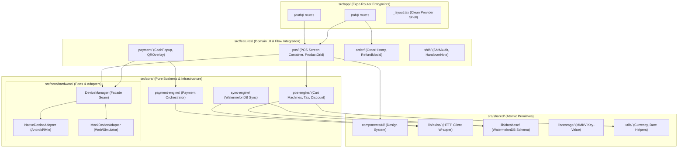
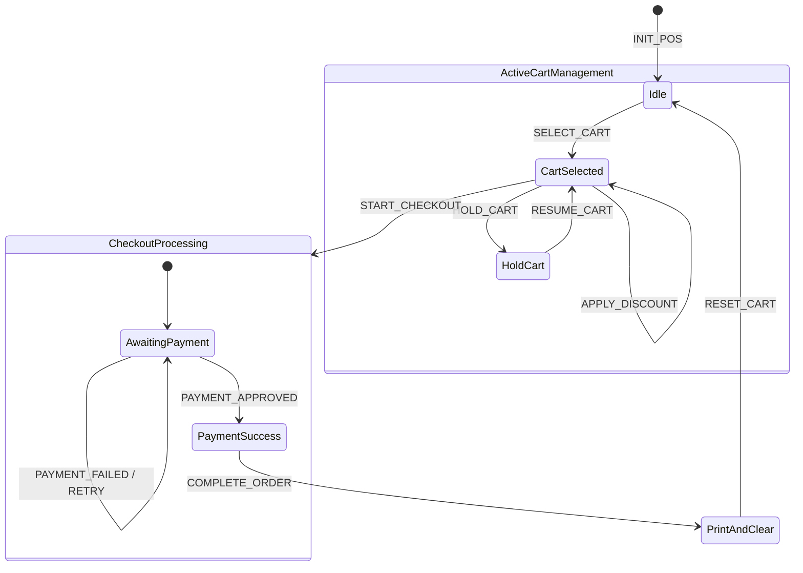
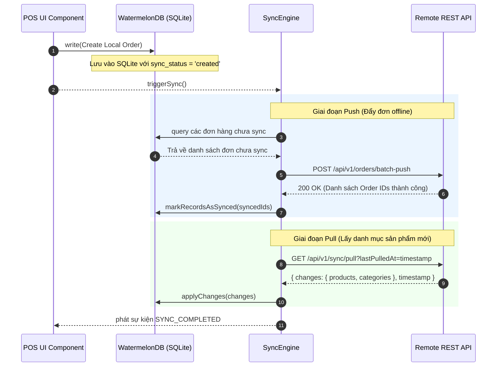

# ĐẶC TẢ KIẾN TRÚC CODEBASE POS PRODUCTION (SENIOR & TECH LEAD REVIEW SPECIFICATION)

> **Dự án**: Mobile POS (Expo / React Native / XState / WatermelonDB / NativeWind)  
> **Tài liệu**: Bản Đề Xuất & Đặc Tả Tái Cấu Trúc Kiến Trúc Codebase Chuẩn Production  
> **Phiên bản**: 2.1-PRODUCTION-READY  
> **Tệp tin**: `docs/ARCHITECTURE_PROPOSAL_PRODUCTION.md`

---

## MỤC LỤC

1. [Tổng Quan & Phân Tích Nợ Kỹ Thuật (Technical Debt Audit)](#1-tổng-quan--phân-tích-nợ-kỹ-thuật-technical-debt-audit)
2. [Triết Lý Kiến Trúc & Nguyên Lý Thiết Kế Core](#2-triết-lý-kiến-trúc--nguyên-lý-thiết-kế-core)
3. [Bản Đồ Cấu Trúc Thư Mục Tổng Thể (System Architecture Map)](#3-bản-đồ-cấu-trúc-thư-mục-tổng-thể-system-architecture-map)
4. [Chi Tiết Nhiệm Vụ Từng Lớp Thư Mục (Layer Specifications)](#4-chi-tiết-nhiệm-vụ-từng-lớp-thư-mục-layer-specifications)
   - [4.1 Layer 1: App Routing & Presentation Shells (`src/app/`)](#41-layer-1-app-routing--presentation-shells-srcapp)
   - [4.2 Layer 2: Core Domain Engines & Hardware Ports (`src/core/`)](#42-layer-2-core-domain-engines--hardware-ports-srccore)
   - [4.3 Layer 3: Feature Business Modules (`src/features/`)](#43-layer-3-feature-business-modules-srcfeatures)
   - [4.4 Layer 4: Shared Infrastructure & Atomic UI (`src/shared/`)](#44-layer-4-shared-infrastructure--atomic-ui-srcshared)
5. [Chuẩn Thiết Kế Single Endpoint Per File (1 File = 1 API)](#5-chuẩn-thiết-kế-single-endpoint-per-file-1-file--1-api)
6. [Đặc Tả Chi Tiết Các Deep Engines & Code Contracts](#6-đặc-tả-chi-tiết-các-deep-engines--code-contracts)
   - [6.1 Hardware Abstraction Layer (Ports & Adapters Pattern)](#61-hardware-abstraction-layer-ports--adapters-pattern)
   - [6.2 POS & Cart State Machine Engine](#62-pos--cart-state-machine-engine)
   - [6.3 Payment Orchestration Engine](#63-payment-orchestration-engine)
   - [6.4 Offline-First WatermelonDB Sync Engine](#64-offline-first-watermelondb-sync-engine)
7. [Ma Trận Sở Hữu Trạng Thái & Luồng Dữ Liệu (State Ownership Matrix)](#7-ma-trận-sở-hữu-trạng-thái--luồng-dữ-liệu-state-ownership-matrix)
8. [Quy Tắc Đóng Gói Module & Ranh Giới Import (Boundary Rules)](#8-quy-tắc-đóng-gói-module--ranh-giới-import-boundary-rules)
9. [Lộ Trình Tái Cấu Trúc 4 Giai Đoạn (Incremental Migration Plan)](#9-lộ-trình-tái-cấu-trúc-4-giai-đoạn-incremental-migration-plan)
10. [Đánh Giá Rủi Ro Kỹ Thuật & Giải Pháp Khắc Phục (Risk Mitigation)](#10-đánh-giá-rủi-ro-kỹ-thuật--giải-pháp-khắc-phục-risk-mitigation)

---

## 1. TỔNG QUAN & PHÂN TÍCH NỢ KỸ THUẬT (TECHNICAL DEBT AUDIT)

Khảo sát thực tế codebase hiện tại (`src/`) ghi nhận ứng dụng đang sở hữu nền tảng công nghệ mạnh (Expo, WatermelonDB, XState, TanStack Query). Tuy nhiên, sau một thời gian phát triển tính năng dồn dập, hệ thống gặp phải **4 nhóm Nợ Kỹ Thuật lớn**:

```
┌─────────────────────────────────────────────────────────────────────────────────┐
│                           PHÂN TÍCH NỢ KỸ THUẬT HỆ THỐNG                        │
├─────────────────────────────────────────────────────────────────────────────────┤
│ 1. GHÉP NỐI CỨNG THIẾT BỊ NGOẠI VI (Hardware Tight Coupling)                   │
│    Vấn đề: `useViceScreen()` và Native Modules bị gọi trực tiếp từ React UI.   │
│    Hậu quả: App bị crash trên iOS Simulator / Browser dev do thiếu phần cứng.   │
│    Khó khăn: Không viết được Unit Test tự động cho luồng POS & In hóa đơn.      │
├─────────────────────────────────────────────────────────────────────────────────┤
│ 2. CHỒNG CHÉO QUẢN LÝ STATE (Dual-Layer State Wrapping)                        │
│    Vấn đề: Wrap XState Machine bên trong Zustand Vanilla Store.                │
│    Hậu quả: Tạo re-render không cần thiết, làm đứt gãy XState DevTools & Log.   │
├─────────────────────────────────────────────────────────────────────────────────┤
│ 3. SUY THOÁI RANH GIỚI THƯ MỤC (Boundary Degradation)                           │
│    Vấn đề: Hầu hết logic (POS, Payment, Shift, Order) bị dồn vào `shared/features`.│
│    Hậu quả: Khái niệm "Shared" bị vô hiệu hóa; không biết cái gì thực sự shared.│
├─────────────────────────────────────────────────────────────────────────────────┤
│ 4. ROOT LAYOUT QUÁ TẢI (Bloated Root Shell)                                    │
│    Vấn đề: `src/app/_layout.tsx` chứa >110 dòng code bọc logic boot & listeners.│
│    Hậu quả: Khó bảo trì root shell, dễ gây race-condition khi khởi động app.   │
└─────────────────────────────────────────────────────────────────────────────────┘
```

---

## 2. TRIẾT LÝ KIẾN TRÚC & NGUYÊN LÝ THIẾT KẾ CORE

Đề xuất tái cấu trúc dựa trên **5 trụ cột thiết kế phần mềm hiện đại**:

1. **Deep Modules (Nguyên lý John Ousterhout)**:
   - **Giao diện nhỏ (Small Surface)**: Caller hoặc React UI chỉ cần học một vài methods / custom hooks đơn giản.
   - **Thực thi sâu (Deep Implementation)**: Toàn bộ độ phức tạp của XState, SQLite WatermelonDB, Native Bridge, Retry Queue được giấu kín bên trong module.

2. **Ports & Adapters (Hexagonal Architecture for Peripherals)**:
   - Mọi giao tiếp với phần cứng máy POS (Màn hình phụ iMin, Máy quẹt thẻ EDC, Máy in Bluetooth) đều thông qua một Contract Interface (`Port`).
   - Hệ thống có 2 bộ Adapters: `NativeDeviceAdapter` (chạy trên Android POS thực tế) và `MockDeviceAdapter` (chạy trên Web/Simulator để dev/test).

3. **Feature-Driven Architecture (Tách biệt UI Feature & Core Engine)**:
   - **Core Engines (`src/core/`)**: Chứa logic nghiệp vụ thuần túy (POS calculation, Payment state machine, Sync engine).
   - **Feature Modules (`src/features/`)**: Chứa giao diện người dùng và container gắn kết UI với Engine.

4. **Single Endpoint Per File (1 File = 1 API)**:
   - Mỗi Endpoint API (Query hoặc Mutation) được đóng gói độc lập hoàn toàn trong 1 file duy nhất bao gồm Schema (Valibot), Fetcher, QueryKey, `queryOptions` (TanStack Query v5) và Hook.

5. **Single Source of Truth (SSOT) theo từng State Domain**:
   - **Workflow State Phức Tạp** $\rightarrow$ Pure XState Actors.
   - **Server Async State** $\rightarrow$ TanStack Query.
   - **Offline Database Persistence** $\rightarrow$ WatermelonDB (SQLite) + MMKV.
   - **Ephemeral Visual UI State** $\rightarrow$ React Local State / Light Zustand.

---

## 3. BẢN ĐỒ CẤU TRÚC THƯ MỤC TỔNG THỂ (SYSTEM ARCHITECTURE MAP)



---

## 4. CHI TIẾT NHIỆM VỤ TỪNG LỚP THƯ MỤC (LAYER SPECIFICATIONS)

### 4.1 Layer 1: App Routing & Presentation Shells (`src/app/`)

- **Mục đích**: Quản lý điều hướng (Routing) bằng Expo Router và bọc các Root Context Providers.
- **Quy tắc tuyệt đối**: **KHÔNG chứa business logic, KHÔNG trực tiếp gọi API hay Database**.
- **Cấu trúc file chi tiết**:
  ```
  src/app/
  ├── (auth)/
  │   ├── login.tsx              # Nhận route params -> render <AuthLoginContainer />
  │   └── activate.tsx           # Nhận route params -> render <DeviceActivateContainer />
  ├── (tab)/
  │   ├── index.tsx              # Render <PosScreenContainer />
  │   ├── orders.tsx             # Render <OrderListContainer />
  │   └── dashboard.tsx          # Render <DashboardContainer />
  ├── _layout.tsx                # Bootstrap Providers sạch gọn (< 60 dòng)
  └── global.css                 # Import NativeWind / Tailwind CSS directives
  ```

---

### 4.2 Layer 2: Core Domain Engines & Hardware Ports (`src/core/`)

- **Mục đích**: Trái tim của ứng dụng. Nơi thực thi logic nghiệp vụ POS, state machines, đồng bộ offline, và giao tiếp phần cứng qua Seam.
- **Cấu trúc file chi tiết**:
  ```
  src/core/
  ├── hardware/
  │   ├── interfaces/
  │   │   ├── vice-screen.interface.ts  # Contract màn hình phụ
  │   │   ├── printer.interface.ts      # Contract máy in
  │   │   └── edc-payment.interface.ts  # Contract quẹt thẻ EDC
  │   ├── adapters/
  │   │   ├── native-vice-screen.adapter.ts
  │   │   ├── mock-vice-screen.adapter.ts
  │   │   ├── native-printer.adapter.ts
  │   │   ├── mock-printer.adapter.ts
  │   │   ├── native-edc.adapter.ts
  │   │   └── mock-edc.adapter.ts
  │   ├── device-manager.ts             # Deep Module Facade
  │   └── index.ts                      # Barrel Export
  │
  ├── pos-engine/
  │   ├── machines/
  │   │   ├── pos.machine.ts            # Parent Multi-cart Machine
  │   │   └── cart.machine.ts           # Child Cart Item Machine
  │   ├── services/
  │   │   ├── cart-calculator.ts        # Pure Tax & Line Discount Engine
  │   │   └── pos-storage.ts            # MMKV State Sync Persistence
  │   ├── hooks/
  │   │   ├── use-active-cart.ts        # Hook lấy giỏ hàng hiện tại
  │   │   └── use-pos-actor.ts          # Hook thao tác XState Actor
  │   ├── pos-context.tsx               # React Context Provider cho XState
  │   └── index.ts                      # Public API
  │
  ├── payment-engine/
  │   ├── machines/
  │   │   └── payment.machine.ts        # Machine điều phối quy trình thanh toán
  │   ├── strategies/
  │   │   ├── cash.strategy.ts
  │   │   ├── qr.strategy.ts
  │   │   ├── edc.strategy.ts
  │   │   └── registry.ts
  │   └── index.ts
  │
  └── sync-engine/
      ├── sync.service.ts               # WatermelonDB Push/Pull Engine
      ├── sync-queue.ts                 # Hàng đợi đẩy đơn khi Re-online
      └── index.ts
  ```

---

### 4.3 Layer 3: Feature Business Modules (`src/features/`)

- **Mục đích**: Chứa toàn bộ giao diện người dùng (UI Components) và logic tương tác riêng của từng tính năng nghiệp vụ.
- **Cấu trúc chuẩn của một Feature (`src/features/session/`)**:
  ```
  src/features/session/
  ├── api/                             # Single Endpoint per File API Modules
  │   ├── get-active-sessions.ts       # Query: GET /v1/sessions/active
  │   ├── get-session-detail.ts        # Query: GET /v1/sessions/:id
  │   ├── close-session.ts             # Mutation: POST /v1/sessions/:id/close
  │   └── index.ts                     # Barrel API Export
  ├── components/                      # UI Dumb Components
  │   ├── session-list-panel.tsx
  │   └── session-card.tsx
  ├── containers/                      # Smart Container Component
  │   └── session-screen-container.tsx
  ├── hooks/                           # Feature local hooks
  ├── types/                           # Shared Types trong Feature
  └── index.ts                         # Barrel File Public API
  ```

---

### 4.4 Layer 4: Shared Infrastructure & Atomic UI (`src/shared/`)

- **Mục đích**: Thư viện dùng chung thực sự (Atomic Design System, Low-level Drivers, Utilities). Hoàn toàn độc lập với ứng dụng nghiệp vụ.
- **Cấu trúc file chi tiết**:
  ```
  src/shared/
  ├── components/
  │   ├── ui/                          # Design System Components (Pure Presentational)
  │   │   ├── button.tsx
  │   │   ├── modal-base.tsx
  │   │   ├── text-input.tsx
  │   │   ├── keypad.tsx
  │   │   ├── badge.tsx
  │   │   └── toast.tsx
  │   └── common/
  │       ├── error-boundary-fallback.tsx
  │       └── loading-screen.tsx
  ├── lib/
  │   ├── axios/                       # HTTP Client cấu hình sẵn BaseURL & Token
  │   │   ├── api-client.ts
  │   │   └── interceptors.ts
  │   ├── database/                    # WatermelonDB Configuration & Models
  │   │   ├── schema.ts
  │   │   ├── database.ts
  │   │   └── models/
  │   ├── storage/                     # MMKV Storage Driver
  │   │   └── mmkv-storage.ts
  │   └── react-query/                 # QueryClient setup
  │       └── query-client.ts
  ├── utils/                           # Hàm thuần túy (Pure Functions)
  │   ├── currency.ts                  # formatVND(100000) => "100.000 ₫"
  │   ├── date.ts                      # formatDateIso()
  │   └── validation.ts
  └── constants/
      ├── api-endpoints.ts
      └── error-codes.ts
  ```

---

## 5. CHUẨN THIẾT KẾ SINGLE ENDPOINT PER FILE (1 FILE = 1 API)

Nhằm đảm bảo tính độc lập và khả năng bảo trì tối đa, mọi tích hợp API Server đều tuân thủ chuẩn **1 File = 1 API Endpoint**.

### Quy chuẩn cấu trúc file API (`get-active-sessions.ts`):

```typescript
import { api } from '@/shared/lib/axios'
import { QueryConfig } from '@/shared/lib/react-query'
import { seconds } from '@/shared/utils'
import { queryOptions, useQuery } from '@tanstack/react-query'
import { array, object, string, type InferOutput } from 'valibot'

// 1. Schema & Types DÙNG RIÊNG CHO API NÀY (Valibot)
export type SessionFilter = 'all' | 'dine_in' | 'counter'

export const sessionSchema = object({
  id: string(),
  tableName: string(),
  // ... fields
})

export type Session = InferOutput<typeof sessionSchema>

export type GetActiveSessionsParams = {
  filter?: SessionFilter
  search?: string
}

// 2. Query Key DÙNG RIÊNG CHO API NÀY
export const getActiveSessionsQueryKey = (params?: GetActiveSessionsParams) =>
  ['sessions', 'active', params?.filter ?? 'all', params?.search ?? ''] as const

// 3. API Fetcher DÙNG RIÊNG CHO API NÀY
export async function getActiveSessionsFetcher(): Promise<Session[]> {
  const response = await api.get('/v1/sessions/active')
  return response.data.sessions
}

// 4. Query Options DÙNG RIÊNG CHO API NÀY (TanStack Query v5)
export const getActiveSessionsQueryOptions = (params?: GetActiveSessionsParams) =>
  queryOptions({
    queryKey: getActiveSessionsQueryKey(params),
    queryFn: getActiveSessionsFetcher,
    staleTime: seconds(15),
    gcTime: seconds(60),
    select: (sessions) =>
      applySessionFilterAndSearch(sessions, params?.filter ?? 'all', params?.search ?? ''),
  })

type UseGetActiveSessionsOptions = GetActiveSessionsParams & {
  queryConfig?: QueryConfig<typeof getActiveSessionsQueryOptions>
}

// 5. Custom Hook DÙNG RIÊNG CHO API NÀY
export function useGetActiveSessions({
  filter = 'all',
  search = '',
  queryConfig,
}: UseGetActiveSessionsOptions = {}) {
  return useQuery({
    ...getActiveSessionsQueryOptions({ filter, search }),
    ...queryConfig,
  })
}

// Helper nội bộ chỉ phục vụ lọc kết quả client
function applySessionFilterAndSearch(
  sessions: Session[],
  filter: SessionFilter,
  search: string,
): Session[] {
  let list = sessions
  if (filter === 'dine_in') list = list.filter((s) => s.orderType === 'DINE_IN')
  if (filter === 'counter') list = list.filter((s) => s.orderType === 'COUNTER')
  if (search.trim()) {
    const q = search.trim().toLowerCase()
    list = list.filter(
      (s) =>
        s.tableName.toLowerCase().includes(q) ||
        s.identifier.toLowerCase().includes(q) ||
        s.staffId.toLowerCase().includes(q) ||
        (s.itemNames ?? []).some((n) => n.toLowerCase().includes(q)),
    )
  }
  return [...list].sort((a, b) => a.openedAt - b.openedAt)
}
```

---

## 6. ĐẶC TẢ CHI TIẾT CÁC DEEP ENGINES & CODE CONTRACTS

### 6.1 Hardware Abstraction Layer (Ports & Adapters Pattern)

#### Interface Contracts (`src/core/hardware/interfaces/device.interface.ts`)

```typescript
export interface CartDisplayPayload {
  cartId: string
  items: Array<{ name: string; qty: number; totalAmount: number }>
  grandTotal: number
  discountAmount: number
}

export interface PrintReceiptPayload {
  orderId: string
  items: Array<{ name: string; price: number; quantity: number }>
  totalAmount: number
  customerCash?: number
  changeAmount?: number
  createdDate: string
  staffName: string
}

export interface EdcPaymentRequest {
  orderId: string
  amount: number
  timeoutMs: number
}

export interface EdcPaymentResponse {
  success: boolean
  transactionId?: string
  cardNoReference?: string
  responseCode: string
  errorMessage?: string
}

/** Hardware Port Interface */
export interface IDeviceManager {
  initialize(): Promise<void>
  updateViceDisplay(payload: CartDisplayPayload): Promise<void>
  clearViceDisplay(): Promise<void>
  printReceipt(payload: PrintReceiptPayload): Promise<void>
  executeEdcPayment(request: EdcPaymentRequest): Promise<EdcPaymentResponse>
  cancelEdcPayment(orderId: string): Promise<boolean>
}
```

#### Facade Implementation (`src/core/hardware/device-manager.ts`)

```typescript
import { Platform } from 'react-native'
import {
  IDeviceManager,
  CartDisplayPayload,
  PrintReceiptPayload,
  EdcPaymentRequest,
  EdcPaymentResponse,
} from './interfaces/device.interface'
import { NativeDeviceAdapter } from './adapters/native-device.adapter'
import { MockDeviceAdapter } from './adapters/mock-device.adapter'

class DeviceManagerFacade implements IDeviceManager {
  private adapter: IDeviceManager

  constructor() {
    // Tự động sử dụng Mock Adapter khi dev trên Web / Simulator hoặc Android không phần cứng
    const isPhysicalAndroidPos = Platform.OS === 'android' && !__DEV__
    this.adapter = isPhysicalAndroidPos ? new NativeDeviceAdapter() : new MockDeviceAdapter()
  }

  async initialize(): Promise<void> {
    return this.adapter.initialize()
  }

  async updateViceDisplay(payload: CartDisplayPayload): Promise<void> {
    return this.adapter.updateViceDisplay(payload)
  }

  async clearViceDisplay(): Promise<void> {
    return this.adapter.clearViceDisplay()
  }

  async printReceipt(payload: PrintReceiptPayload): Promise<void> {
    return this.adapter.printReceipt(payload)
  }

  async executeEdcPayment(request: EdcPaymentRequest): Promise<EdcPaymentResponse> {
    return this.adapter.executeEdcPayment(request)
  }

  async cancelEdcPayment(orderId: string): Promise<boolean> {
    return this.adapter.cancelEdcPayment(orderId)
  }
}

export const DeviceManager = new DeviceManagerFacade()
```

---

### 6.2 POS & Cart State Machine Engine

`posMachine` điều phối danh sách các giỏ hàng (Multi-cart) và spawned child `cartMachine` cho từng tab.



---

### 6.3 Offline-First WatermelonDB Sync Engine

Triển khai cơ chế đồng bộ dữ liệu 2 chiều giữa SQLite local và Server qua REST API:



---

## 7. MA TRẬN SỞ HỮU TRẠNG THÁI & LUỒNG DỮ LIỆU (STATE OWNERSHIP MATRIX)

| Miền Trạng Thái (State Domain)    | Công Nghệ Chủ Sở Hữu      | Bộ Nhớ / Cache Phụ     | Hook / Interface Truy Cập      | Cơ Chế Trigger Re-render       |
| :-------------------------------- | :------------------------ | :--------------------- | :----------------------------- | :----------------------------- |
| **Giỏ hàng & Sản phẩm chọn**      | XState (`cartMachine`)    | MMKV (`pos-storage`)   | `useActiveCart()`              | `useSelector` (Granular Slice) |
| **Quy trình Thanh toán**          | XState (`paymentMachine`) | Ephemeral Memory       | `usePaymentState()`            | `useSelector`                  |
| **Catalog (Sản phẩm/Danh mục)**   | WatermelonDB              | SQLite Storage         | `withObservables` / `useQuery` | Watermelon Observable          |
| **Lịch sử Đơn hàng (Server)**     | TanStack Query            | QueryCache (In-memory) | `useGetActiveSessions()`       | React Query Refetch            |
| **Ca làm việc & Phiên đăng nhập** | XState (`appMachine`)     | MMKV (`app-persist`)   | `useAppSession()`              | `useSelector`                  |
| **Bật/Tắt Modal, Toast UI**       | React Local State         | Zustand (UI Store)     | `useGlobalModal()`             | Zustand Hook                   |

---

## 8. QUY TẮC ĐÓNG GÓI MODULE & RANH GIỚI IMPORT (BOUNDARY RULES)

Để giữ cho codebase luôn sạch sẽ và có thể mở rộng lên tới hàng trăm nghìn dòng code, dự án áp dụng nghiêm ngặt các quy tắc phụ thuộc sau:

```
[Layer 1: App Routes]
       │
       ▼
[Layer 3: Features] ─────────┐
       │                     │
       ▼                     ▼
[Layer 2: Core Engines] ──> [Layer 4: Shared]
```

### Cấu Hình Rules ESLint Boundary (`eslint.config.js`):

1. **Quy tắc phụ thuộc 1 chiều (One-Way Dependency)**:
   - `src/core/` **TUYỆT ĐỐI CẤM** import từ `src/features/` hoặc `src/app/`.
   - `src/shared/` **TUYỆT ĐỐI CẤM** import từ `src/core/`, `src/features/`, hoặc `src/app/`.
   - Mọi Cross-Feature imports đều bị cấm (VD: `src/features/pos` **CẤM** import từ `src/features/order/components/internal-file`).
2. **Quy tắc Barrel Export (`index.ts`)**:
   - Callers ở ngoài module **chỉ được phép import qua file `index.ts`** của module đó.
   - Ví dụ đúng: `import { DeviceManager } from '@/core/hardware'`
   - Ví dụ sai: `import { DeviceManager } from '@/core/hardware/device-manager'`

---

## 9. LỘ TRÌNH TÁI CẤU TRÚC 4 GIAI ĐOẠN (INCREMENTAL MIGRATION PLAN)

```
┌──────────────────────────────────────────────────────────────────────────────────┐
│ GIAI ĐOẠN 1: CHUẨN HÓA HARDWARE PORT & ADAPTERS (Tuần 1)                        │
│ ‣ Khởi tạo thư mục `src/core/hardware/`.                                         │
│ ‣ Tách `useViceScreen` và Native Modules vào Native/Mock DeviceAdapters.          │
│ ‣ Thu gọn `src/app/_layout.tsx` từ >110 dòng xuống còn <60 dòng.                 │
├──────────────────────────────────────────────────────────────────────────────────┤
│ GIAI ĐOẠN 2: ĐƠN GIẢN HÓA XSTATE & KHỞI TẠO POS ENGINE (Tuần 2)                  │
│ ‣ Gỡ bỏ hoàn toàn Zustand wrapper quanh `posMachine` và `appMachine`.             │
│ ‣ Tạo `PosProvider` (XState React Context Provider) thuần túy.                   │
│ ‣ Viết Unit Tests độc lập cho `cart-calculator.ts` và `posMachine`.               │
├──────────────────────────────────────────────────────────────────────────────────┤
│ GIAI ĐOẠN 3: PHÂN TÁCH FEATURE SLICES & BARREL EXPORTS (Tuần 3)                 │
│ ‣ Di chuyển `src/shared/features/*` về `src/features/` & `src/core/`.            │
│ ‣ Áp dụng chuẩn "1 File = 1 API Endpoint" cho toàn bộ API calls.                 │
│ ‣ Bật các quy tắc kiểm tra ESLint Import Boundary Rules.                         │
├──────────────────────────────────────────────────────────────────────────────────┤
│ GIAI ĐOẠN 4: GIA CỐ OFFLINE SYNC ENGINE & KIỂM THỬ (Tuần 4)                     │
│ ‣ Chuẩn hóa `src/core/sync-engine/` với hàng đợi push WatermelonDB.              │
│ ‣ Viết bổ sung Integration Tests cho luồng POS Offline -> Re-online -> Push.     │
└──────────────────────────────────────────────────────────────────────────────────┘
```

---

## 10. ĐÁNH GIÁ RỦI RO KỸ THUẬT & GIẢI PHÁP KHẮC PHỤC (RISK MITIGATION)

| Rủi Ro Kỹ Thuật                                            | Khả Năng Xảy Ra | Mức Độ Ảnh Hưởng | Giải Pháp Khắc Phục (Mitigation)                                                                                                                            |
| :--------------------------------------------------------- | :-------------- | :--------------- | :---------------------------------------------------------------------------------------------------------------------------------------------------------- |
| **1. Trễ hiệu năng Native Bridge (Expo Modules)**          | Trung bình      | Cao              | Batching dữ liệu gửi Màn hình phụ iMin; chỉ gửi tin nhắn Delta JSON khi tổng tiền hoặc số lượng món trong giỏ thực sự thay đổi.                             |
| **2. Lock SQLite / Transation Concurrency (WatermelonDB)** | Thấp            | Cao              | Bọc toàn bộ các thao tác ghi dữ liệu hàng loạt trong `database.write(async () => ...)` block; tuyệt đối không mở các transaction lồng nhau.                 |
| **3. Memory Leak do XState Actor trên React Unmount**      | Trung bình      | Trung bình       | Đảm bảo các child actors (`cartMachine`) được stop tự động thông qua cleanup lifecycle khi xóa tab giỏ hàng.                                                |
| **4. Bão Re-render UI khi cập nhật Giỏ Hàng**              | Cao             | Trung bình       | Sử dụng `useSelector(actor, selector, shallowEqual)` để chỉ re-render đúng Component hiển thị số dư / dòng sản phẩm thay vì re-render toàn bộ màn hình POS. |

---

## 11. TỔNG KẾT & TIÊU CHÍ SIGN-OFF CHO TECH LEAD

- [ ] File `src/app/_layout.tsx` đạt độ gọn nhẹ mục tiêu (< 60 dòng).
- [ ] Không còn bất kỳ file React Component / Hook UI nào import trực tiếp Native Module phần cứng.
- [ ] XState Actor `posMachine` chạy độc lập mà không qua Zustand Vanilla Wrapper.
- [ ] Mọi API Calls đều được đóng gói theo chuẩn **1 File = 1 API Endpoint**.
- [ ] 100% các đường dẫn import giữa các Feature tuân thủ quy tắc Barrel File (`index.ts`).
- [ ] Bộ Unit Tests cho `src/core/pos-engine` vượt qua 100% trên Node.js môi trường CLI mà không cần React DOM renderer.
