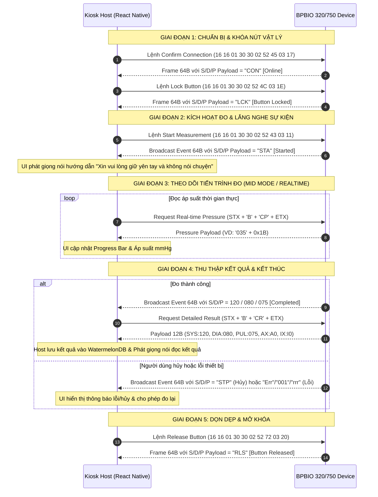

# Đặc Tả Giao Thức Kết Nối Máy Đo Huyết Áp BPBIO320/750 (Protocol Spec)

- **Thiết bị áp dụng**: Máy Đo Huyết Áp Tự Động InBody BPBIO320 Series (BPBIO320, BPBIO320S) & BPBIO750
- **Chuẩn giao tiếp**: Serial UART / RS-232 / Open Protocol
- **Phiên bản tài liệu**: 4.0 (Chuẩn hóa cho Hệ thống Kiosk ProMedi)
- **Ngày cập nhật**: 2026-09-25
- **Thư mục liên quan**: `src/core/hardware/bpbio/`

---

## 📌 1. Phương Thức Kết Nối & Thông Số Phần Cứng

Hệ thống Kiosk ProMedi kết nối, điều khiển và trích xuất dữ liệu trực tiếp từ các dòng máy đo huyết áp tự động BPBIO320 / BPBIO750 thông qua cổng nối tiếp (Serial UART / RS-232).

### 1.1 Thông số cổng Serial (UART / USB-Serial)

Để thiết lập kết nối phần cứng ổn định với thiết bị, cổng Serial trên máy Kiosk phải được khởi tạo với các thông số bắt buộc:

- **Tốc độ truyền (Baud Rate)**: `9600 bps`
- **Số bit dữ liệu (Data Bits)**: `8 bit`
- **Bit dừng (Stop Bits)**: `1 bit`
- **Kiểm tra chẵn lẻ (Parity)**: `None` (`No parity`)
- **Điều khiển luồng (Flow Control)**: `None`

### 1.2 Nguyên tắc Truyền tin & Giao thức Kép

Thiết bị hỗ trợ 2 chế độ truyền nhận dữ liệu đồng thời:

1. **Chế độ Lắng nghe Sự kiện (Event-Driven Broadcast)**: Thiết bị chủ động gửi các gói tin cố định **64 byte** lên Kiosk khi trạng thái hoạt động thay đổi (Bắt đầu đo, Đang đo, Hủy đo, Hoàn tất, Lỗi, Phát hiện người, Cùi chỏ).
2. **Chế độ Lệnh Chủ Động (Active Control & Open Protocol)**: Kiosk chủ động phát lệnh Tx (64-byte frame cố định hoặc STX/ETX khung động) xuống thiết bị để kích hoạt đo, hủy đo, khóa/mở khóa nút bấm vật lý, hoặc rút dữ liệu nâng cao (áp suất thời gian thực, cảnh báo lâm sàng, đồ thị dạng sóng).

---

## 📦 2. Cấu Trúc Khung Truyền Cơ Bản (Basic Protocol Frame - 64 Bytes)

Toàn bộ các gói tin sự kiện tự động và các lệnh điều khiển cơ bản đều tuân theo một khung truyền (Frame) cố định có chiều dài chính xác **64 byte** (đánh chỉ mục index từ `0` đến `63`).

### 2.1 Sơ đồ ánh xạ Byte (Byte Mapping)

Dữ liệu có ý nghĩa chỉ tồn tại ở các chỉ mục (index/offset) cố định, được phân tách bằng byte `0x1E` (ASCII RS - Record Separator):

- **Header (Index 0–5)**:
  - Byte đồng bộ `0x16 0x16 0x01` tại index `0`, `1`, `2`.
  - Byte bắt đầu (STX) `0x02` tại index `5`.
- **Khối Tâm thu (Systolic - S)**:
  - Ký tự định danh `'S'` (`0x53`) tại index `33`.
  - Payload 3 byte tại index **`34`**, **`35`**, **`36`**.
- **Khối Tâm trương (Diastolic - D)**:
  - Ký tự định danh `'D'` (`0x44`) tại index `43`.
  - Payload 3 byte tại index **`44`**, **`45`**, **`46`**.
- **Khối Nhịp tim (Pulse - P)**:
  - Ký tự định danh `'P'` (`0x50`) tại index `48`.
  - Payload 3 byte tại index **`49`**, **`50`**, **`51`**.
- **Footer (Index 62–63)**:
  - Byte kết thúc (ETX) `0x03` tại index `62`.
  - Byte kiểm tra lỗi Checksum (BCC) tại index `63`.

> ⚠️ **Nguyên tắc Parsing bắt buộc**: Mọi byte nằm ngoài các chỉ mục được liệt kê ở trên (bao gồm các byte mang giá trị `0x00` hoặc ký tự rác) đều phải bị bỏ qua hoàn toàn. Không sử dụng các byte này để kiểm tra tính hợp lệ của gói tin vì chúng không được đảm bảo cố định.

---

### 2.2 Ví dụ mô phỏng gói tin 64 byte hoàn chỉnh

**Ví dụ**: Kết quả đo thành công với Tâm thu = `120` mmHg, Tâm trương = `80` mmHg, Nhịp tim = `75` bpm.

```javascript
// Mảng 64 byte nhận được từ cổng Serial (UART)
[
  // Index 0-15 (Hàng 0): Chứa Header đồng bộ & STX
  0x16, 0x16, 0x01, 0x00, 0x00, 0x02, 0x00, 0x00, 0x00, 0x00, 0x00, 0x00, 0x00, 0x00, 0x00, 0x00,
  // Index 16-31 (Hàng 1): Chứa byte rác / đệm
  0x00, 0x00, 0x00, 0x00, 0x00, 0x00, 0x00, 0x1E, 0x52, 0x42, 0x1E, 0x00, 0x00, 0x00, 0x00, 0x00,
  // Index 32-47 (Hàng 2): Chứa trường S (Systolic) và D (Diastolic)
  0x1E, 0x53, 0x31, 0x32, 0x30, 0x1E, 0x4D, 0x00, 0x00, 0x00, 0x1E, 0x44, 0x30, 0x38, 0x30, 0x1E,
  // Index 48-63 (Hàng 3): Chứa trường P (Pulse) và Footer ETX/BCC
  0x50, 0x30, 0x37, 0x35, 0x1E, 0x00, 0x00, 0x00, 0x00, 0x00, 0x00, 0x00, 0x00, 0x1E, 0x03, 0xXX
]
```

#### Chi tiết giải mã gói tin mẫu:

- **Trường S (Index 33..36)**: `0x53` (`'S'`) ➔ Payload `[0x31, 0x32, 0x30]` ➔ Chuỗi ASCII `"120"` ➔ **Tâm thu: 120 mmHg**
- **Trường D (Index 43..46)**: `0x44` (`'D'`) ➔ Payload `[0x30, 0x38, 0x30]` ➔ Chuỗi ASCII `"080"` ➔ **Tâm trương: 80 mmHg**
- **Trường P (Index 48..51)**: `0x50` (`'P'`) ➔ Payload `[0x30, 0x37, 0x35]` ➔ Chuỗi ASCII `"075"` ➔ **Nhịp tim: 75 bpm**

---

## 📡 3. Giao Thức Lắng Nghe Sự Kiện (Event-Driven Transmission)

Thiết bị sẽ tự động phát sóng (broadcast) gói tin 64 byte lên hệ thống Kiosk tương ứng với **7 trạng thái hoạt động thực tế**. Logic phần mềm trên Kiosk trích xuất 3 byte dữ liệu tại các trường `S`, `D`, `P` để ánh xạ sự kiện:

|  ID   | Tên Sự Kiện         | Payload tại trường S `[34,35,36]` | Payload tại trường D `[44,45,46]` | Payload tại trường P `[49,50,51]` | Mã Hex minh họa (Trường S) | Ghi chú & Điều kiện áp dụng                      |
| :---: | :------------------ | :-------------------------------: | :-------------------------------: | :-------------------------------: | :------------------------: | :----------------------------------------------- |
| **1** | **Đo hoàn tất**     |    Kết quả Tâm thu (VD: `120`)    |  Kết quả Tâm trương (VD: `080`)   |   Kết quả Nhịp tim (VD: `075`)    | `0x31 0x32 0x30` (`"120"`) | Trả về các số đo chuẩn y tế                      |
| **2** | **Bắt đầu đo**      |               `STA`               |               `STA`               |               `STA`               | `0x53 0x54 0x41` (`"STA"`) | Máy bắt đầu bơm hơi                              |
| **3** | **Hủy đo thủ công** |               `STP`               |               `STP`               |               `STP`               | `0x53 0x54 0x50` (`"STP"`) | Người dùng nhấn nút STOP trên máy                |
| **4** | **Lỗi thiết bị**    |               `Err`               |        Mã lỗi (VD: `001`)         |               `rrr`               | `0x45 0x72 0x72` (`"Err"`) | ⚠️ **Đặc biệt**: S=`"Err"`, D=`"001"`, P=`"rrr"` |
| **5** | **Phát hiện người** |               `AWK`               |               `AWK`               |               `AWK`               | `0x41 0x57 0x4B` (`"AWK"`) | Áp dụng cho dòng **BPBIO320S / BPBIO750**        |
| **6** | **Cùi chỏ đặt vào** |               `ELB`               |               `ELB`               |               `ELB`               | `0x45 0x4C 0x42` (`"ELB"`) | Chỉ áp dụng ở chế độ **MID mode**                |
| **7** | **Cùi chỏ nhấc ra** |               `elb`               |               `elb`               |               `elb`               | `0x65 0x6C 0x62` (`"elb"`) | Chỉ áp dụng ở chế độ **MID mode**                |

> 📌 **LƯU Ý QUAN TRỌNG VỀ SỰ KIỆN LỖI (SỰ KIỆN 4)**:
> Trái ngược với các sự kiện trạng thái thông thường (payload 3 trường S, D, P giống hệt nhau), khi xảy ra **Lỗi thiết bị**:
>
> - Trường **S** = `"Err"` (`0x45 0x72 0x72`)
> - Trường **D** = Mã lỗi 3 chữ số, ví dụ `"001"` (`0x30 0x30 0x31`)
> - Trường **P** = `"rrr"` (`0x72 0x72 0x72`) _(ký tự `r` viết thường, không phải "Err")_

---

## 🎮 4. Các Lệnh Điều Khiển Chủ Động (Control Commands)

Hệ thống Kiosk có thể gửi các mảng byte cố định (Frame Tx) xuống thiết bị để điều khiển chức năng. Thiết bị sẽ phản hồi bằng một khung 64 byte (Rx), Kiosk cần kiểm tra payload tại các trường S, D, P để xác nhận thành công.

### Bảng Tra Cứu Lệnh Điều Khiển

|  STT  | Tên Lệnh                                             | Mảng Byte Kiosk gửi (Frame Tx Hex) |  Payload thiết bị phản hồi (Rx S/D/P)   | Ý Nghĩa & Hành Động                                               |
| :---: | :--------------------------------------------------- | :--------------------------------- | :-------------------------------------: | :---------------------------------------------------------------- |
| **1** | **Kiểm tra kết nối** _(Confirm Connection)_          | `16 16 01 30 30 02 52 45 03 17`    |                  `CON`                  | Dùng để Polling kiểm tra máy đo đang online/sẵn sàng.             |
| **2** | **Khóa nút vật lý** _(Lock Button)_                  | `16 16 01 30 30 02 52 4C 03 1E`    |                  `LCK`                  | Vô hiệu hóa nút START/STOP trên máy để Kiosk kiểm soát hoàn toàn. |
| **3** | **Mở khóa nút vật lý** _(Release Button)_            | `16 16 01 30 30 02 52 72 03 20`    |                  `RLS`                  | Cho phép nút bấm vật lý hoạt động lại bình thường.                |
| **4** | **Ép bắt đầu đo** _(Start Measurement)_              | `16 16 01 30 30 02 52 43 03 11`    |             Lắng nghe `STA`             | Kiosk chủ động lệnh cho máy bắt đầu bơm hơi đo huyết áp.          |
| **5** | **Ép dừng đo** _(Stop Measurement)_                  | `16 16 01 30 30 02 52 46 03 14`    |              Xả hơi & Dừng              | Ngắt quá trình đo khẩn cấp, máy lập tức xả khí.                   |
| **6** | **Yêu cầu kết quả cơ bản** _(Request Recent Result)_ | `16 16 01 30 30 02 52 42 03 10`    | Chuỗi S, D, P (VD: `120`, `080`, `075`) | Rút kết quả đo mới nhất vừa lưu trong bộ nhớ máy.                 |

---

## 🔍 5. Các Lệnh Truy Xuất Dữ Liệu Nâng Cao (Open Protocol)

Giao thức mở rộng (Open Protocol) cho phép Kiosk truy xuất các thông số lâm sàng chuyên sâu và dữ liệu đồ thị thời gian thực. Các gói tin phản hồi có độ dài tùy biến, sử dụng byte `0x1B` (ASCII ESC) làm cờ phân cách (Delimiter).

### Cấu trúc Khung Gửi Chuẩn (Host ➔ Device)

```
[STX (0x02)] [ID ('B' / 0x42)] [BOD0] [BOD1] [CMD0] [CMD1] [Data] [CheckSum] [ETX (0x03)]
```

---

### 5.1 Lệnh Truy Xuất Áp Suất Thời Gian Thực (Real-time Pressure - MID Mode)

- **Mục đích**: Lấy giá trị áp suất túi khí đang tăng/giảm theo thời gian thực để vẽ thanh tiến trình (Progress Bar) hoặc đồng hồ áp suất sinh động trên màn hình Kiosk khi máy đang bơm.
- **Mã lệnh gửi**: `CMD0 = 'C'`, `CMD1 = 'P'`
- **Cấu trúc phản hồi (Rx)**: Payload chứa chuỗi áp suất 3 chữ số theo sau là byte phân cách `0x1B`.
- **Ví dụ**: Khi áp suất túi khí đang là $35$ mmHg, thiết bị trả về chuỗi ASCII `'035'` + `0x1B` (`0x30 0x33 0x35 0x1B`).

---

### 5.2 Lệnh Truy Xuất Kết Quả Đo Lường Chi Tiết (Request Latest Result)

- **Mục đích**: Lấy kết quả y tế đầy đủ bao gồm các chỉ số huyết áp, nhịp tim và các cảnh báo lâm sàng (trạng thái cùi chỏ/rút tay, nhịp tim bất thường).
- **Mã lệnh gửi (Tx)**: `CMD0 = 'C'` (`0x43`), `CMD1 = 'R'` (`0x52`) _(Trường Data để trống)_
- **Cấu trúc phản hồi (Rx)**: Chuỗi ASCII 12 byte bao gồm **5 trường dữ liệu** phân cách bởi byte `0x1B` (Delimiter):

```
[SYS (3B)] + 0x1B + [DIA (3B)] + 0x1B + [PUL (3B)] + 0x1B + [AX (2B)] + 0x1B + [IX (2B)] + 0x1B
```

#### Bảng tra cứu các trường dữ liệu:

1. **`[SYS]`**: Huyết áp tâm thu (Systolic - 3 byte ASCII, ví dụ `"120"`).
2. **`[DIA]`**: Huyết áp tâm trương (Diastolic - 3 byte ASCII, ví dụ `"080"`).
3. **`[PUL]`**: Nhịp tim (Pulse - 3 byte ASCII, ví dụ `"070"`).
4. **`[AX]` Trạng Thái Cảm Biến Cùi Chỏ (Elbow Status - 2 byte ASCII)**:
   - `A0`: Cùi chỏ/cánh tay đặt đúng vị trí chuẩn trong ống đo (`X = '0'` - Detected).
   - `A1`: Cùi chỏ/cánh tay bị nhấc ra hoặc rút ra khỏi vị trí (`X = '1'` - Removed).
5. **`[IX]` Cảnh Báo Nhịp Tim Bất Thường (Irregular Pulse - 2 byte ASCII)**:
   - `I0`: Nhịp tim đều, bình thường (`X = '0'` - Not Detected).
   - `I1`: Phát hiện nhịp tim bất thường / loạn nhịp (`X = '1'` - Detected).

---

### 5.3 Lệnh Truy Xuất Dữ Liệu Dạng Sóng (Request Envelope Data - Waveform Graph)

- **Mục đích**: Trích xuất mảng dữ liệu đồ thị biên độ sóng xung (Pulse Graph / Envelope Data) để vẽ biểu đồ áp suất và nhịp nảy tim thời gian thực trên giao diện Kiosk ProMedi.
- **Mã lệnh gửi (Tx)**: `CMD0 = 'C'` (`0x43`), `CMD1 = 'E'` (`0x45`) _(Trường Data để trống)_
- **Cấu trúc phản hồi (Rx Data Frame)**: Chuỗi **171 Bytes** (Offset từ `0` đến `170`), phân tách bằng byte `0x1B` (Delimiter).

#### Bảng Ánh Xạ Byte Chi Tiết Khối Dữ Liệu Data Frame (`CE` Response Payload):

|    Offset    | Độ dài | Nội dung Byte     | Ý nghĩa & Mô tả                                                                    |
| :----------: | :----: | :---------------- | :--------------------------------------------------------------------------------- |
|    **0**     | 1 byte | `'S'` (`0x53`)    | Ký tự bắt đầu khối dữ liệu áp suất mở đầu _(Opening identifier of pressure graph)_ |
|   **1..3**   | 3 byte | ASCII `[H, T, U]` | Giá trị áp suất mở đầu (Hàng trăm, Hàng chục, Hàng đơn vị - mmHg)                  |
|    **4**     | 1 byte | `0x1B`            | Byte phân cách (Delimiter)                                                         |
|    **5**     | 1 byte | `'E'` (`0x45`)    | Ký tự bắt đầu khối dữ liệu áp suất kết thúc _(End delimiter of pressure graph)_    |
|   **6..8**   | 3 byte | ASCII `[H, T, U]` | Giá trị áp suất kết thúc (Hàng trăm, Hàng chục, Hàng đơn vị - mmHg)                |
|    **9**     | 1 byte | `0x1B`            | Byte phân cách (Delimiter)                                                         |
|    **10**    | 1 byte | `'D'` (`0x44`)    | Ký tự phân cách bắt đầu mảng dữ liệu Envelope _(Envelope Data delimiter)_          |
|  **11..13**  | 3 byte | ASCII `[H, T, U]` | **Điểm đồ thị 1**: Giá trị biên độ áp suất sóng xung thứ 1                         |
|    **14**    | 1 byte | `0x1B`            | Byte phân cách (Delimiter)                                                         |
|  **15..17**  | 3 byte | ASCII `[H, T, U]` | **Điểm đồ thị 2**: Giá trị biên độ áp suất sóng xung thứ 2                         |
|    **18**    | 1 byte | `0x1B`            | Byte phân cách (Delimiter)                                                         |
|    `...`     | `...`  | `...`             | _(Tiếp tục định dạng 3 byte số ASCII + 1 byte `0x1B` phân cách)_                   |
| **167..169** | 3 byte | ASCII `[H, T, U]` | **Điểm đồ thị 40**: Giá trị biên độ áp suất sóng xung thứ 40 (Cuối cùng)           |
|   **170**    | 1 byte | `0x1B`            | Byte phân cách kết thúc mảng đồ thị                                                |

---

## 🔄 6. Sơ Đồ Luồng Thực Thi Kiosk Production (Sequence & FSM)

Quy trình tự động điều khiển máy đo huyết áp BPBIO320/750 trên Kiosk được quản lý chặt chẽ qua **State Machine (`bpbio-session.machine.ts`)**:



---

## 🛡️ 7. Xử Lý Ngoại Lệ & Quy Tắc An Toàn (Error & Timeout Handling)

1. **Bắt Mã Lỗi Thiết Bị (`Err` / `001` / `rrr`)**:
   - Khi nhận gói 64 byte có trường S = `"Err"`, D = Mã lỗi (ví dụ `"001"`), P = `"rrr"`:
     - Log chi tiết mã lỗi hệ thống xuống cơ sở dữ liệu local.
     - Phát âm thanh giọng nói: _"Đã xảy ra lỗi trong quá trình đo huyết áp. Xin vui lòng kiểm tra lại tư thế tay và thử lại"_.
     - Reset trạng thái màn hình Kiosk cho phép khách hàng nhấn "Đo lại".
2. **Xử Lý Hủy Đo Thủ Công (`STP`)**:
   - Khi nhận sự kiện `"STP"`, hệ thống ghi nhận người dùng đã chủ động hủy đo. Ngừng đếm ngược, hủy tiến trình đo và chuyển về màn hình xác nhận trên Kiosk.
3. **Timeout Kết Nối & Bơm Hơi**:
   - Nếu đã gửi lệnh Start Measurement (`RC`) quá **10 giây** mà không nhận được phản hồi sự kiện `"STA"`, Host tiến hành retry gửi lại lệnh tối đa 2 lần trước khi báo lỗi phần cứng.
   - Nếu quá trình bơm hơi kéo dài quá **90 giây** mà không có kết quả hoàn tất (`Event 1`), Host chủ động gửi lệnh Stop Measurement (`RF`) để xả áp suất an toàn cho tay người dùng.
4. **Giải Phóng Nút Bấm Vật Lý Khi Thoát**:
   - Khi phiên đo kết thúc (dù thành công, thất bại hay hết giờ đếm ngược privacy 60s), Host **BẮT BUỘC** gửi lệnh Mở khóa nút (`16 16 01 30 30 02 52 72 03 20` ➔ `"RLS"`) để trả máy đo về trạng thái hoạt động độc lập bình thường.

---

## 📱 8. Lưu Ý Triển Khai Thực Tế Trên Android / Sunmi K2 (Byte Accumulation)

Khi kết nối máy BPBIO qua cổng USB-Serial trên hệ điều hành Android (như Kiosk Sunmi K2) với tốc độ **9600 bps**, sẽ xảy ra hiện tượng **phân mảnh gói tin (chunking)**.

- **Vấn đề**: Hàm callback `onData` của Serial Bridge thường xuyên trả về các mảng byte rất nhỏ (1-3 byte mỗi lần) thay vì toàn bộ khung truyền hoặc một cụm chữ hoàn chỉnh. Ví dụ: Phản hồi `CON` có thể bị cắt thành `[0x43]`, sau đó là `[0x4F, 0x4E]`.
- **Giải pháp**: **BẮT BUỘC** phải triển khai cơ chế **Cộng dồn Byte (Accumulation)**:
  - Khởi tạo mảng `accumulatedBytes: number[] = []`.
  - Push toàn bộ các chunk byte nhận được vào mảng này.
  - Sử dụng hàm kiểm tra bộ đệm (ví dụ: `.includes()`, check độ dài >= số lượng mong muốn) thay vì kiểm tra trực tiếp trên chunk vừa nhận.
  - Sử dụng thêm cơ chế **Debounce / Timeout (1500ms - 3000ms)** để chờ gói dữ liệu truyền đầy đủ trước khi chốt kết quả, tránh việc `timeout` quá sớm gây nhận định sai là máy không phản hồi.

---

## 🛠️ 9. Các Giải Pháp Kỹ Thuật & Sửa Lỗi Thực Tế Đã Chốt (Engineering Fixes & Architecture ADR)

Trong quá trình tích hợp thực tế với máy đo BPBIO320/750 trên Kiosk Sunmi K2 Mini (Android OS), các vấn đề giao tiếp phần cứng mức thấp đã được nghiên cứu và chốt giải pháp xử lý triệt để như sau:

### 9.1 Đăng Ký Listener Trước Khi Write (Pre-Write Listener Attachment)

- **Vấn đề (Bug #1)**: Khi gửi các lệnh ACK phản hồi nhanh như Kiểm tra kết nối `RE` (trả về `"CON"`), Khóa phím `RL` (trả về `"LCK"`) hoặc Mở khóa `Rr` (trả về `"RLS"`), phần cứng phản hồi cực kỳ nhanh (<50ms). Nếu gọi `UsbSerialBridge.write()` trước rồi mới đăng ký `emitter.addListener('onData')`, byte dữ liệu từ cáp Serial truyền về sẽ đến trước khi listener kịp chạy ➔ bỏ lỡ tín hiệu và gây ra lỗi `Timeout 3000ms` giả lập dù phần cứng hoạt động tốt.
- **Giải pháp**: Luôn đăng ký `emitter.addListener('onData')` **TRƯỚC KHI** gọi lệnh `UsbSerialBridge.write()`.

### 9.2 Delay 150ms Ổn Định Thanh Ghi Chip USB-Serial (Post-Open Stabilization Delay)

- **Vấn đề (Bug #2)**: Các chip chuyển đổi USB-to-Serial phổ biến (CH340, CP210x, FTDI) trên Kiosk Android Sunmi K2 cần khoảng thời gian khoảng **150ms** sau khi gọi `UsbSerialBridge.open()` (kích hoạt `ioManager.start()`) để thanh ghi nhị phân nội bộ ổn định. Nếu phát lệnh `write()` ngay lập tức trong khoảng 0-100ms sau open, chip Serial sẽ bị rớt khung (frame drop) hoặc không phát tín hiệu điện áp xuống dây cáp.
- **Giải pháp**: Thêm `await new Promise(r => setTimeout(r, 150))` ngay sau khi mở cổng `open()` trước khi gửi bất kỳ lệnh nào.

### 9.3 Dò Cổng USB Tự Động Qua MMKV Binding Store & Probe Handshake

- **Vấn đề (Bug #3)**: Hệ điều hành Android OS không đảm bảo thứ tự index liệt kê thiết bị USB Serial (`/dev/bus/usb/001/007` vs `008`). Rơi vào fallback ngẫu nhiên theo index (`devs[0]`, `devs[1]`) sẽ gây ra tình trạng gửi nhầm lệnh InBody sang máy BPBIO hoặc máy in nhiệt.
- **Giải pháp**: Sử dụng `DeviceResolver` phát gói tín hiệu Probe Handshake (`STATUS 0x63` với InBody, `RE 0x52 0x45` với BPBIO) để tự động phát hiện đúng chip phần cứng và lưu cố định vào MMKV `bindingStore`.

### 9.4 Dual Checksum Validation (`BCC5` vs `BCC0`)

- **Vấn đề**: Các phiên bản firmware khác nhau của BPBIO320/750 có thể tính toán cờ BCC XOR theo 2 quy chuẩn:
  - `BCC5`: XOR các byte trong khoảng từ `STX` (Index 5) đến `ETX` (Index 14).
  - `BCC0`: XOR toàn bộ các byte từ Index 0 đến 14.
- **Giải pháp**: Bộ giải mã `BpbioFrameCodec` kiểm tra hợp lệ với cả 2 quy chuẩn `BCC5` và `BCC0`, đảm bảo tương thích 100% các biến thể máy đo trong thực tế.

### 9.5 Quản Lý Luồng Giao Thức Đơn (`16B`) & Broadcast (`64B`) Song Song Zero Side-Effect

- **Vấn đề**: Bộ giải mã `BpbioFrameCodec` nhận luồng byte liên tục từ `onData`. Nếu gọi cộng dồn chung 1 bộ đệm buffer cho cả gói 16-byte chỉ số y tế và gói 64-byte broadcast tự động, bộ đệm sẽ bị đẩy trùng byte làm sai lệch chỉ số.
- **Giải pháp**: Tách biệt logic bóc tách gói 16-byte (`feed`) và gói 64-byte (`feedWithEvents`) thông qua hàm bóc tách không làm dính buffer hoặc sử dụng codec instance độc lập.

### 9.6 Log Trực Tiếp Chi Tiết Đa Định Dạng (`notifyBpbioBroadcastEvent`)

- **Giải pháp**: Khi nhận luồng broadcast tự động, hàm `notifyBpbioBroadcastEvent` ghi log sạch ra Terminal và Log Window gồm:
  - Mã sự kiện chuẩn (1-7), Loại sự kiện (`START_MEASUREMENT`, `MANUAL_CANCEL`, `DEVICE_ERROR`, `MEASUREMENT_COMPLETED`, `PRESENCE_DETECTED`, `ELBOW_INSERTED`, `ELBOW_REMOVED`).
  - Raw ASCII fields $S, D, P$.
  - Mảng Hex Bytes thô ($64$ Bytes) giúp kỹ thuật viên nghiệm thu trực tiếp dữ liệu trên phần cứng thật mà không cần thêm code giả lập.
