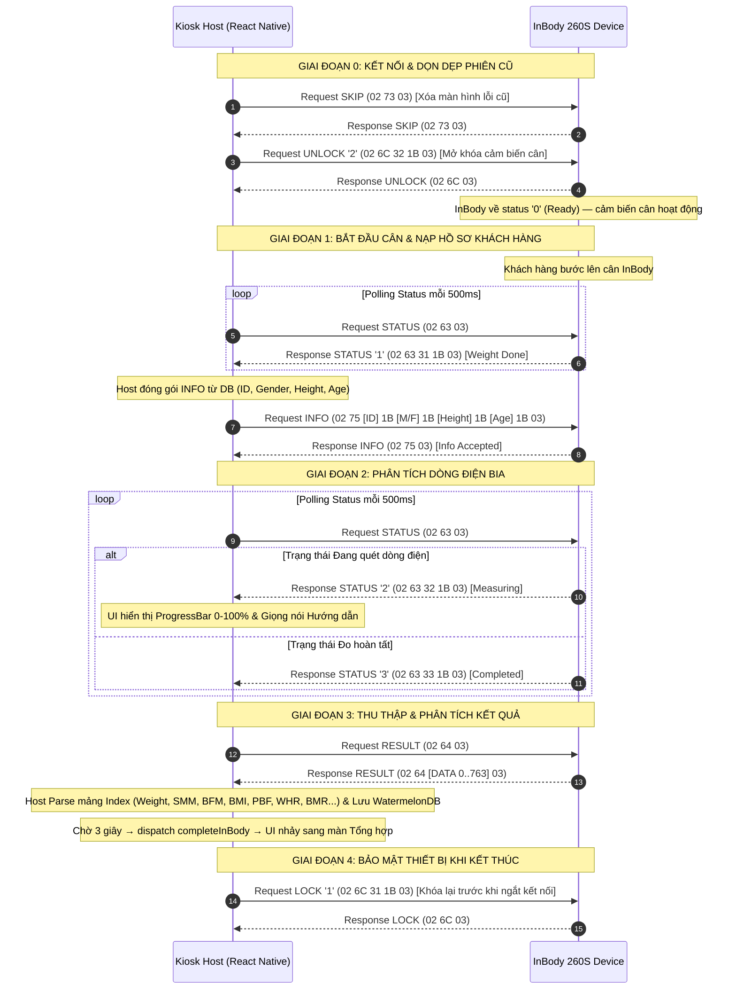

# Đặc Tả Giao Thức Kết Nối Máy Đo InBody 260S (Open Protocol Spec)

- **Thiết bị áp dụng**: Máy Phân Tích Thành Phần Cơ Thể InBody 260S
- **Chuẩn giao tiếp**: Open Protocol (ASCII Commands over UART / TCP-IP / Bluetooth)
- **Phiên bản tài liệu**: 4.0 (Chuẩn hóa cho Hệ thống Kiosk ProMedi)
- **Ngày cập nhật**: 2026-09-23
- **Thư mục liên quan**: `src/core/hardware/inbody/`

---

## 📌 1. Phương Thức Kết Nối & Thông Số Phần Cứng

Hệ thống Kiosk ProMedi giao tiếp với thiết bị InBody 260S thông qua giao thức mở (**Open Protocol**) dạng các câu lệnh ASCII được đóng gói thành khung Hex.

### 1.1 Thông số cổng Serial (UART / USB-Serial)

- **Baud rate**: `19200 bps`
- **Data Bits**: `8 bit`
- **Parity Bits**: `None` (`No parity`)
- **Stop Bits**: `1 bit`
- **Flow Control**: `None`

### 1.2 Sơ đồ chân kết nối DB9 (Female Connector Pinout)

| Chân (Pin) | Tín hiệu (Signal) | Mô tả                         |
| :--------: | :---------------: | :---------------------------- |
| **Pin 2**  |       `RXD`       | Chân nhận dữ liệu từ Host     |
| **Pin 3**  |       `TXD`       | Chân truyền dữ liệu sang Host |
| **Pin 5**  |       `GND`       | Chân đất (Ground)             |
| **Pin 9**  |       `VCC`       | Nguồn 12V DC                  |
|   _Khác_   |       `N.C`       | Không sử dụng (No Connection) |

### 1.3 Phương thức kết nối Mạng (LAN / Wi-Fi) & Bluetooth

- **TCP/IP Socket**: Máy InBody hoạt động ở chế độ TCP Client / Server trên **Port `2004`**.
- **Bluetooth**: Sử dụng SPP (Serial Port Profile) theo chuẩn giao tiếp UART ảo.

### 1.4 Nguyên tắc Truyền tin & Độ trễ

- **Chế độ truyền**: Bán song công (**Half-Duplex**).
- **Cơ chế Polling**: Host (Kiosk) phải chủ động gửi lệnh hỏi (Request). InBody phản hồi (Response) sau khi xử lý lệnh, **tuyệt đối không tự động đẩy dữ liệu (Unsolicited Push)**.
- **Độ trễ phản hồi chuẩn (Response Delay)**: **400ms – 500ms** giữa lệnh Request và Response.

---

## 📦 2. Cấu Trúc Khung Truyền (Packet Structure)

Mọi gói tin gửi (Request) và nhận (Response) giữa Host và InBody 260S đều tuân thủ khung 4 thành phần cố định:

```
+----------+---------------+-----------------------+----------+
| STX (1B) | COMMAND (1B)  |   DATA (Tùy biến)     | ETX (1B) |
|  0x02    | Hex ASCII Code| ASCII payload + 0x1B  |  0x03    |
+----------+---------------+-----------------------+----------+
```

### Chi tiết các khối dữ liệu:

1. **STX (Start of Frame)**: Byte cố định `0x02` (ASCII STX).
2. **COMMAND**: 1 Byte mã lệnh Hex tương ứng ký tự ASCII (Ví dụ: `'c'` = `0x63`, `'u'` = `0x75`, `'d'` = `0x64`, `'l'` = `0x6C`).
3. **DATA**: Khối chứa thông tin chi tiết.
   - Có thể rỗng nếu lệnh không yêu cầu tham số.
   - **Vách phân cách (String Separator)**: Byte `0x1B` (ASCII ESC, Hex `1B`) dùng để ngăn cách giữa các trường dữ liệu trong khối DATA.
4. **ETX (End of Frame)**: Byte cố định `0x03` (ASCII ETX).

---

## 📑 3. Bảng Mã Lệnh Điều Khiển (Command Reference)

| Tên Lệnh        | ASCII | Mã HEX |   Hướng đi    | Mô tả chức năng chính                                                              |
| :-------------- | :---: | :----: | :-----------: | :--------------------------------------------------------------------------------- |
| **STATUS**      | `'c'` | `0x63` | Host ➔ Device | Dò hỏi trạng thái hoạt động hiện tại của máy InBody                                |
| **INFO**        | `'u'` | `0x75` | Host ➔ Device | Gửi thông tin cá nhân khách hàng (ID, Giới tính, Chiều cao, Tuổi) xuống máy InBody |
| **RESULT**      | `'d'` | `0x64` | Host ➔ Device | Yêu cầu InBody trả về mảng kết quả đo thành phần cơ thể                            |
| **LOCK/UNLOCK** | `'l'` | `0x6C` | Host ➔ Device | Khóa hoặc mở khóa bàn phím vật lý & màn hình cảm ứng InBody                        |
| **SKIP**        | `'s'` | `0x73` | Host ➔ Device | Bỏ qua trang màn hình thông báo lỗi khi đang đo                                    |
| **SEND ID**     | `'i'` | `0x69` | Host ➔ Device | Gửi duy nhất mã ID khách hàng xuống InBody                                         |
| **WEIGHT**      | `'k'` | `0x6B` | Host ➔ Device | Hỏi trạng thái quá trình cân và số liệu trọng lượng hiện tại                       |
| **REQUEST ID**  | `'w'` | `0x77` | Host ➔ Device | Yêu cầu máy InBody trả về mã ID đang lưu trong thiết bị                            |
| **SET TIME**    | `'t'` | `0x74` | Host ➔ Device | Đồng bộ thời gian hệ thống (Ngày/Giờ) xuống InBody                                 |

---

## 🔍 4. Chi Tiết Các Mã Lệnh & Ví Dụ Mã Hóa Hex

### 4.1 Lệnh STATUS (`0x63`)

Dùng để Polling (Dò hỏi định kỳ tuần tự) trạng thái máy InBody phục vụ điều phối FSM và cập nhật UI Kiosk.

- **Request (Host ➔ InBody)**: `02 63 03`
- **Response (InBody ➔ Host)**: `02 63 [DATA] 1B 03` hoặc `02 63 [DATA] 00 03` _(Thực tế phần cứng trả về byte NULL `0x00` kết thúc chuỗi DATA)_

#### Bảng giá trị DATA trả về:

| Giá trị DATA (Hex) | Ký tự ASCII | Trạng thái máy InBody                       | Ý nghĩa nghiệp vụ & Hành động Host                                      |
| :----------------: | :---------: | :------------------------------------------ | :---------------------------------------------------------------------- |
|        `30`        |    `'0'`    | Ready for measurement                       | Máy rảnh, sẵn sàng đo. Host tiến hành gửi lệnh Khóa (LOCK).             |
|        `31`        |    `'1'`    | After weight measurement, input info status | Khách hàng đã cân xong. Máy chờ nhận thông tin (Host gửi Lệnh `INFO`).  |
|        `32`        |    `'2'`    | Measuring status                            | Máy đang quét dòng điện sinh học BIA. Host hiển thị loading 0-100%.     |
|        `33`        |    `'3'`    | Measure completed status                    | Phân tích xong. Host dừng polling STATUS và gửi lệnh `RESULT` (`0x64`). |
|        `34`        |    `'4'`    | Lock status (AutoLock)                      | Máy đang ở chế độ Khóa bàn phím/màn hình.                               |
|        `35`        |    `'5'`    | Error status                                | Phát sinh lỗi dữ liệu đầu vào. Kèm theo mã lỗi phân cách bởi `1B`/`00`. |

#### Các mã lỗi đi kèm STATUS `35` (`02 63 35 1B [ERR] 1B 03` hoặc `02 63 35 00 [ERR] 00 03`):

- **Lỗi Giới tính (Gender Error - 1)**: `02 63 35 1B 31 1B 03` (Mã ASCII `'1'` = `0x31`)
- **Lỗi Chiều cao (Height Error - 2)**: `02 63 35 1B 32 1B 03` (Mã ASCII `'2'` = `0x32`)
- **Lỗi Tuổi (Age Error - 3)**: `02 63 35 1B 33 1B 03` (Mã ASCII `'3'` = `0x33`)

---

### 4.2 Lệnh INFO (`0x75`)

Dùng để nạp trực tiếp hồ sơ khách hàng từ Kiosk xuống InBody khi máy báo trạng thái `31`.

- **Cấu trúc DATA**: `ID` + `0x1B` + `Gender` + `0x1B` + `Height` + `0x1B` + `Age` + `0x1B`
- **Giới hạn trường dữ liệu**:
  - `ID`: Tối đa 14 Bytes (Chuỗi ký tự ASCII)
  - `Gender`: 1 Byte (`'M'` = `0x4D` đại diện cho Nam, `'F'` = `0x46` đại diện cho Nữ)
  - `Height`: Tối đa 5 Bytes chuỗi số thập phân (Ví dụ: `'173.1'`)
  - `Age`: Tối đa 4 Bytes chuỗi số thập phân (Ví dụ: `'28.0'`)

#### Ví dụ mã hóa Hex thực tế:

- **Thông tin mẫu**: ID: `JOHN`, Giới tính: Nam (`M`), Chiều cao: `173.1` cm, Tuổi: `28.0`
- **Mã Hex từng phần**:
  - ID (`JOHN`): `4A 4F 48 4E` + Phân cách `1B`
  - Gender (`M`): `4D` + Phân cách `1B`
  - Height (`173.1`): `'1'`(`31`) `'7'`(`37`) `'3'`(`33`) `'.'`(`2E`) `'1'`(`31`) ➔ `31 37 33 2E 31` + Phân cách `1B`
  - Age (`28.0`): `'2'`(`32`) `'8'`(`38`) `'.'`(`2E`) `'0'`(`30`) ➔ `32 38 2E 30` + Phân cách `1B`
- **Gói tin Request hoàn chỉnh (Host ➔ InBody)**:
  `02 75 4A 4F 48 4E 1B 4D 1B 31 37 33 2E 31 1B 32 38 2E 30 1B 03`
- **Response xác nhận (InBody ➔ Host)**:
  `02 75 03`

---

### 4.3 Lệnh LOCK / UNLOCK (`0x6C`)

Khóa bàn phím và màn hình InBody để ngăn người dùng thao tác sai quy trình tự động của Kiosk.

- **Request (Host ➔ InBody)**: `02 6C [FLAG] 1B 03`
  - Flag `0` (`0x30`): Mở khóa tạm thời 1 lần (Unlock 1 time)
  - Flag `1` (`0x31`): Khóa cố định (Lock)
  - Flag `2` (`0x32`): Mở khóa hoàn toàn (Unlock)
- **Response (InBody ➔ Host)**: `02 6C 03`

_Lưu ý: Khi đã thiết lập Flag `1` (Lock), sau khi kết thúc lượt đo hoặc thoát Menu Quản trị, InBody sẽ luôn tự động quay về trạng thái Khóa._

---

### 4.4 Lệnh RESULT (`0x64`) & Bảng Tra Cứu Chỉ Số (Data Index Mapping)

Khi InBody báo trạng thái `33` (Đo hoàn tất), Host gửi lệnh rút dữ liệu:

- **Request (Host ➔ InBody)**: `02 64 03`
- **Response (InBody ➔ Host)**: `02 64 [DATA] 03`

Khối `DATA` chứa một mảng các chuỗi đại diện cho các chỉ số đo được phân cách bằng `0x1B` (Index từ `0` đến `763`). Trường không có dữ liệu trả về ký tự ASCII `'0'` (`0x30`).

#### Bảng Mapping Chỉ Số InBody 260S Chi Tiết:

|    Index    | Tên Chỉ Số (Parameter)   | Mô tả & Đơn vị                                                   |
| :---------: | :----------------------- | :--------------------------------------------------------------- |
|    **0**    | `InBody ID`              | Mã ID nội bộ thiết bị InBody                                     |
|    **1**    | `ID`                     | Mã ID người dùng truyền xuống                                    |
|    **2**    | `Gender`                 | Giới tính (`M`/`F`)                                              |
|    **3**    | `Height`                 | Chiều cao (cm)                                                   |
|    **4**    | `Age`                    | Tuổi (năm)                                                       |
|    **5**    | `Weight`                 | Trọng lượng cơ thể (kg)                                          |
|    **6**    | `Test Date`              | Ngày đo (`YYYY.MM.DD`)                                           |
|    **7**    | `Test Time`              | Giờ đo (`HH:MM:SS`)                                              |
|  **8~14**   | _None_                   | Giá trị mặc định (`0x30`)                                        |
|   **15**    | `Protein`                | Khối lượng Protein (kg)                                          |
|   **16**    | `Minerals`               | Khối lượng Khoáng chất (kg)                                      |
|   **17**    | `BFM`                    | Body Fat Mass - Khối lượng mỡ cơ thể (kg)                        |
|   **18**    | `TBW`                    | Total Body Water - Tổng lượng nước cơ thể (L)                    |
|   **19**    | `FFM / LBM`              | Fat Free Mass / Lean Body Mass - Khối lượng cơ thể không mỡ (kg) |
|   **20**    | `SMM`                    | Skeletal Muscle Mass - Khối lượng cơ xương (kg)                  |
|   **21**    | _None_                   | Giá trị mặc định (`0x30`)                                        |
|   **22**    | `BMI`                    | Body Mass Index - Chỉ số khối cơ thể ($kg/m^2$)                  |
|   **23**    | `PBF`                    | Percent Body Fat - Tỷ lệ phần trăm mỡ cơ thể (%)                 |
|   **24**    | `WHR`                    | Waist-Hip Ratio - Tỷ lệ eo/hông                                  |
|  **25~26**  | _None_                   | Giá trị mặc định (`0x30`)                                        |
|   **27**    | `BMR`                    | Basal Metabolic Rate - Tỷ lệ trao đổi chất cơ bản (kcal)         |
|  **28~33**  | _None_                   | Giá trị mặc định (`0x30`)                                        |
|   **34**    | `Mobile Number`          | Số điện thoại đăng ký                                            |
|   **35**    | _None_                   | Giá trị mặc định (`0x30`)                                        |
|   **36**    | `VFL`                    | Visceral Fat Level - Mức mỡ nội tạng (Cấp độ 1~20)               |
| **37~102**  | _None_                   | Giá trị mặc định (`0x30`)                                        |
|   **103**   | `FFM Right Arm`          | Khối lượng nạc Tay Phải (kg)                                     |
|   **104**   | `FFM Left Arm`           | Khối lượng nạc Tay Trái (kg)                                     |
|   **105**   | `FFM Trunk`              | Khối lượng nạc Thân Chi (kg)                                     |
|   **106**   | `FFM Right Leg`          | Khối lượng nạc Chân Phải (kg)                                    |
|   **107**   | `FFM Left Leg`           | Khối lượng nạc Chân Trái (kg)                                    |
|   **108**   | `BFM Right Arm`          | Khối lượng mỡ Tay Phải (kg)                                      |
|   **109**   | `BFM Left Arm`           | Khối lượng mỡ Tay Trái (kg)                                      |
|   **110**   | `BFM Trunk`              | Khối lượng mỡ Thân Chi (kg)                                      |
|   **111**   | `BFM Right Leg`          | Khối lượng mỡ Chân Phải (kg)                                     |
|   **112**   | `BFM Left Leg`           | Khối lượng mỡ Chân Trái (kg)                                     |
| **113~146** | _None_                   | Giá trị mặc định (`0x30`)                                        |
|   **147**   | `Upper Limit Protein`    | Giới hạn trên chuẩn Protein                                      |
|   **148**   | `Lower Limit Protein`    | Giới hạn dưới chuẩn Protein                                      |
|   **149**   | `Upper Limit Minerals`   | Giới hạn trên chuẩn Khoáng chất                                  |
|   **150**   | `Lower Limit Minerals`   | Giới hạn dưới chuẩn Khoáng chất                                  |
|   **153**   | `Upper Limit Weight`     | Giới hạn trên Cân nặng chuẩn                                     |
|   **154**   | `Lower Limit Weight`     | Giới hạn dưới Cân nặng chuẩn                                     |
|   **155**   | `Upper Limit SMM`        | Giới hạn trên Cơ xương chuẩn                                     |
|   **156**   | `Lower Limit SMM`        | Giới hạn dưới Cơ xương chuẩn                                     |
|   **157**   | `Upper Limit BMI`        | Giới hạn trên BMI chuẩn                                          |
|   **158**   | `Lower Limit BMI`        | Giới hạn dưới BMI chuẩn                                          |
|   **159**   | `Upper Limit PBF`        | Giới hạn trên PBF chuẩn                                          |
|   **160**   | `Lower Limit PBF`        | Giới hạn dưới PBF chuẩn                                          |
|   **161**   | `Upper Limit WHR`        | Giới hạn trên WHR chuẩn                                          |
|   **162**   | `Lower Limit WHR`        | Giới hạn dưới WHR chuẩn                                          |
|   **169**   | `Lower Limit BFM`        | Giới hạn dưới Mỡ cơ thể chuẩn                                    |
|   **170**   | `Upper Limit BFM`        | Giới hạn trên Mỡ cơ thể chuẩn                                    |
|   **171**   | `Lower Limit BMR`        | Giới hạn dưới BMR chuẩn                                          |
|   **172**   | `Upper Limit BMR`        | Giới hạn trên BMR chuẩn                                          |
|   **173**   | `Lower Limit TBW`        | Giới hạn dưới Nước cơ thể chuẩn                                  |
|   **174**   | `Upper Limit TBW`        | Giới hạn trên Nước cơ thể chuẩn                                  |
|   **175**   | `Lower Limit FFM`        | Giới hạn dưới Khối lượng nạc chuẩn                               |
|   **176**   | `Upper Limit FFM`        | Giới hạn trên Khối lượng nạc chuẩn                               |
|   **184**   | `Evaluation Protein`     | Đánh giá Protein (Thiếu/Bình thường/Thừa)                        |
|   **185**   | `Evaluation Minerals`    | Đánh giá Khoáng chất                                             |
|   **186**   | `Evaluation Body Fat`    | Đánh giá Mỡ cơ thể                                               |
|   **190**   | `Obesity Evaluation BMI` | Đánh giá béo phì qua BMI                                         |
|   **191**   | `Obesity Evaluation PBF` | Đánh giá béo phì qua PBF                                         |
| **193~195** | `Body Balance Eval`      | Đánh giá cân đối cơ thể (Thân trên, Thân dưới, Trên-Dưới)        |
|   **203**   | `Target Weight`          | Trọng lượng mục tiêu (kg)                                        |
|   **204**   | `Weight Control`         | Điều chỉnh cân nặng (+/- kg)                                     |
|   **205**   | `BFM Control`            | Điều chỉnh mỡ (+/- kg)                                           |
|   **206**   | `FFM Control`            | Điều chỉnh cơ/nạc (+/- kg)                                       |
|   **207**   | `InBody Score`           | Điểm số sức khỏe InBody (Thang điểm 100)                         |
|   **211**   | `SMI`                    | Skeletal Muscle Index ($kg/m^2$)                                 |
|   **306**   | `Growth Score`           | Điểm số phát triển (Dành cho trẻ em)                             |
| **307~308** | `Obesity Degree`         | Độ béo phì (%)                                                   |
|   **313**   | `Recommended Energy`     | Khuyến nghị năng lượng tiêu thụ (kcal)                           |
| **314~318** | `Lean Mass Eval`         | Đánh giá phân bổ nạc 5 vùng (Tay T/P, Thân, Chân T/P)            |
| **319~323** | `Fat Mass Eval`          | Đánh giá phân bổ mỡ 5 vùng (Tay T/P, Thân, Chân T/P)             |
|   **744**   | `Impedance Check`        | Trạng thái điện trở sinh học (OK/Error)                          |

---

### 4.5 Các Lệnh Mở Rộng Rời Rạc

#### Lệnh WEIGHT (`0x6B`)

- **Request**: `02 6B 03`
- **Response**: `02 6B [STATUS] 1B [WEIGHT] 1B 03`
- **STATUS Data**:
  - `30`: Ready for Weight measurement (Sẵn sàng cân)
  - `31`: Weight Measuring (Đang cân động)
  - `32`: Weight Measure completed (Cân định lượng xong)

#### Lệnh SET TIME (`0x74`)

- **Request**: `02 74 [YYYY:MM:DD/HH:MM:SS] 1B 03`
  - Ví dụ thời gian `2026:09:23/10:30:00` mã hóa sang ASCII tương ứng.
- **Response**: `02 74 03`

#### Lệnh SKIP (`0x73`)

- **Request**: `02 73 03`
- **Response**: `02 73 03` (Chủ động bỏ qua thông báo màn hình InBody khi gặp lỗi để quay về trạng thái chờ).

---

## 🔄 5. Sơ Đồ Luồng Thực Thi Kiosk Production (Sequence & FSM)

Quy trình tự động điều khiển máy InBody 260S trên Kiosk được thực hiện qua **4 Giai đoạn tuyến tính** thông qua State Machine (`inbody-session.machine.ts`):



> **⚠️ Lưu ý quan trọng về LOCK/UNLOCK (ADR-INBODY-01):**
> InBody 260S **tự động quay về trạng thái LOCK** (`STATUS '4'`) sau mỗi lượt đo hoàn tất. Nếu phiên cũ không được dọn dẹp đúng cách, cảm biến cân sẽ không nhận tín hiệu người bước lên. Do đó, Kiosk **BẮT BUỘC gửi UNLOCK `'2'` ngay khi bắt đầu phiên đo mới** (state `locking` dùng `unlockActor`), và chỉ gửi LOCK `'1'` khi kết thúc phiên (`lockingThenDisconnect`).

---

## 🛡️ 6. Xử Lý Ngoại Lệ & Quy Tắc An Toàn (Error & Timeout Handling)

1. **Sequential Async Poller & Timeout Polling**: Host thực thi vòng lặp polling bất đồng bộ tuần tự (Sequential Async Loop), chỉ gửi câu lệnh tiếp theo sau khi câu lệnh trước đó đã hoàn tất hoặc timeout. Nếu gửi lệnh Request quá **5 lần liên tiếp** (mỗi lần ~1200ms) mà không nhận được Byte ETX (`0x03`), Host kích hoạt ngắt kết nối và phát âm thanh thông báo `"Lỗi kết nối máy đo cơ thể"`.
2. **Lỗi Thông Số Đầu Vào (STATUS 35)**:
   - Nếu nhận `02 63 35 1B 31 1B 03` (hoặc `35 00 31 00`): Báo lỗi Giới tính không hợp lệ.
   - Nếu nhận `02 63 35 1B 32 1B 03` (hoặc `35 00 32 00`): Báo lỗi Chiều cao ngoài dải đo cho phép ($50.0 - 250.0$ cm).
   - Nếu nhận `02 63 35 1B 33 1B 03` (hoặc `35 00 33 00`): Báo lỗi Tuổi ngoài dải cho phép ($3 - 99$ tuổi).
   - **Xử lý**: Host gửi lệnh `SKIP` (`02 73 03`) để làm sạch màn hình lỗi của InBody và đưa người dùng về bước chỉnh sửa thông tin trên Kiosk.
3. **Mở Khóa An Toàn Khi Thoát**:
   - Khi phiên khám kết thúc hoặc timeout 60s hết giờ, Host **BẮT BUỘC** gửi lệnh Unlock (`02 6C 30 1B 03` hoặc `02 6C 32 1B 03`) để đảm bảo thiết bị không bị treo ở trạng thái khóa cố định cho lượt sử dụng tiếp theo.
