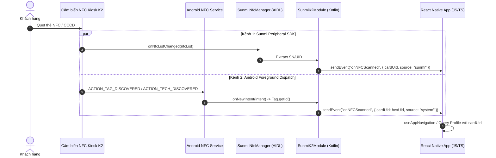

# Đặc Tả Kỹ Thuật & Kiến Trúc Tích Hợp Kiosk Sunmi K2 (Hardware Specification)

> Tài liệu đặc tả chuẩn tích hợp phần cứng máy trạm **Kiosk Sunmi K2 / Sunmi K2 mini** vào hệ thống khám sức khỏe tự động **ProMedi**.

---

## 🎯 Ranh Giới Trách Nhiệm (Scope & Boundaries)

- **Mô-đun LÀM GÌ**:
  - Giao tiếp trực tiếp với SDK phần cứng Sunmi (`sunmiperipher_sdk_v1.0.2.aar` và `com.sunmi:printerx:1.0.20`).
  - Đọc thẻ định danh NFC / CCCD qua hai kênh đồng thời: AIDL Sunmi Peripheral SDK và Android Foreground Dispatch.
  - Quản lý máy in nhiệt tích hợp khổ giấy 80mm: In ảnh biên nhận kết quả từ chuỗi Base64, nhị phân hóa ảnh, đẩy giấy và cắt giấy tự động.
  - Cung cấp giao diện TypeScript Type-Safe (`expo-sunmi-k2`) cho tầng Core Hardware và UI Features.
- **Mô-đun KHÔNG LÀM GÌ**:
  - **KHÔNG** can thiệp vào logic xử lý dữ liệu đo sinh trắc học InBody hoặc Huyết áp (thuộc về `src/core/hardware/inbody` và `src/core/hardware/bpbio`).
  - **KHÔNG** sinh giao diện màn hình trực tiếp (UI rendering thuộc về `src/features/`).
  - **KHÔNG** giao tiếp mạng backend (thuộc về `src/features/identification/api` hoặc `src/shared/api`).

---

## 1. Đường Ống & Luồng Dữ Liệu (Architecture & Flow Pipelines)

### 1.1. Luồng Nhận Thẻ NFC Kênh Đôi (Dual-Channel NFC Pipeline)



### 1.2. Luồng In Phiếu Kết Quả Khám (Thermal Receipt Printing Pipeline)

```mermaid
flowchart TD
    A[Màn hình Bước 6: Tổng Hợp Kết Quả] -->|Tạo Capture Bitmap / Base64| B[Call printReceiptAsync(base64Image)]
    B --> C[SunmiK2Module.kt]
    C --> D[Loại bỏ Prefix data:image/...;base64,]
    D --> E[Base64.decode -> ByteArray]
    E --> F[BitmapFactory.decodeByteArray]
    F --> G[PrinterSdk.getInstance.getPrinter]
    G --> H[lineApi.initLine]
    H --> I[Thiết lập BitmapStyle: Align.CENTER + Binarization 128]
    I --> J[lineApi.printBitmap]
    J --> K[lineApi.autoOut - Cắt giấy tự động]
    K --> L[Promise.resolve true]
```

---

## 2. Bảng Cấu Trúc Dữ Liệu & API Contracts

### 2.1. Sự Kiện NFC (`NFCScanEvent`)

| Trường    | Kiểu dữ liệu          | Ý nghĩa                                               | Ví dụ            |
| :-------- | :-------------------- | :---------------------------------------------------- | :--------------- |
| `cardUid` | `string`              | Mã định danh UID của thẻ NFC dạng chuỗi Hex viết hoa  | `"04A2B3C4D5E6"` |
| `source`  | `'sunmi' \| 'system'` | Kênh nhận diện phần cứng (Sunmi AIDL hoặc Android OS) | `'sunmi'`        |

### 2.2. Tùy Chọn In (`PrintBitmapOptions`)

| Tùy chọn        | Kiểu dữ liệu                    | Mặc định   | Ý nghĩa                                                           |
| :-------------- | :------------------------------ | :--------- | :---------------------------------------------------------------- |
| `align`         | `'left' \| 'center' \| 'right'` | `'center'` | Vị trí căn lề ảnh trên khổ giấy 80mm                              |
| `binarizeValue` | `number` (0 - 255)              | `128`      | Ngưỡng tương phản đen/trắng (giúp QR code và chữ nét đậm rõ ràng) |
| `autoOut`       | `boolean`                       | `true`     | Tự động đẩy giấy và kích hoạt dao cắt (Auto Cut) sau khi in       |

### 2.3. Bảng Phương Thức Native Module (`SunmiK2Module`)

```typescript
// Định nghĩa API Exposed từ Native Module
export interface ISunmiK2Module {
  isNfcSupported(): boolean
  switchNfcModule(sn: string): void
  setWatermarkAlpha(alpha: number): void
  printReceiptAsync(base64Image: string): Promise<boolean>
  printBitmapWithOptionsAsync(base64Image: string, options: PrintBitmapOptions): Promise<boolean>
  getPrinterStatusAsync(): Promise<PrinterStatusResult>
  feedPaperAsync(lines: number): Promise<boolean>
  cutPaperAsync(): Promise<boolean>
}
```

---

## 3. Giải Trình Lý Do Thiết Kế (Design Rationale / HOW & WHY)

### 3.1. Tại sao chuyển từ WebView Bridge sang React Native Expo Native Module?

- **Nhược điểm của WebView Bridge cũ**:
  - Phải duy trì một lớp Web phụ trong `WebView`, giao diện phản hồi chậm chạp và tiêu tốn nhiều RAM.
  - Giao tiếp hai chiều dùng `window.Android.printReceipt(...)` và `webView.evaluateJavascript(...)` tiềm ẩn lỗi inject chuỗi và thiếu Type-Safety.
- **Lợi ích khi dùng Expo Native Module**:
  - Giao diện React Native 60fps Native mượt mà, phản hồi cảm ứng tức thì.
  - Sử dụng `EventEmitter` và `AsyncFunction` chuẩn của Expo Modules API v2, toàn bộ luồng truyền tham số được kiểm tra kiểu chặt chẽ bằng TypeScript.

### 3.2. Tại sao duy trì cả Sunmi Peripheral SDK và Android Foreground Dispatch?

- Module NFC phần cứng gắn trong thân máy Kiosk Sunmi K2 kết nối qua dịch vụ nội bộ AIDL (`NfcManager`).
- Tuy nhiên, trong môi trường Kiosk thực tế, các trung tâm y tế có thể gắn thêm đầu đọc thẻ NFC ngoài qua cổng USB. Android Foreground Dispatch đảm bảo **100% các loại thẻ quẹt vào cổng ngoài hoặc cảm biến tích hợp đều được phát hiện chính xác**.

### 3.3. Thuật toán Xử Lý Ảnh In Nhiệt (Thermal Image Binarization)

- Máy in nhiệt Sunmi K2 in bằng cách đốt nóng các đầu kim nhiệt trên giấy cảm nhiệt, chỉ có 2 trạng thái: Có đốt (Đen) hoặc Không đốt (Trắng).
- Áp dụng thuật toán nhị phân hóa (`ImageAlgorithm.BINARIZATION`) với ngưỡng `128` đảm bảo:
  - Mã QR code không bị vỡ hạt hay mờ cạnh, máy quét điện thoại đọc được trong 0.1s.
  - Biểu đồ huyết áp và chỉ số InBody có độ sắc nét và tương phản cao nhất.

### 3.4. Quản Lý Vòng Đời & Chống Memory Leak

- `SunmiK2Module` tự động hook vào vòng đời Activity qua Expo `ModuleDefinition`:
  - `OnResume`: Kích hoạt `nfcAdapter.enableForegroundDispatch`.
  - `OnPause`: Vô hiệu hóa `nfcAdapter.disableForegroundDispatch` để tránh xung đột hệ thống.
  - `OnDestroy`: Hủy `NfcManager.unregisterNfcListener` và giải phóng AIDL Service (`NfcManager.destroy`).
