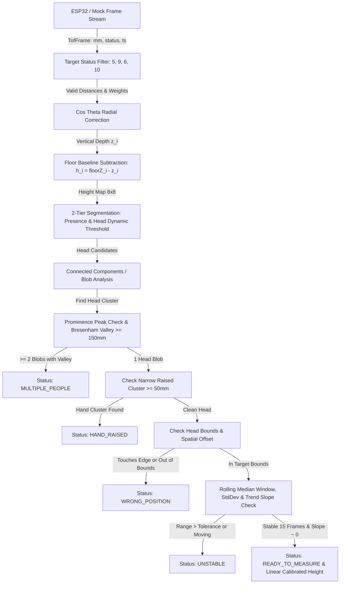

# Đặc tả Kỹ thuật & Thuật toán Cảm biến Khoảng cách VL53L8CX / VL53L5CX (ToF Sensor) - Phiên bản V5.1 (Production Standard)

## 📌 Tổng quan & Mục đích

Tài liệu này đặc tả thiết kế kiến trúc, mô hình dữ liệu và thuật toán xử lý dữ liệu cho cảm biến khoảng cách đa vùng **STMicroelectronics VL53L8CX / VL53L5CX (Time-of-Flight 8x8 Multizone Sensor)** lắp đặt tại trần nhà Kiosk ProMedi.

Cảm biến được sử dụng để:

1. **Phát hiện sự có mặt người dùng (Presence Detection)** tự động kích hoạt màn hình Kiosk.
2. **Xác nhận vị trí đứng chuẩn (Position Alignment)** bên dưới sàn.
3. **Phát hiện kịch bản ngoại lệ**: Có 2 người trong khung hình, dẫm sai vị trí, giơ tay làm nhiễu (`HAND_RAISED`), hoặc người dùng chưa đứng yên.
4. **Tự động đo và chốt chỉ số chiều cao chính xác (Height Measurement)** phục vụ phiên khám sức khỏe.

---

## 🎯 Scope & Boundaries (Ranh giới Trách nhiệm)

### Mô-đun LÀM GÌ (In Scope):

- Nhận ma trận khoảng cách $8 \times 8$ (64 zones) kèm mảng trạng thái `status` từ Hardware Serial HAL / Mock Adapter.
- Hiệu chỉnh góc chéo $\cos\theta$ (Trụ sụt radial trigonometric correction) đưa về khoảng cách đứng $z_i$.
- Trừ nền mặt sàn tự động (Background Subtraction) theo Baseline Floor $D_{\text{floor}}$ thu thập từ quy trình Floor Calibration.
- Cắt ngưỡng 2 tầng (2-Tier Segmentation): `presenceThreshold` ($\approx 800\text{mm}$) và `headSegmentThreshold` động ($H_{\text{peak}} - 150\text{mm}$).
- Phân tích Cụm liên thông (Connected Components / Blob) để phát hiện cụm Đỉnh đầu, lọc điểm nhọn giơ tay (`HAND_RAISED`) và phát hiện $\ge 2$ người qua độ sâu thung lũng (Valley depth $\ge 150\text{mm}$ với Bresenham line search).
- Kiểm tra độ ổn định theo chuỗi thời gian (Rolling Median Window, Trend Slope & Glitch Grace Period) trước khi chốt chiều cao.

### Mô-đun KHÔNG LÀM GÌ (Out of Scope):

- **Không phát giọng nói hay UI trực tiếp**: Engine chỉ trả về Event Code/Domain Status (`WRONG_POSITION`, `HAND_RAISED`, `HOLD_STILL`, `MEASURED_SUCCESS`). Lớp UI & Voice Engine sẽ tự ánh xạ sang âm thanh & câu chữ.
- **Không đụng I/O trong Engine**: `HeightMeasurementEngine` là Pure Class (100% testable trong Jest).

---

## 📐 Thông số Hình học & Trigonometric Cosine Correction ($\cos\theta$)

### 1. Phóng đại độ dài do góc chéo ToF

Cảm biến phát các tia ToF tỏa ra theo dạng kim tự tháp với góc quét $45^\circ \times 45^\circ$. Tia ở góc mép/đường chéo đi dài hơn tia ở trung tâm.

Mỗi zone $c$ ($0 \le c \le 7$) có góc nghiêng tâm zone so với trục đứng:

$$\theta_x(c) = (c - 3.5) \cdot \frac{45^\circ}{8} = (c - 3.5) \cdot 5.625^\circ = (c - 3.5) \cdot \frac{\pi}{32}$$

- Ở ô cột 5 (lệch $\theta_x = 1.5 \times 5.625^\circ = 8.44^\circ$), ở khoảng cách tới đầu $d \approx 600\text{mm}$, sai số khoảng $\approx 7\text{mm}$.
- Ở 4 ô góc đường chéo mép ngoài ($\theta \approx 28^\circ$, $d \approx 700\text{mm}$), sai số chênh lệch lên tới **$40\text{mm} - 50\text{mm}$**. Việc bù $\cos\theta$ là bắt buộc để đạt độ chính xác chốt chiều cao $\pm 5\text{mm}$.

### 2. Công thức bù $\cos\theta$ và Bảng Ma trận Tính sẵn (Lookup Table)

Độ sâu đứng thẳng từ trần $z_i$ của zone $i = (r, c)$ được tính theo công thức:

$$z_i = \text{Distance}_i \cdot \text{COS}_i$$

$$\text{COS}[r, c] = \frac{1}{\sqrt{1 + \tan^2\theta_x(c) + \tan^2\theta_y(r)}}$$

Chiều cao so với sàn sau khi trừ nền:

$$h_i = \text{floorZ}_i - z_i$$

#### 💡 Giải thích Trực quan: Độ sâu Thẳng đứng $z$ là gì?

##### 1. Phân biệt Khoảng cách xiên ($d$) và Độ sâu thẳng đứng ($z$):

- **Khoảng cách xiên/chếch ($d$)**: Là độ dài tia Laser phát ra từ cảm biến **chiếu chếch theo đường chéo** tới điểm nằm ở góc mép khung hình (vai hoặc đỉnh đầu). Trong tam giác vuông, đây chính là **CẠNH HUYỀN**.
- **Độ sâu thẳng đứng ($z$)**: Là khoảng cách được thả **vuông góc $90^\circ$ từ mặt phẳng trần nhà xuống** mặt sàn/đỉnh đầu. Trong tam giác vuông, đây chính là **CẠNH GÓC VUÔNG THẲNG ĐỨNG**.

##### 2. Sơ đồ Tam giác Vuông Minh họa:

```text
       [CẢM BIẾN TRẦN]
             O ─────── MẶT PHẲNG TRẦN NHÀ (0mm)
             │ \
             │  \
             │   \   <-- Tia Laser bắn CHÉO (Distance d = 610mm)
   ĐỘ SÂU    │    \      (CẠNH HUYỀN)
   THẲNG ĐỨNG │     \
   z = 600mm │      \
  (CẠNH VUÔNG)│       \
             │        \
             └───────── P (Đỉnh đầu người đứng lệch mép)
```

##### 3. Ví dụ bằng con số thực tế:

Giả sử Kiosk có trần nhà cao $2300\text{ mm}$ (2.3m), một người cao **1m70 ($1700\text{ mm}$)** đứng hơi lệch sang mép bàn cờ:

- **Nếu KHÔNG quy đổi ra $z$ (Lấy nhầm khoảng cách chéo $d = 610\text{ mm}$)**:
  $$\text{Chiều cao sai} = 2300 - 607 = \mathbf{1693\text{ mm}\text{ (1m693)}} \quad \rightarrow \text{Bị sai lệch 7mm!}$$
- **Nếu CÓ quy đổi ra $z$ (Nhân $\cos(8.44^\circ) = 0.98917 \rightarrow z = 607 \cdot 0.98917 = 600\text{ mm}$)**:
  $$\text{Chiều cao chuẩn} = 2300 - 600 = \mathbf{1700\text{ mm}\text{ (1m70 chuẩn xác!)}}$$

### 3. Cơ chế Đảo Thấu kính Quang học (Lens Optical Inversion - Section 8.1.3 Datasheet)

Theo Datasheet chính hãng STMicroelectronics (trang 24, Figure 23):

- Thấu kính trên đầu thu (Rx Lens) làm **đảo ngược cả chiều ngang lẫn chiều dọc** của hình ảnh chiếu lên mảng SPAD.
- Do đó, **Zone 0** (nằm ở góc bottom-left của mảng cảm biến) thực chất nhận ánh sáng từ góc **top-right** của khung cảnh thực tế dưới sàn.
- **Zone 63** (nằm ở góc top-right) nhận ánh sáng từ góc **bottom-left**.
- 👉 Đây là lý do vì sao cấu hình `axisMap { swapXY, flipX, flipY }` trong Engine là **rất quan trọng** để ánh xạ chính xác hướng di chuyển thực tế (Bước tới/lùi, bước trái/phải) của khách hàng với khung hình cảm biến.

### 4. Cấu Hình Driver ST ULD Khuyên Dùng (ST Manual UM3109 Recommendations)

Để đạt hiệu năng đo chiều cao tối ưu khi phát triển Firmware trên ESP32, cần cấu hình Driver ULD theo các khuyến nghị sau từ UM3109:

1. **Thứ tự Mục tiêu Target Order (`vl53l8cx_set_target_order`)**:
   - **Bắt buộc chọn `Closest`** (Mục tiêu gần nhất) thay vì `Strongest`.
   - **Lý do**: Cảm biến lắp ở trần nhà rọi xuống, Đỉnh Đầu là vật thể nằm **gần trần nhất**. Chọn `Closest` giúp bắt đỉnh đầu cực kỳ nhạy, loại bỏ nhiễu phản hồi mạnh từ mặt sàn bên dưới.
2. **Hiệu chỉnh Nhiễu Kính Che Kiosk (Cover Glass Xtalk Calibration - UM3109 Section 3.2 & 4.11)**:
   - Khi lắp cảm biến đằng sau tấm kính bảo vệ của vỏ Kiosk, hiện tượng Xtalk có thể làm sai lệch mục tiêu ở khoảng cách $< 60\text{cm}$ (vùng người cao gần chạm trần).
   - Thực hiện lệnh `vl53l8cx_calibrate_xtalk()` một lần duy nhất với bia xám 18% chuẩn ở khoảng cách $> 600\text{mm}$ (môi trường không IR nền) và lưu dữ liệu calibration vào Flash của ESP32.
3. **Tự động Bù Nhiệt độ Định kỳ (`vl53l8cx_set_VHV_repeat_count`) (UM3109 Section 4.16)**:
   - Đặt `repeat_count = 30` (Cứ mỗi 30 frames $\approx 2$ giây tự chạy bù nhiệt VHV 1 lần trong vài ms).
   - Giúp duy trì độ trôi nhiệt $0.1\text{ mm}/^\circ\text{C}$ khi Kiosk vận hành liên tục 24/7.
4. **Mức lọc Mép Sharpener Percent (`vl53l8cx_set_sharpener_percent`) (UM3109 Section 4.8)**:
   - Cài đặt `sharpener_percent = 1%` (giá trị mặc định Rev 12) để triệt tiêu nhiễu tán xạ biên (veiling glare) giữa zone đỉnh đầu và vai.

---

## 🏗️ 1. Sơ đồ Kiến trúc Engine & FSM 2 Lớp



---

## 📋 2. Cấu trúc Dữ liệu & TypeScript Types (Strict Output Contract)

```typescript
/** Khung dữ liệu thô nhận từ Hardware/ESP32 qua USB Serial */
export interface TofFrame {
  mm: number[] // Mảng 64 phần tử khoảng cách (mm)
  status: number[] // Mảng 64 phần tử mã trạng thái (5, 9, 6, 10)
  timestamp: number // Thời gian đo từ ESP32 (ms)
  sequence?: number // Số thứ tự gói chống mất frame
}

/** Cấu hình Engine & Vị trí lắp đặt */
export interface VL53SensorConfig {
  ceilingHeightMm: number // Độ cao trần nhà so với sàn (VD: 2300mm)
  presenceThresholdMm: number // Ngưỡng lọc rác mặt sàn (VD: 800mm)
  stabilityFrameCount: number // Số frame ổn định (VD: 15 frames @ 15Hz)
  stabilityRangeMm: number // Độ chênh lệch max - min cho phép (VD: 15mm)
  stabilityStdDevMm: number // Độ lệch chuẩn max cho phép (VD: 5mm)
  glitchGraceFrames: number // Số frame lỗi liên tiếp cho phép giữ buffer (VD: 3)
  handThresholdMm: number // Độ cao vật mảnh trên đầu báo giơ tay (VD: 50mm)
  valleyDepthMm: number // Độ sâu thung lũng phân biệt 2 người (VD: 150mm)
  axisMap: {
    // Ánh xạ hướng gắn cảm biến
    swapXY: boolean
    flipX: boolean
    flipY: boolean
  }
  offsetMm: number // Hằng số bù sai số cố định (VD: +15mm từ Linear Regression)
  gainScale: number // Tỉ lệ scale thực nghiệm (VD: 1.002 từ Linear Regression)
}

/** Domain Event Status (Không phụ thuộc Voice/UI) */
export type HeightEngineStatus =
  | 'NO_PERSON' // Không có người
  | 'MULTIPLE_PEOPLE' // Phát hiện >= 2 người đứng trong khung
  | 'WRONG_POSITION' // Đỉnh đầu chạm viền khung hình / dẫm quá lệch
  | 'HAND_RAISED' // Đang giơ tay / Có vật thể nhọn trên đầu
  | 'UNSTABLE' // Đang cử động, đung đưa hoặc đứng lên
  | 'READY_TO_MEASURE' // Đã ổn định, chốt kết quả

/** Hướng điều chỉnh vị trí đứng */
export type StepDirection =
  | 'STEP_FORWARD'
  | 'STEP_BACKWARD'
  | 'STEP_LEFT'
  | 'STEP_RIGHT'
  | 'CENTERED'

/** Hợp đồng đầu ra Engine */
export interface HeightEngineResult {
  status: HeightEngineStatus
  estimatedHeightMm: number | null
  stepDirection: StepDirection
  detectedPeopleCount: number
  confidence: number // Calculated dynamic confidence: 0.0 -> 1.0
  heightMap: number[][] // Ma trận chiều cao 8x8 (mm) sau bù cosθ
  headCentroidMm: { x: number; y: number } | null // Tọa độ thực (mm) của đỉnh đầu
  source: 'sensor' | 'manual'
  errorCode?: string
}
```

---

## 🧠 3. Chi tiết Các Thuật toán Đã Khắc phục Lỗi (Corrected Core Algorithms)

### 3.1. Lọc Target Status & Đánh Giá Độ Tin Cậy (UM3109 Table 4)

#### Bảng Mã Trạng Thái Target Status Chuẩn từ ST (UM3109 Table 4):

|                  Code                  | Mô tả Kỹ thuật (ST UM3109)                                | Ý nghĩa Nghiệp vụ                                  | Trọng số Tin cậy (Weight) |
| :------------------------------------: | :-------------------------------------------------------- | :------------------------------------------------- | :-----------------------: |
|                **`5`**                 | **Range valid**                                           | 🟢 **Valid 100%** (Đo chuẩn xác tuyệt đối)         |          **1.0**          |
|                **`9`**                 | **Range valid with large pulse (merged target)**          | 🟡 **Valid 50%** (Đo hợp lệ ở xung rộng)           |          **0.5**          |
|                **`6`**                 | **Wrap around not performed (first range)**               | 🟡 **Presence Only** (Chỉ dùng nhận diện có người) | **0.5 (No Height Lock)**  |
|                **`10`**                | **Range valid, but no target detected at previous range** | 🟡 **Presence Only** (Chỉ dùng nhận diện có người) | **0.5 (No Height Lock)**  |
| `0, 1, 2, 3, 4, 7, 8, 11, 12, 13, 255` | Các lỗi tín hiệu yếu, nhiễu SPAD, bất nhất                | 🔴 **Invalid** (Gán `NaN`, loại bỏ)                |          **0.0**          |

#### Quy tắc Tính Confidence Động của Frame:

$$\text{Confidence} = \frac{\sum \text{Weight}_{\text{valid\_zones}}}{\text{Total\_Head\_Zones}} \times \left(1 - \frac{\text{Range}}{\text{stabilityRangeMm} \times 2}\right)$$

---

### 3.2. Cắt Ngưỡng 2 Tầng (2-Tier Segmentation) & Prominence Peak Valley (A4)

1. **Tầng 1 - Presence Filter**: Loại bỏ zone có $h_i < \text{presenceThresholdMm}$ ($\approx 800\text{mm}$).
2. **Tầng 2 - Head Segmentation Dynamic Filter**:
   - Tìm peak chiều cao lớn nhất $H_{\text{max}}$.
   - Cắt cụm Đỉnh Đầu theo ngưỡng động: $h_i \ge (H_{\text{max}} - 150\text{mm})$ để tách sạch Đỉnh Đầu khỏi Vai.
3. **Phân biệt 2 Người bằng Bresenham Line Search**:
   - Duyệt các cụm đỉnh local maxima có prominence.
   - Tìm điểm thấp nhất dọc đường nối giữa 2 đỉnh bằng giải thuật Bresenham 2D grid.
   - Nếu $\text{ValleyDepth} = \min(h(P_1), h(P_2)) - h_{\text{min\_line}} \ge 150\text{mm}$ $\rightarrow$ Xác nhận **`MULTIPLE_PEOPLE`**.

---

### 3.3. Lọc Giơ Tay / Vật Nhọn (`HAND_RAISED`) (A5)

1. Xác định cụm Đỉnh Đầu chính (Cluster nằm gần vùng tâm target nhất).
2. Kiểm tra nếu xuất hiện một cụm nhỏ/mảnh (1–3 zones) nối qua cổ hẹp hoặc tách rời, nằm cao hơn Đỉnh Đầu chính $\ge 50\text{mm}$ $\rightarrow$ Trạng thái lập tức chuyển sang **`HAND_RAISED`**.
3. Engine từ chối đo và báo UI nhắc người dùng hạ tay xuống.

---

### 3.4. Vị Trí Đứng & Ánh Xạ Hướng (`axisMap`) (A3 & A7)

1. Tính tâm khối của **riêng cụm Đỉnh Đầu** $C = (X_{\text{mm}}, Y_{\text{mm}})$.
2. Điều kiện hợp lệ:
   - Cụm đỉnh đầu **KHÔNG được chạm các ô biên rìa** (hàng 0, 7 hoặc cột 0, 7).
   - Tọa độ tâm $(X, Y)$ nằm trong dung sai $\pm 100\text{mm}$ so với điểm tâm chuẩn.
3. Hướng di chuyển (`stepDirection`) được tính qua `axisMap` cấu hình phù hợp với hướng gắn phần cứng thực tế.

---

### 3.5. Kiểm Tra Ổn Định Chuỗi Thời Gian (Rolling Median Window, Slope & Grace Period) (A6)

1. Sử dụng cửa sổ Rolling Window 15 frames.
2. Với mỗi frame, lấy **Median** của các ô đỉnh đầu để triệt tiêu nhiễu Spike.
3. Cho phép **ân hạn tối đa 3 frames lỗi/giao thoa liên tiếp (`glitchGraceFrames = 3`)** trước khi reset bộ đệm.
4. **Điều kiện chốt chiều cao**:
   - `Range = Max(Window) - Min(Window) <= 15mm`.
   - `StdDev(Window) <= 5mm`.
   - `TrendSlope(Window) ≈ 0` (đảm bảo người dùng không đang từ từ đứng thẳng lên).
5. Chiều cao chốt $H_{\text{final}} = \text{TrimmedMean}(\text{Window}) \cdot \text{gainScale} + \text{offsetMm}$.

---

### 3.6. Quy Trình Floor Baseline Calibration (Hệ Thống Sàn Trống)

1. **Khởi tạo Calibration**: Khi Kiosk rảnh (Idle), gọi lệnh thu thập $N=30$ frames sàn trống.
2. **Tính toán Baseline**:
   - Lấy Median cho từng zone $i \in [0..63]$ để thu được mảng `floorZTable[64]`.
   - Kiểm tra độ phẳng sàn: Độ lệch chuẩn giữa các zone sàn không vượt quá $30\text{mm}$.
3. **Lưu trữ & Auto Drift Check**:
   - Lưu `floorZTable` vào MMKV Storage local.
   - Khi Kiosk ở trạng thái Idle, liên tục so sánh frame hiện tại với baseline. Nếu lệch bất thường $> 50\text{mm}$ kéo dài $\rightarrow$ Cảnh báo vật bỏ quên trên sàn hoặc cảm biến bị xê dịch.

---

## 📝 4. Mã Giả Xử Lý Cốt Lõi V5.1 (Production-Ready Pseudocode)

```typescript
export class HeightMeasurementEngine {
  private config: VL53SensorConfig
  private cosTable: number[]
  private floorZTable: number[]
  private historyBuffer: number[] = []
  private glitchCounter: number = 0

  constructor(config: VL53SensorConfig, floorRawDistances: number[]) {
    this.config = config
    this.cosTable = this.buildCosTable()
    // Bù cos-theta cho baseline sàn
    this.floorZTable = floorRawDistances.map((d, i) => d * this.cosTable[i])
  }

  public processFrame(frame: TofFrame): HeightEngineResult {
    // 1. Lọc status hợp lệ & Bù cos-theta
    const heightMap8x8 = Array.from({ length: 8 }, () => Array(8).fill(0))
    const validZones: { r: number; c: number; h: number; weight: number }[] = []

    for (let r = 0; r < 8; r++) {
      for (let c = 0; c < 8; c++) {
        const idx = r * 8 + c
        const st = frame.status[idx]
        const weight = this.getStatusWeight(st)

        if (weight > 0) {
          const z = frame.mm[idx] * this.cosTable[idx]
          const h = Math.max(0, this.floorZTable[idx] - z)
          if (h >= this.config.presenceThresholdMm) {
            heightMap8x8[r][c] = h
            validZones.push({ r, c, h, weight })
          }
        }
      }
    }

    // Nếu không có ô nào vượt ngưỡng presenceThreshold -> NO_PERSON
    if (validZones.length === 0) {
      this.handleGlitch()
      return this.buildResult('NO_PERSON', null, 'CENTERED', 0, heightMap8x8, 0, null)
    }

    // 2. Gom cụm liên thông (Blobs) & Bresenham Valley Check 2 người
    const blobs = this.findConnectedComponents(heightMap8x8)
    if (this.detectMultiplePeople(blobs, heightMap8x8)) {
      this.resetBuffer()
      return this.buildResult(
        'MULTIPLE_PEOPLE',
        null,
        'CENTERED',
        blobs.length,
        heightMap8x8,
        0.4,
        null,
      )
    }

    // 3. Tìm cụm Đỉnh Đầu & Kiểm tra giơ tay HAND_RAISED
    const headBlob = this.findHeadBlob(blobs, heightMap8x8)
    if (this.checkHandRaised(blobs, headBlob)) {
      this.resetBuffer()
      return this.buildResult('HAND_RAISED', null, 'CENTERED', 1, heightMap8x8, 0.3, null)
    }

    // 4. Kiểm tra vị trí đứng (Head Centroid & Touch Edge)
    const headCentroid = this.calculateHeadCentroidMm(headBlob, heightMap8x8)
    if (this.touchesEdge(headBlob) || !this.isInBounds(headCentroid)) {
      this.handleGlitch()
      return this.buildResult(
        'WRONG_POSITION',
        null,
        this.getCorrection(headCentroid),
        1,
        heightMap8x8,
        0.5,
        headCentroid,
      )
    }

    // 5. Đỉnh đầu mượt (Head Peak Median)
    const currentHeadHeight = this.getHeadPeakMedian(headBlob, heightMap8x8)

    // 6. Rolling Median Window, Slope & Stability Check
    this.historyBuffer.push(currentHeadHeight)
    if (this.historyBuffer.length > this.config.stabilityFrameCount) {
      this.historyBuffer.shift()
    }
    this.glitchCounter = 0 // Reset ân hạn khi frame hợp lệ

    const range = Math.max(...this.historyBuffer) - Math.min(...this.historyBuffer)
    const stdDev = this.calculateStdDev(this.historyBuffer)
    const slope = this.calculateTrendSlope(this.historyBuffer)

    const isStable =
      this.historyBuffer.length >= this.config.stabilityFrameCount &&
      range <= this.config.stabilityRangeMm &&
      stdDev <= this.config.stabilityStdDevMm &&
      Math.abs(slope) < 0.5

    const dynamicConfidence = this.calculateDynamicConfidence(validZones, headBlob, range)

    if (!isStable) {
      return this.buildResult(
        'UNSTABLE',
        currentHeadHeight,
        'CENTERED',
        1,
        heightMap8x8,
        dynamicConfidence,
        headCentroid,
      )
    }

    // Chốt kết quả chiều cao bằng Hồi quy tuyến tính (Linear Regression Calibration)
    const rawCalibrated = this.calculateTrimmedMean(this.historyBuffer)
    const finalHeightMm = Math.round(rawCalibrated * this.config.gainScale + this.config.offsetMm)

    return this.buildResult(
      'READY_TO_MEASURE',
      finalHeightMm,
      'CENTERED',
      1,
      heightMap8x8,
      0.98,
      headCentroid,
    )
  }

  private getStatusWeight(st: number): number {
    if (st === 5) return 1.0
    if (st === 9 || st === 6 || st === 10) return 0.5
    return 0.0
  }

  private handleGlitch(): void {
    this.glitchCounter++
    if (this.glitchCounter > this.config.glitchGraceFrames) {
      this.resetBuffer()
    }
  }

  private resetBuffer(): void {
    this.historyBuffer = []
    this.glitchCounter = 0
  }

  private buildCosTable(): number[] {
    // Sửa công thức góc chuẩn: theta_x(c) = (c - 3.5) * (PI / 32)
    const table = new Array(64)
    const angleStepRad = (45 * Math.PI) / 180 / 8 // 5.625 độ / zone
    for (let r = 0; r < 8; r++) {
      for (let c = 0; c < 8; c++) {
        const angleX = (c - 3.5) * angleStepRad
        const angleY = (r - 3.5) * angleStepRad
        table[r * 8 + c] =
          1 / Math.sqrt(1 + Math.pow(Math.tan(angleX), 2) + Math.pow(Math.tan(angleY), 2))
      }
    }
    return table
  }

  private calculateDynamicConfidence(
    validZones: { weight: number }[],
    headBlob: any,
    range: number,
  ): number {
    const validRatio =
      validZones.reduce((sum, z) => sum + z.weight, 0) / Math.max(1, validZones.length)
    const rangeFactor = Math.max(0, 1 - range / (this.config.stabilityRangeMm * 2))
    return Math.min(1.0, Math.max(0.1, Number((validRatio * 0.6 + rangeFactor * 0.4).toFixed(2))))
  }

  private buildResult(
    status: HeightEngineStatus,
    height: number | null,
    dir: StepDirection,
    people: number,
    map: number[][],
    confidence: number,
    centroid: { x: number; y: number } | null,
  ): HeightEngineResult {
    return {
      status,
      estimatedHeightMm: height,
      stepDirection: dir,
      detectedPeopleCount: people,
      confidence,
      heightMap: map,
      headCentroidMm: centroid,
      source: 'sensor',
    }
  }
}
```

---

## 📌 Hướng dẫn Nghiệm thu & Replay Testing

- [ ] **Test 1: Lọc Zone lỗi**: Ép một số ô status = 0 hoặc 2 $\rightarrow$ Engine không bị tạo đỉnh giả $2300\text{mm}$.
- [ ] **Test 2: Bù cos-theta**: Đứng ở zone trung tâm vs zone lệch mép cột 5 cùng 1 chiều cao $\rightarrow$ Sai số giữa 2 vị trí $< 3\text{mm}$.
- [ ] **Test 3: Phát hiện 2 người qua thung lũng**: 2 người đứng gần nhau có thung lũng $\ge 150\text{mm}$ $\rightarrow$ Trả về `MULTIPLE_PEOPLE`.
- [ ] **Test 4: Giơ tay**: Đưa bàn tay cao hơn đầu $\ge 50\text{mm}$ $\rightarrow$ Trả về `HAND_RAISED`.
- [ ] **Test 5: Replay Dataset**: Chạy Replay 30 bộ Log Frame ghi từ thực tế qua Jest $\rightarrow$ Đạt 100% tỷ lệ chốt chiều cao chính xác.
