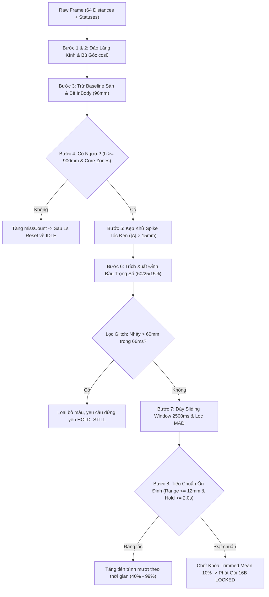

# Đặc tả Kỹ thuật Cảm biến Khoảng cách STMicroelectronics VL53L8CX (ToF Height Sensor - SPI High-Speed) - Phiên bản V5.2

## 📌 Tổng quan & Mục đích

Tài liệu này đặc tả thiết kế kỹ thuật, sơ đồ phần cứng, giao tiếp bus SPI tốc độ cao (10–20 MHz) và giao thức nhị phân siêu tinh gọn 16 Bytes cho cảm biến khoảng cách đa vùng **STMicroelectronics VL53L8CX (Time-of-Flight 8x8 Multizone Sensor)** kết hợp vi điều khiển **ESP32** đóng vai trò là một mô-đun đo chiều cao chuyên dụng (Dedicated Edge Height Measurement Engine) cho hệ thống Kiosk Y Tế Tự Động ProMedi.

### 🌟 Điểm Vượt Trội của VL53L8CX so với VL53L5CX:

| Tiêu chí kỹ thuật             | VL53L5CX (Bản Tiêu chuẩn)                                                               | VL53L8CX (Bản Nâng cấp Cao cấp)                                                         |
| :---------------------------- | :-------------------------------------------------------------------------------------- | :-------------------------------------------------------------------------------------- |
| **Giao diện truyền thông**    | Chỉ hỗ trợ **I2C** (tối đa 1 MHz Fast Mode Plus)                                        | Hỗ trợ cả **SPI High-Speed (10–20 MHz)** và I2C                                         |
| **Thời gian đọc 64 zones**    | $\approx 1.8\text{ ms} - 2.0\text{ ms}$ trên bus I2C                                    | **$< 0.15\text{ ms}$** qua bus SPI (nhanh hơn gấp 12 lần)                               |
| **Tần số lấy mẫu thực tế**    | $11.2\text{ Hz} - 11.9\text{ Hz}$ (nghẽn I2C polling)                                   | **$15.0\text{ Hz} - 30.0\text{ Hz}$** vững chãi, zero jitter                            |
| **Nguồn phát Laser VCSEL**    | VCSEL thế hệ cũ                                                                         | **VCSEL thế hệ mới** tăng cường độ phản xạ trên tóc đen                                 |
| **Kháng ánh sáng môi trường** | $1\text{ klx} - 2\text{ klx}$                                                           | **$5\text{ klx}$** (chống nhiễu đèn trần phòng khám công suất lớn)                      |
| **Khoảng cách đo tối đa**     | $\approx 3.5\text{m} - 4.0\text{m}$ (trong tối)                                         | **$4.0\text{m}$** ngay cả dưới ánh sáng mạnh                                            |
| **Mã nguồn Firmware**         | [`firmware/esp32-vl53l5cx-driver/`](file:///d:/promedi/firmware/esp32-vl53l5cx-driver/) | [`firmware/esp32-vl53l8cx-driver/`](file:///d:/promedi/firmware/esp32-vl53l8cx-driver/) |

---

## 🎯 Scope & Boundaries (Kiến trúc Module Hóa V5.2)

```text
[ Cảm biến ST VL53L8CX (8x8 @ 15-30Hz) ]
               │ SPI Bus 10MHz (SCK: 18, MISO: 19, MOSI: 23, CS: 5)
               ▼
[ Vi điều khiển ESP32 - HeightEngine C++ ]
  - Bước 1: Thu nhận 64 zones & Đảo ngược lăng kính quang học Rx (180°)
  - Bước 2: Bù góc cosθ Spatial Transform (LUT 8x8)
  - Bước 3: Trừ Baseline sàn (2220mm) & bệ cân InBody (96mm)
  - Bước 4: Nhận diện người (Core Zones hàng 2..5, cột 2..5 & h >= 900mm)
  - Bước 5: Kẹp chống Spike quang học trên tóc đen (|Δ| > 15mm)
  - Bước 6: Trích xuất đỉnh đầu trọng số vòm sọ (Crown Peak Weighted: 60/25/15%)
  - Bước 7: Lọc Glitch (> 60mm/66ms) & Lọc ngoại lai MAD trong Sliding Window 2500ms
  - Bước 8: Đánh giá ổn định (Range <= 12mm, |Slope| <= 6mm/s, Hold >= 2.0s) & Chốt 10%
               │
               ▼ Gói Nhị Phân Siêu Tinh Gọn 16 Bytes (USB Serial @ 460800 baud)
[ Kiosk React Native - Hardware ToF HAL ]
  - ToFDistanceDevice / ToFClient
  - Giải mã gói tin 16B & Cắt khung HeightStreamFramer
  - Điều khiển FSM inbodySessionMachine (bắt tay tải trọng InBody 260S)
  - Đồng bộ cấu hình động (PING, CONFIG, RESET)
```

---

## 🔌 Sơ Đồ Đấu Nối Phần Cứng Chi Tiết (Hardware Schematics & Wiring)

### 1. Sơ Đồ Chân Trực Quan ESP32 DevKit $\leftrightarrow$ Module VL53L8CX

```text
   +---------------------------------------+
   |        ESP32 DEVKIT V1 (30/38 PINS)   |
   |                                       |
   | [3V3] ───────────────────────────────┐|
   | [GND] ──────────────────────────────┐||
   |                                     |||
   | [GPIO 18] (VSPI CLK)  ─────────────┐|||
   | [GPIO 19] (VSPI MISO) ────────────┐||||
   | [GPIO 23] (VSPI MOSI) ───────────┐|||||
   | [GPIO  5] (VSPI CS)   ──────────┐||||||
   | [GPIO  4] (Control)   ─────────┐|||||||
   | [GPIO 17] (Interrupt) ────────┐||||||||
   +-------------------------------+||||||||
                                   |||||||||
                                   vvvvvvvvv
                     +---------------------------+
                     |    MODULE VL53L8CX        |
                     |                           |
                     |  1. VIN / VDD   (3.3V)    | <── 3V3 ESP32
                     |  2. GND         (Mass)    | <── GND ESP32
                     |  3. SCL / SCK   (Clock)   | <── GPIO 18
                     |  4. SDO / MISO  (Data In) | <── GPIO 19
                     |  5. SDA / MOSI  (Data Out)| <── GPIO 23
                     |  6. NCS / CS    (Select)  | <── GPIO 5
                     |  7. LPN / XSHUT (Enable)  | <── GPIO 4
                     |  8. INT / GPIO1 (Ngắt)    | <── GPIO 17 (Tùy chọn)
                     |  9. I2C_SPI_N   (Chế độ)  | <── Kéo lên 3V3 (SPI Mode)
                     | 10. PWREN       (Nguồn)   | <── Kéo lên 3V3 (Enable)
                     +---------------------------+
```

### 2. Bảng Đối Chiếu Chân Chi Tiết (Pinout Table)

#### A. Cấu hình SPI Tốc độ cao (VSPI 10–20 MHz) — _Khuyên dùng cho Kiosk_:

| Chân ESP32    | Tên Chân Module L8CX        | Mức Logic   | Chức năng kỹ thuật / Lưu ý                                                                      |
| :------------ | :-------------------------- | :---------- | :---------------------------------------------------------------------------------------------- |
| **`3V3`**     | **`VIN`** _(hoặc VDD/AVDD)_ | 3.3V DC     | Cung cấp nguồn 3.3V ổn định ($\ge 300\text{mA}$ peak khi VCSEL phát xung). ⚠️ **Không cắm 5V**. |
| **`GND`**     | **`GND`**                   | 0V          | Nối đất chung toàn hệ thống.                                                                    |
| **`GPIO 18`** | **`SCL / SCLK`**            | 3.3V Logic  | Tuyến xung nhịp SPI Master Clock (tần số 10 MHz).                                               |
| **`GPIO 19`** | **`SDO / MISO`**            | 3.3V Logic  | Tuyến dữ liệu Master In Slave Out (ESP32 đọc frame 64 zones).                                   |
| **`GPIO 23`** | **`SDA / MOSI`**            | 3.3V Logic  | Tuyến dữ liệu Master Out Slave In (ESP32 gửi lệnh/cấu hình).                                    |
| **`GPIO 5`**  | **`NCS / CS`**              | Active LOW  | Chip Select: Kéo xuống LOW khi truyền nhận byte SPI, kéo HIGH khi nghỉ.                         |
| **`GPIO 4`**  | **`LPn / XSHUT`**           | Active HIGH | Chân kích hoạt cảm biến. Kéo LOW để reset phần cứng chip, kéo HIGH để khởi động.                |
| **`GPIO 17`** | **`INT / GPIO1`**           | Active LOW  | _(Tùy chọn)_ Ngắt Data Ready: Cảm biến kéo LOW khi có dữ liệu mới, giúp ESP32 zero polling.     |
| **`3V3`**     | **`I2C_SPI_N`**             | 3.3V HIGH   | **Chân chọn giao tiếp**: Kéo lên HIGH/3V3 để chọn chế độ SPI (bắt buộc).                        |
| **`3V3`**     | **`PWREN`**                 | 3.3V HIGH   | Kéo lên 3V3 để kích hoạt bộ chuyển đổi nguồn nội bộ của module.                                 |

#### B. Cấu hình I2C Dự phòng (Fast Mode Plus 1 MHz):

| Chân ESP32    | Tên Chân Module L8CX | Chức năng kỹ thuật                                                                    |
| :------------ | :------------------- | :------------------------------------------------------------------------------------ |
| **`GPIO 21`** | **`SDA`**            | Tuyến dữ liệu I2C Data (kèm trở kéo $4.7\text{k}\Omega$ lên 3.3V nếu module chưa có). |
| **`GPIO 22`** | **`SCL`**            | Tuyến xung nhịp I2C Clock (tần số tối đa 1 MHz).                                      |
| **`GPIO 4`**  | **`LPn`**            | Low Power Enable (kéo HIGH để bật chip).                                              |
| **`GND`**     | **`I2C_SPI_N`**      | Kéo xuống LOW hoặc nối Mass để chọn chế độ I2C.                                       |

---

## 📐 Sơ Đồ Kết Nối Hệ Thống Kiosk Hoàn Chỉnh

```text
┌────────────────────────────────────────────────────────────────────────┐
│                          TRẦN NHÀ KIOSK                                │
│                                                                        │
│          [ ST VL53L8CX Time-of-Flight Multizone Sensor ]               │
│                (Lắp rọi thẳng góc 90° xuống mặt sàn)                   │
└───────────────────────────────────┬────────────────────────────────────┘
                                    │ Cáp bọc kim chống nhiễu (Shielded SPI Cable)
                                    │ Chiều dài <= 1.5 mét
                                    ▼
┌────────────────────────────────────────────────────────────────────────┐
│                        HỘP ĐIỀU KHIỂN ESP32                            │
│  [ ESP32 DevKit V1 ] ── Board xử lý HeightEngine C++ 8 bước           │
│  - Chuyển đổi tọa độ thấu kính cosθ                                    │
│  - Lọc nhiễu tóc đen, Glitch & Ngoại lai MAD                           │
│  - Đánh giá độ ổn định và chốt khóa chiều cao                          │
└───────────────────────────────────┬────────────────────────────────────┘
                                    │ Cáp USB Type-C / Micro-USB Serial
                                    │ Tốc độ: 460800 baud (Chống giật lag)
                                    ▼
┌────────────────────────────────────────────────────────────────────────┐
│                    KIOSK SUNMI K2 / SUNMI K2 MINI                      │
│  [ Cổng USB Host Kiosk ]                                              │
│  - React Native Layer (ToFDistanceDevice / ToFClient)                  │
│  - Giải mã gói 16 Bytes & Bắt tay FSM inbodySessionMachine             │
│  - Phát âm thanh giọng nói (Voice Engine) & Hiển thị kết quả           │
└────────────────────────────────────────────────────────────────────────┘
```

---

## 🧠 Quét Lại Chi Tiết 8 Bước Thuật Toán (Exhaustive Algorithm Pipeline)

Toàn bộ thuật toán được hiện thực hóa trong tệp [`firmware/esp32-vl53l8cx-driver/src/HeightEngine.cpp`](file:///d:/promedi/firmware/esp32-vl53l8cx-driver/src/HeightEngine.cpp), chạy ở chu kỳ $66\text{ms}$ ($15\text{Hz}$) với thời gian thực thi chỉ mất $\sim 18 - 20\mu s$:



---

### Bước 1 & 2: Đảo Lăng Kính Quang Học & Bù Góc Không Gian $\cos\theta$

1. **Đảo lăng kính Rx 180°**:
   - Thấu kính thu quang học làm đảo ngược hình ảnh chiếu lên mảng SPAD. Hàm `flipLensOrientation` chuyển đổi zone $(r, c)$ thành $(7 - r, 7 - c)$.
2. **Bù góc không gian kim tự tháp ToF $45^\circ \times 45^\circ$**:
   - Cảm biến phát chùm tia nón tỏa ra, tia ở góc mép đi dài hơn tia trục giữa.
   - Góc lệch trục: $\theta_x(c) = (c - 3.5) \cdot 5.625^\circ = (c - 3.5) \cdot \frac{\pi}{32}$.
   - Hệ số $\cos\theta$ được tính trước vào mảng tĩnh Look-Up Table (LUT $8 \times 8$):
     $$\text{COS}[r, c] = \frac{1}{\sqrt{1 + \tan^2\theta_x(c) + \tan^2\theta_y(r)}}$$
   - Độ sâu đứng thẳng từ trần xuống đỉnh đầu:
     $$z_i = \text{Distance}_i \cdot \text{COS}[r, c]$$

---

### Bước 3: Trừ Baseline Mặt Sàn & Độ Cao Bệ Cân

$$h_i = \text{expectedFloorMm} - z_i - \text{platformHeightMm}$$

- `expectedFloorMm`: Chiều cao từ cảm biến trần xuống sàn (mặc định $2220\text{mm}$).
- `platformHeightMm`: Độ cao của bệ cân InBody 260S đặt trên sàn (mặc định $96\text{mm}$, hoặc $0\text{mm}$ nếu đo từ sàn).
- Lọc bỏ các zone ngoài dải tin cậy: khoảng cách $d \le 50\text{mm}$, $d \ge 3900\text{mm}$, hoặc mã `status` không hợp lệ ($< 5$).

---

### Bước 4: Nhận Diện Người Đứng (Person Detection) & Vùng Lõi ROI

- Tìm giá trị đỉnh cao nhất trong 64 ô: $\text{peakH} = \max(h_i)$.
- Gom các ô nằm trong dải đỉnh đầu: $\text{bandZones} = \{h_i \mid h_i \ge \text{peakH} - 80\text{mm}\}$.
- **Xác thực vùng lõi (Core Region)**: Đỉnh đầu bắt buộc phải có ít nhất 1 zone nằm trong vùng trung tâm bàn cân (hàng 2..5, cột 2..5).
- Điều kiện người xuất hiện: $\text{peakH} \ge 900\text{mm}$ và $\text{hasCorePeak} == \text{true}$.
- Sau 6 frames liên tiếp ($\approx 400\text{ms}$) xác nhận có người, FSM phát sự kiện `PERSON_PRESENT` và chuyển sang `MEASURING`.

---

### Bước 5: Khử Gai Nhọn Quang Học Trên Tóc Đen (Anti-Spike Clamping)

- **Nguyên nhân vật lý**: Sợi tóc đen hấp thụ mạnh tia Laser $940\text{nm}$, độ phản xạ chỉ $\approx 5-10\%$, dễ gây hiện tượng 1 zone bị nhiễu photon nhảy vọt lên $\pm 20\text{mm}$.
- **Thuật toán kẹp**: Sắp xếp mảng dải đỉnh đầu giảm dần ($h_0 \ge h_1 \ge h_2$). Nếu ô cao nhất vọt lên quá $15\text{mm}$ so với ô thứ hai:
  $$h_0 = h_1 + 5.0\text{ mm}$$

---

### Bước 6: Trích Xuất Đỉnh Đầu Trọng Số Vòm Sọ (Crown Peak-Weighted)

Thay vì lấy trung bình phẳng làm tụt kết quả khi đầu nằm giữa 2 ô hoặc ngã tư 4 ô:

- **Zone 0** (đỉnh chóp): **60%** trọng số.
- **Zone 1**: **25%** trọng số (chỉ lấy nếu cách đỉnh $h_0 - h_1 \le 25\text{mm}$).
- **Zone 2**: **15%** trọng số (chỉ lấy nếu cách đỉnh $h_0 - h_2 \le 25\text{mm}$).
  $$\text{instantH} = \frac{0.60 \cdot h_0 + 0.25 \cdot h_1 + 0.15 \cdot h_2}{0.60 + 0.25 + 0.15}$$

---

### Bước 7: Lọc Bước Nhảy Glitch & Lọc Ngoại Lai Thống Kê MAD Trong Cửa Sổ Trượt

1. **Bộ lọc Glitch**:
   - Nếu cụm đỉnh đầu $< 2$ zones $\rightarrow$ Tia nhiễu đơn lẻ.
   - Nếu $\text{instantH} < 800\text{mm}$ hoặc $> 2300\text{mm}$ $\rightarrow$ Ngoài dải nhân trắc học.
   - Nếu bước nhảy $|\text{instantH} - \text{prevH}| > 60\text{mm}$ ($6\text{cm}$) trong $66\text{ms}$ $\rightarrow$ Quơ tay hoặc bóng lướt qua.
2. **Cửa sổ trượt Circular Buffer (2500ms)**:
   - Lưu trữ lịch sử các mẫu trong 2.5 giây gần nhất.
3. **Bộ lọc MAD (Median Absolute Deviation)**:
   - Tính trung vị $\text{Med} = \text{median}(h)$.
   - Tính độ lệch tuyệt đối so với trung vị: $\text{dev}_i = |h_i - \text{Med}|$.
   - Tính $\text{MAD} = \text{median}(\text{dev}_i)$ với ngưỡng sàn $\text{MAD}_{\min} = 3.0\text{mm}$.
   - Giữ lại các mẫu hợp lệ thỏa mãn:
     $$|h_i - \text{Med}| \le 3.0 \times \text{MAD}$$
   - Bắt buộc giữ lại $\ge 70\%$ mẫu trong cửa sổ trượt; nếu người cử động làm mất $> 30\%$ mẫu, hệ thống giữ FSM ở `HOLD_STILL` và đặt tiến trình ở 30%.

---

### Bước 8: Tiêu Chuẩn Ổn Định Nhân Trắc Học & Chốt Khóa Trimmed Mean 10%

1. **Tiêu chuẩn ổn định thực tế (Bao dung nhịp thở lồng ngực)**:
   - **Biên độ dao động**: $\text{Range} = \max(h) - \min(h) \le 12.0\text{mm}$ ($1.2\text{cm}$).
   - **Vận tốc dịch chuyển**: Hồi quy tuyến tính $|\text{Slope}| \le 6.0\text{mm/s}$.
   - **Thời gian giữ yên**: $t_{\text{hold}} \ge 2000\text{ms}$ (2.0 giây liên tục) với $\ge 16$ mẫu hợp lệ.
2. **Tiến trình tăng mượt**:
   - Khi người dùng đã vào dải ổn định $\le 12\text{mm}$, tiến trình tăng tuyến tính từ $40\% \to 99\%$ theo tỷ lệ thời gian giữ yên $t_{\text{hold}} / 2000\text{ms}$.
3. **Chốt khóa Trimmed Mean 10%**:
   - Sắp xếp tăng dần các mẫu đã ổn định.
   - Cắt bỏ 10% biên dưới và 10% biên trên để triệt tiêu hoàn toàn nhiễu đuôi phân phối xác suất.
   - Tính trung bình các mẫu còn lại: $\text{rawMm} = \text{mean}(h_{\text{trimmed}})$.
   - Áp dụng hệ số hiệu chuẩn phần cứng:
     $$\text{lockedHeightMm} = \text{round}(\text{rawMm} \times \text{gainScale} + \text{offsetMm})$$
   - Phát sự kiện `HEIGHT_EVENT_LOCKED`, chuyển FSM sang `LOCKED`, tiến trình $100\%$, phát gói nhị phân 16 Bytes lên Kiosk.

---

## 📦 Cấu Trúc Gói Tin Nhị Phân 16 Bytes (`HeightPacketPayload`)

| Byte Offset | Kiểu dữ liệu | Tên trường        | Ý nghĩa / Giá trị                                                              |
| :---------: | :----------: | :---------------- | :----------------------------------------------------------------------------- |
|   `0..1`    | `uint8_t[2]` | `header`          | Magic Header: `0xAA`, `0x55`                                                   |
|     `2`     |  `uint8_t`   | `packetType`      | Mã loại gói: `0x48` (ASCII `'H'`)                                              |
|     `3`     |  `uint8_t`   | `state`           | `0`=IDLE, `1`=MEASURING, `2`=HOLD_STILL, `3`=LOCKED, `4`=TIMEOUT, `5`=ERROR    |
|     `4`     |  `uint8_t`   | `guidance`        | `0`=IDLE, `1`=STEP_ON, `2`=HOLD_STILL, `3`=MEASURING, `4`=LOCKED, `5`=TIMEOUT  |
|   `5..6`    |  `uint16_t`  | `lockedHeightMm`  | Chiều cao chốt (Little-Endian, mm, VD: `1725` = 172.5 cm)                      |
|   `7..8`    |  `uint16_t`  | `instantHeightMm` | Chiều cao tức thời (Little-Endian, mm)                                         |
|     `9`     |  `uint8_t`   | `progress`        | Tiến trình ổn định (`0` đến `100%`)                                            |
|    `10`     |  `uint8_t`   | `confidence`      | Độ tin cậy tính toán (`85%` đến `99%`)                                         |
|    `11`     |  `uint8_t`   | `headZoneCount`   | Số lượng zone đỉnh đầu (1 đến 4 zones)                                         |
|    `12`     |  `uint8_t`   | `eventCode`       | `0`=NONE, `1`=PERSON_PRESENT, `2`=LOCKED, `3`=PERSON_LEFT, `4`=TIMEOUT         |
|    `13`     |  `uint8_t`   | `flags`           | Bitwise: `Bit 0` = isStable, `Bit 1` = hasPerson, `Bit 2` = needsRecalibration |
|  `14..15`   |  `uint16_t`  | `checksumCrc16`   | Mã kiểm tra toàn vẹn CRC16-Modbus tính trên 14 bytes đầu                       |

---

## 🔄 Bộ Lệnh Điều Khiển Hai Chiều Kiosk $\leftrightarrow$ ESP32

1. **Lệnh PING (`0xAA 0x55 0x50 0x47` / `"PG"`)**:
   - ESP32 phản hồi ngay gói PONG (`0xAA 0x55 0x4F 0x4B` / `"OK"`). Dùng để dò cổng COM tự động khi Kiosk cắm vào.
2. **Lệnh CONFIG (`0xAA 0x55 0x43 0x46` + 14 Bytes Payload)**:
   - Truyền cấu hình: `expectedFloorMm` (uint16), `platformHeightMm` (uint16), `gainScale` (float 4B), `offsetMm` (float 4B) và CRC16 (2B).
   - ESP32 xác thực CRC và phản hồi `CONFIG_OK` (`0xAA 0x55 0x43 0x4B` / `"CK"`).
3. **Lệnh RESET (`0xAA 0x55 0x52 0x53` / `"RS"`)**:
   - ESP32 hủy bỏ phiên đo hiện tại và reset FSM về trạng thái `IDLE` sẵn sàng cho người mới.
4. **Lệnh DEBUG RAW (`0xAA 0x55 0x44 0x42 0x01` / `"DB 1"`)**:
   - Bật/tắt chế độ truyền song song gói tin 204 Bytes ma trận thô 64 zones khi Kiosk mở màn hình kiểm định Heatmap.
