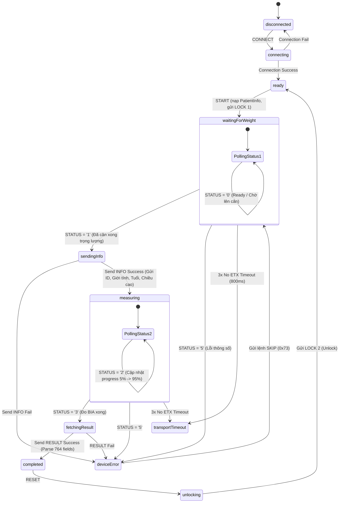
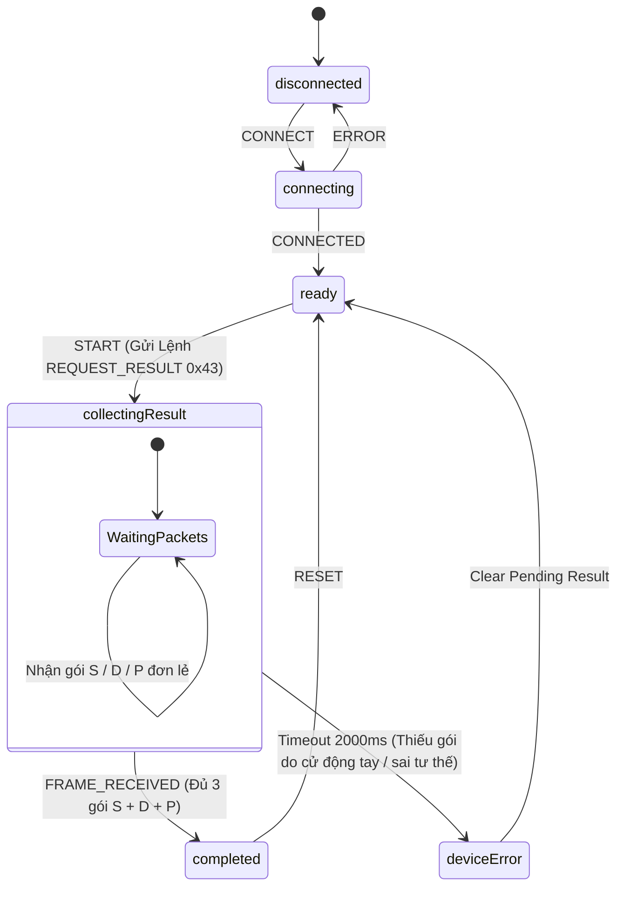
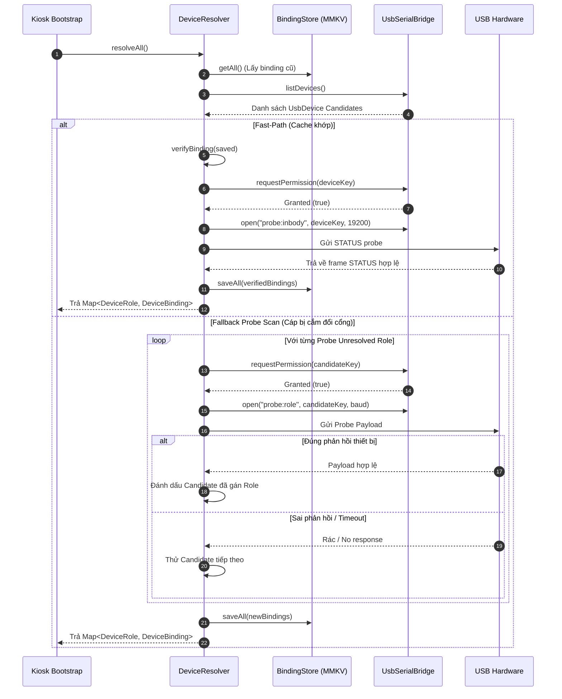

# Đặc Tả Kiến Trúc SDK Kết Nối Thiết Bị Đo (InBody 260S + BPBIO750) — Kiosk Sunmi K2 Mini

- **Mô-đun**: SDK Kết Nối & Điều Khiển Thiết Bị Đo Y Tế Đa Cổng (Dual USB-Serial Hardware SDK)
- **Vị trí trong mã nguồn**: `src/core/hardware/`
- **Tầng kiến trúc**: Layer 2 (Core Layer) - Business Logic, Hardware HAL & State Machines
- **Đối tượng triển khai**: Kiosk Sunmi K2 Mini (Android, Expo custom dev client), triển khai trên nhiều trạm (fleet)
- **Thiết bị tích hợp**:
  - **InBody 260S**: Máy phân tích thành phần cơ thể (Body Composition Analyzer) — Baud `19200 8N1`
  - **BPBIO750**: Máy đo huyết áp tự động (Automatic Blood Pressure Monitor) — Baud `9600 8N1`
- **Transport thật**: **USB Host API chuẩn Android** (`UsbManager`) thông qua Native Module `expo-usb-serial-bridge` (bọc `usb-serial-for-android` mik3y, v3.11.0).

---

## 🎯 1. Scope & Boundaries (Ranh Giới Trách Nhiệm)

### Mô-đun LÀM GÌ (In Scope):

- Tách biệt 5 phân lớp: `Native Bridge` ➔ `Transport Layer` ➔ `Device Resolver` ➔ `Protocol Codecs` ➔ `Clients & XState Machines` ➔ `Device Adapters`.
- Cách ly 100% tài nguyên giữa 2 thiết bị: mỗi máy đo sở hữu `Transport`, `Client`, `Codec`, `Buffer` và luồng đọc nền riêng biệt.
- Tự động dò và gán vai trò (`inbody` | `bpbio`) cho 2 cổng USB bằng giao thức bắt tay (Probe Handshake) không phụ thuộc cổng cắm hay thứ tự cắm dây.
- Đóng gói parser streaming-safe:
  - InBody: Cắt frame biến-độ-dài an toàn qua STX (`0x02`) / ETX (`0x03`) / ESC (`0x1B`).
  - BPBIO750: Cắt frame 16-byte cố định kèm kiểm tra checksum `BCC` (XOR sum) và xóa buffer khi nhận lại identifier trùng lặp trong 1 chu kỳ đo.
- Quản lý trạng thái và ngoại lệ đo:
  - InBody: Polling STATUS 500ms, tự động retry, xử lý timeout 3x no-ETX, unlock bắt buộc khi thoát/reset.
  - BPBIO750: Timeout 2000ms thu thập dữ liệu, phát hiện cử động tay / sai tư thế / tuột bao đo ngắt đo giữa chừng.

### Mô-đun KHÔNG LÀM GÌ (Out of Scope):

- **KHÔNG quản lý UI / Layout / Styles**: Giao diện hiển thị thuộc Layer 3 (`src/features/measure-inbody/`, `src/features/measure-bp/`).
- **KHÔNG phát âm thanh trực tiếp**: Việc phát giọng nói hướng dẫn do `VoiceEngine` (`src/core/voice-engine/`) quản lý qua event/state.
- **KHÔNG lưu trữ SQLite lâu dài**: Dữ liệu sau khi đo được chuyển về Session Machine tổng (`health-session.machine.ts`) xử lý lưu WatermelonDB.

---

## 2. Sơ Đồ Kiến Trúc & Luồng Chuyển Trạng Thái (FSM & Pipeline Diagrams)

### 2.1 Sơ Đồ 5 Tầng Phân Lớp Kiến Trúc

```
┌────────────────────────────────────────────────────────────────┐
│  Layer 3: UI Screens (`src/features/measure-*`)                 │
│  - Render ProgressBar, Toast thông báo, Lỗi tư thế               │
├────────────────────────────────────────────────────────────────┤
│  Layer 2: Kiosk Session FSM (`health-session.machine.ts`)       │
│  - Điều phối 6 bước khám, quản lý đếm ngược Privacy 60s         │
├────────────────────────────────────────────────────────────────┤
│  Device Resolver (`src/core/hardware/resolver/`)               │
│  - Dò tự động Cổng USB lúc Boot qua Probe Handshake            │
│  - Fast-path Cache verification qua MMKV                       │
├────────────────────────────────────────────────────────────────┤
│  IMeasurementDevice (`src/core/hardware/types/`)               │
│  - InBodyDevice, BpbioDevice cùng implement                       │
├────────────────────────────────────────────────────────────────┤
│  InBodyClient (FrameCodec)  │ BpbioClient (BpbioFrameCodec)    │
│  - Polling STATUS 500ms     │ - Ghép gói S/D/P                 │
│  - Mutex Half-Duplex        │ - Duplicate reset safety         │
├────────────────────────────────────────────────────────────────┤
│  Session Machine (XState v5)                                   │
│  - inbodySessionMachine     │ bpbioSessionMachine              │
├────────────────────────────────────────────────────────────────┤
│  Transport Layer (`src/core/hardware/transport/`)              │
│  - UsbSerialTransport (Promise.race timeout) / TcpTransport     │
├────────────────────────────────────────────────────────────────┤
│  Expo Native Module (`modules/expo-usb-serial-bridge/`)         │
│  - UsbManager + UsbSerialProber + SerialInputOutputManager      │
│  - Chạy qua ioManager.start() luồng đọc ngầm riêng cho từng port │
└────────────────────────────────────────────────────────────────┘
```

---

### 2.2 Sơ Đồ FSM Chuyển Trạng Thái InBody 260S (`inbodySessionMachine`)



---

### 2.3 Sơ Đồ FSM Chuyển Trạng Thái BPBIO750 (`bpbioSessionMachine`)



---

### 2.4 Sơ Đồ Tiến Trình Dò Cổng Tự Động (Device Resolver Sequence)



---

## 3. Ma Trận Xử Lý Lỗi & Tư Thế (Exception & Error Matrix)

### 3.1 Ma Trận Ngoại Lệ Máy Đo Huyết Áp BPBIO750

| Tình huống lỗi               | Nguyên nhân                                                         | Nhận biết ở SDK                                                                   | Phản hồi Hệ thống & Voice Prompt                                                                                                                        |
| ---------------------------- | ------------------------------------------------------------------- | --------------------------------------------------------------------------------- | ------------------------------------------------------------------------------------------------------------------------------------------------------- |
| **Cử động tay / Nói chuyện** | Khách hàng nhúc nhích tay hoặc nói chuyện trong lúc bao đo đang bơm | Máy ngắt đo giữa chừng, chỉ nhận được 1-2 gói (ví dụ chỉ có `S` mà thiếu `D`/`P`) | `bpbioSessionMachine` đếm timeout 2000ms `after` ➔ chuyển `deviceError` ➔ Voice: _"Phát hiện di chuyển. Vui lòng thả lỏng tay, giữ yên và bấm đo lại."_ |
| **Sai tư thế / Tuột bao đo** | Tay đặt không đúng vị trí bao đo hoặc không xỏ tay hết chiều sâu    | Máy xả hơi sớm, không gửi gói kết quả nào                                         | Timeout 2000ms không có dữ liệu ➔ chuyển `deviceError` ➔ Hiển thị GIF minh họa tư thế chuẩn + Voice hướng dẫn                                           |
| **Nhiễu tín hiệu Serial**    | Khách hàng va chạm dây cáp USB lúc truyền byte                      | Byte checksum `BCC` bị sai                                                        | `BpbioFrameCodec.tryParseDataFrame()` kiểm tra `BCC !== raw[15]` ➔ Âm thầm loại bỏ gói rác, chờ gói kế tiếp                                             |
| **Rút cáp USB giữa chừng**   | Dây cáp USB bị lỏng hoặc ngắt kết nối                               | Native `SerialInputOutputManager.Listener.onRunError` bắn event `onDetached`      | `UsbSerialTransport.onClose()` bắt được ➔ Chuyển machine sang `disconnected` ➔ Toast cảnh báo: _"Mất kết nối máy đo huyết áp"_                          |

### 3.2 Ma Trận Ngoại Lệ Máy Phân Tích Cơ Thể InBody 260S

| Tình huống lỗi                     | Nguyên nhân                                       | Nhận biết ở SDK                                                                                         | Phản hồi Hệ thống & Voice Prompt                                                                               |
| ---------------------------------- | ------------------------------------------------- | ------------------------------------------------------------------------------------------------------- | -------------------------------------------------------------------------------------------------------------- |
| **Nhập sai thông số**              | Chiều cao < 90cm hoặc > 220cm, Tuổi < 3 hoặc > 99 | Máy phản hồi `STATUS` với code `'5'` (ERROR) và `errorCode` (`1`: Giới tính, `2`: Chiều cao, `3`: Tuổi) | `inbodySessionMachine` nhận status `'5'` ➔ `deviceError` ➔ Gửi lệnh `SKIP` (`0x73`) ➔ Báo lỗi thông số trên UI |
| **Mất kết nối 3x ETX**             | Mất tín hiệu truyền nhận giữa Kiosk và InBody     | 3 lần liên tiếp `pollStatusOnce()` bị timeout không nhận byte `ETX` trong 800ms                         | Chuyển `transportTimeout` ➔ Phát âm thanh cảnh báo kết nối + Tự động mở khóa `UNLOCK` (`0x6C 0x32`)            |
| **Bỏ dở giữa chừng (Timeout 60s)** | Khách hàng rời đi khi chưa đo xong                | Actor cha `kiosk-session.machine` đếm ngược 60s không tương tác                                         | Tự động gọi `inbodyDevice.reset()` (lệnh `LOCK 2` unlock) ➔ Xóa dữ liệu tạm phiên ➔ Quay về Màn 1 Home         |

---

## 4. Bảng Ánh Xạ Vị Trí Chỉ Số Kết Quả InBody (`RESULT_INDEX_MAP`)

Khi lệnh `RESULT` (`0x64`) được gửi, InBody 260S trả về chuỗi 764 fields phân cách bởi byte `0x1B` (ESC). Dưới đây là bảng ánh xạ các chỉ số quan trọng được mapper bóc tách trong `result-mapper.ts`:

| Chỉ số                                                 | Index trong Payload | Thuộc tính TypeScript (`InBodyResult`) |   Đơn vị   |
| ------------------------------------------------------ | :-----------------: | -------------------------------------- | :--------: |
| ID InBody                                              |         `0`         | `inBodyId`                             |   String   |
| Mã Khách hàng                                          |         `1`         | `userId`                               |   String   |
| Giới tính                                              |         `2`         | `gender` (`'M'` / `'F'`)               |    Enum    |
| Chiều cao                                              |         `3`         | `height`                               |     cm     |
| Tuổi                                                   |         `4`         | `age`                                  |    Tuổi    |
| Cân nặng                                               |         `5`         | `weight`                               |     kg     |
| Ngày đo                                                |         `6`         | `testDate`                             | YYYY.MM.DD |
| Giờ đo                                                 |         `7`         | `testTime`                             |  HH:mm:ss  |
| Protein                                                |        `15`         | `protein`                              |     kg     |
| Khoáng chất (Minerals)                                 |        `16`         | `minerals`                             |     kg     |
| Khối lượng mỡ cơ thể (BFM)                             |        `17`         | `bfm`                                  |     kg     |
| Tổng lượng nước cơ thể (TBW)                           |        `18`         | `tbw`                                  |    Lít     |
| Khối lượng không mỡ (FFM)                              |        `19`         | `ffm`                                  |     kg     |
| Khối lượng cơ xương (SMM)                              |        `20`         | `smm`                                  |     kg     |
| Chỉ số khối cơ thể (BMI)                               |        `22`         | `bmi`                                  |   kg/m²    |
| Phần trăm mỡ cơ thể (PBF)                              |        `23`         | `pbf`                                  |     %      |
| Tỷ lệ mỡ bụng (WHR)                                    |        `24`         | `whr`                                  |   Ratio    |
| Tỷ lệ chuyển hóa cơ bản (BMR)                          |        `27`         | `bmr`                                  |    kcal    |
| Cấp độ mỡ nội tạng (VFL)                               |        `36`         | `vfl`                                  |   Level    |
| Điểm InBody (InBody Score)                             |        `207`        | `inBodyScore`                          |    Điểm    |
| Chỉ số cơ xương khớp (SMI)                             |        `211`        | `smi`                                  |   kg/m²    |
| FFM Tay Phải / Tay Trái / Thân / Chân Phải / Chân Trái |   `103` .. `107`    | `segmental.ffm*`                       |     kg     |
| BFM Tay Phải / Tay Trái / Thân / Chân Phải / Chân Trái |   `108` .. `112`    | `segmental.bfm*`                       |     kg     |

---

## 5. Giải Trình Quyết Định Thiết Kế (Architecture Decision Records - ADR)

### ADR-01: Chọn `usb-serial-for-android` qua Expo Native Module thay vì JNI/termios

- **Bối cảnh**: Cần kết nối dongle USB-Serial trên Kiosk Sunmi K2 Mini.
- **Quyết định**: Sử dụng thư viện `usb-serial-for-android` (v3.11.0) bọc trong Expo Native Module `expo-usb-serial-bridge`.
- **Lý do**: Thư viện này hỗ trợ sẵn toàn bộ driver chip (CH340/FTDI/CP210x) qua Android USB Host API chuẩn (`UsbManager`), chạy 100% trong môi trường Java/Kotlin không cần tự duy trì code JNI/C++ mức thấp, loại bỏ rủi ro không tương thích giữa các bản Android ROM tùy biến khác nhau.

### ADR-02: Cơ chế Tự Dò Cổng Device Resolver qua Probe Handshake

- **Bối cảnh**: Trên N trạm Kiosk khác nhau, 2 dongle USB-to-Serial có thể dùng cùng chip CH340 (`vendorId:productId` trùng nhau `1A86:7523`), không thể gán cố định cổng theo mã USB.
- **Quyết định**: Thực hiệnProbe Handshake gửi tín hiệu thử nghiệm và kiểm tra phản hồi giao thức thật.
- **Lý do**: Đảm bảo dải trạm Kiosk triển khai 100% Zero-Touch (kỹ thuật viên cắm dây cổng nào cũng tự nhận đúng máy).

### ADR-03: Phân tách Namespace `portId` (`probe:role`) khi Dò Cổng

- **Bối cảnh**: `UsbSerialBridgeModule.kt` sẽ tự động đóng kết nối cũ nếu gặp cùng 1 `portId`.
- **Quyết định**: Các request probe của Resolver sử dụng `portId` dạng `probe:inbody` hoặc `probe:bpbio`.
- **Lý do**: Đảm bảo các lần probe dò cổng hoặc rescan ở màn Admin không bao giờ vô tình đóng kết nối cổng thật (`inbody`/`bpbio`) đang đo dữ liệu trực tiếp.

### ADR-04: Xóa bộ đệm `pending` khi gặp `identifier` trùng lặp ở BPBIO Client

- **Bối cảnh**: Khách hàng cử động tay làm máy BPBIO750 ngắt giữa chừng (chỉ gửi được 1-2 gói như `S`, `D`), sau đó đo lại từ đầu.
- **Quyết định**: `BpbioClient.applyFrame()` tự động reset toàn bộ `pending` khi nhận lại `identifier` đã có sẵn.
- **Lý do**: Tránh việc ghép chỉ số `D` cũ của lần đo thất bại với chỉ số `S` mới của lần đo thành công, làm sai lệch kết quả huyết áp mà không có dấu hiệu lỗi.

---

## 6. Hướng Dẫn Thực Thi & Nghiệm Thu Trên Phần Cứng (Hardware Runbook)

### 6.1 Bước 0: Kiểm Tra Tối Thiểu Native Driver Trên Kiosk Thật

Trước khi chạy toàn bộ app, nạp đoạn code Kotlin test tối thiểu vào Custom Dev Client:

```kotlin
val manager = getSystemService(Context.USB_SERVICE) as UsbManager
val drivers = UsbSerialProber.getDefaultProber().findAllDrivers(manager)
Log.d("USB_TEST", "Found ${drivers.size} drivers")

for (driver in drivers) {
    val device = driver.device
    val connection = manager.openDevice(device)
    Log.d("USB_TEST", "Device ${device.deviceName} open: ${connection != null}")
    if (connection != null) {
        val port = driver.ports[0]
        port.open(connection)
        port.setParameters(19200, 8, UsbSerialPort.STOPBITS_1, UsbSerialPort.PARITY_NONE)
        Log.d("USB_TEST", "Port opened successfully for ${device.deviceName}")
        port.close()
        connection.close()
    }
}
```

**Tiêu chí đạt**:

- [x] Cả 2 dongle xuất hiện trong danh sách `drivers`.
- [x] `openDevice()` trả về connection `non-null`.
- [x] `port.open()` và `port.setParameters()` không ném exception.

---

### 6.2 Lệnh Chạy Kiểm Thử Tự Động (Automated Testing Commands)

```bash
# 1. Kiểm tra TypeScript strict type compliance (0 Errors)
npx tsc --noEmit

# 2. Kiểm tra Code Quality Linter (0 Errors)
npm run lint

# 3. Chạy toàn bộ Unit Tests cho Hardware Layer (Jest)
npx jest src/core/hardware
```
