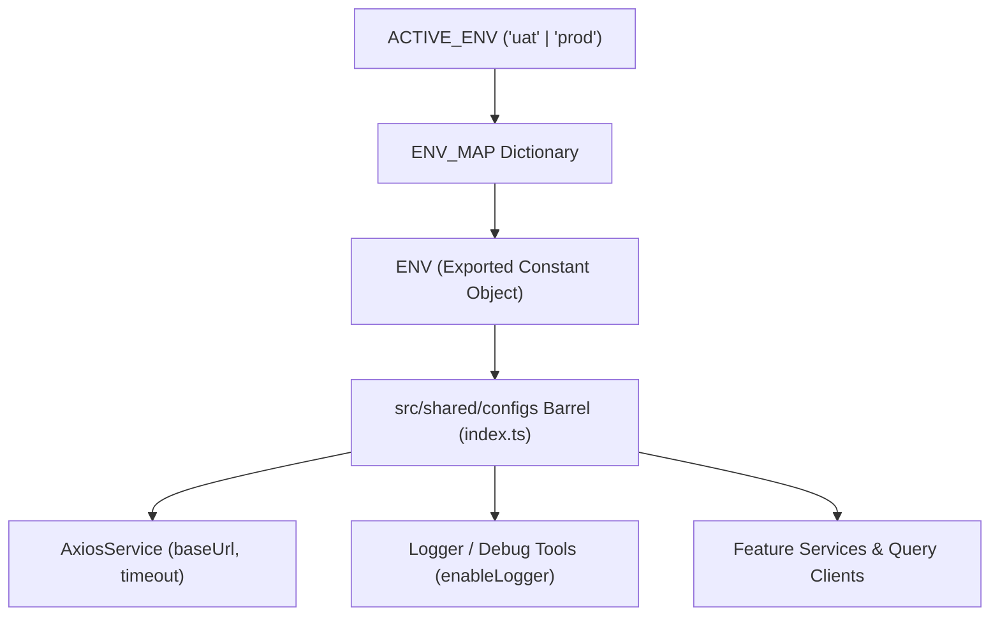

# Đặc tả Kiến trúc Cấu hình Môi trường Hệ thống (Environment Configuration Spec)

- **Thời gian tạo (Created)**: 2026-10-13 14:35:00 (GMT+7)
- **Trạng thái**: ĐÃ HOÀN THÀNH
- **Thiết bị mục tiêu**: Kiosk Sumi mini K2 / Sunmi K2 mini (Android Kiosk Standalone) & Mobile Simulator

---

## Scope & Boundaries (Ranh giới Trách nhiệm)

### Mô-đun LÀM GÌ:

- Cung cấp Single Source of Truth cho cấu hình môi trường ứng dụng dưới dạng Pure TypeScript (`env.config.ts`), không phụ thuộc file `.env` hay bundler environment injection phức tạp lúc runtime.
- Hỗ trợ switch nhanh giữa 2 môi trường: **UAT** (gộp chung cho DEV và UAT) và **PROD** (Production).
- Cung cấp type-safe interface (`EnvConfig`) cho các thông số: Base API URL, Request Timeout, Logger Flag, và cờ boolean xác định môi trường (`isUat`, `isDev`, `isProd`).
- Tích hợp trực tiếp vào `AxiosService` tại tầng Shared (`src/shared/lib/axios/`).

### Mô-đun KHÔNG LÀM GÌ:

- Không lưu trữ các thông tin bí mật động của người dùng (Token, Private Key) – việc này do MMKV / Keystore bảo mật quản lý.
- Không đọc ghi runtime file storage (`.env` parser, fs file reading) để đảm bảo zero I/O và tối ưu khởi động ứng dụng trên Kiosk.

---

## 1. Đường ống & Luồng dữ liệu (Data Flow)



---

## 2. Bảng Cấu trúc Dữ liệu & Interfaces

```typescript
export type AppEnvironment = 'uat' | 'prod'

export interface EnvConfig {
  /** Môi trường hiện tại ('uat' | 'prod') */
  readonly env: AppEnvironment
  /** Cờ kiểm tra môi trường UAT / DEV */
  readonly isUat: boolean
  /** Cờ kiểm tra môi trường UAT / DEV (alias) */
  readonly isDev: boolean
  /** Cờ kiểm tra môi trường PROD */
  readonly isProd: boolean
  /** API Gateway Base URL */
  readonly apiBaseUrl: string
  /** Thời gian timeout của request (ms) */
  readonly apiTimeout: number
  /** Bật/tắt console log / debug logger */
  readonly enableLogger: boolean
}
```

---

## 3. Danh mục Môi trường & Giá trị Mặc định

| Thuộc tính        | UAT (DEV & UAT)               | PROD (Production)         | Ghi chú                            |
| :---------------- | :---------------------------- | :------------------------ | :--------------------------------- |
| `apiBaseUrl`      | `https://api-wms-dev.aidx.vn` | `https://api-wms.aidx.vn` | Endpoint Gateway của hệ thống      |
| `apiTimeout`      | `30000` (30s)                 | `30000` (30s)             | Timeout cho Axios request          |
| `enableLogger`    | `true`                        | `false`                   | Tắt log console trên thiết bị thật |
| `isUat` / `isDev` | `true`                        | `false`                   | Cờ nhận diện môi trường test       |
| `isProd`          | `false`                       | `true`                    | Cờ nhận diện môi trường sản phẩm   |

---

## 4. Hướng dẫn Chuyển đổi Môi trường

Để chuyển đổi môi trường, lập trình viên chỉ cần thay đổi biến `ACTIVE_ENV` trong `src/shared/configs/env.config.ts`:

```typescript
// Chuyển sang UAT (DEV/UAT)
export const ACTIVE_ENV: AppEnvironment = 'uat'

// Chuyển sang PROD (Production)
export const ACTIVE_ENV: AppEnvironment = 'prod'
```
