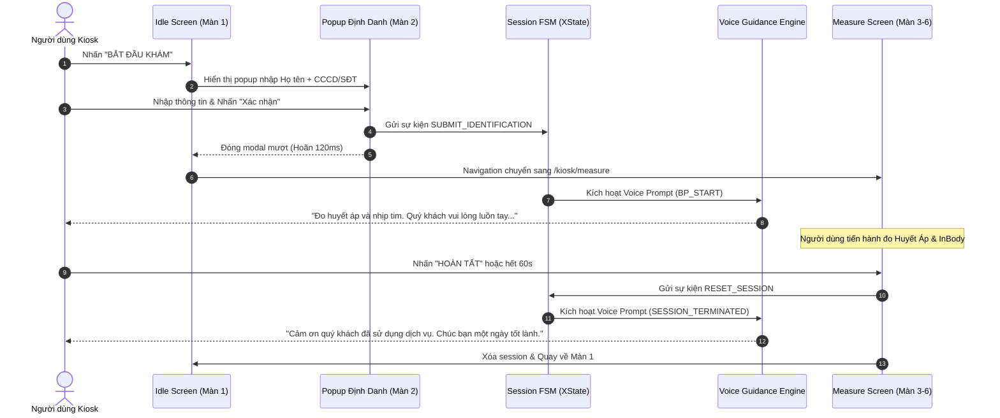

# Đặc Tả Kiến Trúc Giao Diện & Hệ Thống Giọng Nói Kiosk V4.0 (Kiosk UI & Voice Engine Architecture Spec)

- **Thời gian tạo (Created)**: 2026-09-22 14:46:00 (GMT+7)
- **Phiên bản**: V4.0 Production
- **Phạm vi tác động**: `src/core/voice-engine/`, `src/features/measure/`, `src/shared/components/ui/wave-background.tsx`, `src/app/(kiosk)/`

---

## Ranh Giới Trách Nhiệm (Scope & Boundaries)

### Mô-đun LÀM GÌ (In Scope):

- Tự động hóa phát giọng nói Tiếng Việt hướng dẫn người dùng qua từng bước khám sức khỏe (Đo Huyết áp, InBody, Kết quả).
- Đồng bộ giao diện phẳng (Flat UI), loại bỏ khung viền rườm rà, tích hợp đường lụa sóng Bézier vector 3D (`WaveBackground`).
- Đảm bảo hiệu năng 60fps trên GPU Android Kiosk, không gây rò rỉ bộ nhớ hay crash xung đột native module.

### Mô-đun KHÔNG LÀM GÌ (Out of Scope):

- Không can thiệp trực tiếp vào lệnh ghi/đọc driver phần cứng cổng COM/Serial (việc này do Hardware HAL đảm nhận).
- Không tự ý lưu trữ dữ liệu cá nhân khách hàng lên cloud mà không qua SQLite WatermelonDB/API Layer.

---

## 1. Đường Ống & Luồng Dữ Liệu (Mermaid Sequence & State Pipeline)



---

## 2. Cấu Trúc Dữ Liệu & Payload Contracts

### 2.1 Voice Prompt Matrix Schema (`VoicePromptKey`)

```typescript
export type VoicePromptKey =
  | 'SERVICE_SELECTION' // Mời quý khách chọn các dịch vụ cần đo...
  | 'BP_START' // Đo huyết áp và nhịp tim...
  | 'BP_ELBOW_OFF' // Cảnh báo: Khuỷu tay chưa chạm...
  | 'BP_COMPLETE' // Đã đo xong huyết áp...
  | 'INBODY_START' // Phân tích chỉ số cơ thể...
  | 'INBODY_CONTACT_ERROR' // Cảnh báo: Chưa nhận đủ tiếp xúc điện cực...
  | 'INBODY_COMPLETE' // Đã phân tích xong chỉ số cơ thể...
  | 'SUMMARY_START' // Quá trình khám sức khỏe đã hoàn tất...
  | 'SUMMARY_TIMEOUT_10S' // Màn hình sẽ đóng sau 10 giây nữa...
  | 'SESSION_TERMINATED' // Cảm ơn quý khách đã sử dụng dịch vụ...
```

### 2.2 Result Summary Data Model (`InBodyMetrics` & `BpMetrics`)

```typescript
export interface ResultSummaryPayload {
  bpData: {
    systolic: number // mmHg (VD: 118)
    diastolic: number // mmHg (VD: 76)
    pulse: number // bpm (VD: 72)
  }
  inBodyData: {
    weight: number // kg (VD: 68.5)
    muscleMass: number // kg (VD: 31.2)
    bodyFatPercentage: number // % (VD: 18.4)
    score: number // Điểm sức khỏe (VD: 82)
    bmi: string // kg/m² (VD: "23.2")
    bodyAge: number // tuổi (VD: 28)
    visceralFat: number // Level (VD: 4)
    tbw: number // lít (VD: 41.5)
  }
}
```

---

## 3. Giải Trình Lý Do Thiết Kế (Design Rationale / HOW & WHY)

1. **Hủy Lời Thoại Cũ Trước Khi Phát Lời Thoại Mới (Audio Queue Cancellation):**
   - _Vấn đề_: Khi người dùng đứng trên Kiosk bấm chuyển bước nhanh, câu thoại của bước trước vẫn tiếp tục nói chồng lên câu thoại bước sau gây chói tai và thiếu chuyên nghiệp.
   - _Giải pháp_: Trong `VoicePlayerService.speak()`, luôn thực thi `await stop()` hủy tiến trình `expo-speech` hiện tại trước khi bắt đầu câu thoại mới.

2. **Cách Ly Phân Lớp Nền Sóng Toán Học (`WaveBackground` Layering):**
   - _Vấn đề_: Đặt SVG background trực tiếp trong layout dễ đè lên header hoặc cản trở sự kiện chạm (touch events).
   - _Giải pháp_: Đặt `WaveBackground` cùng cấp với `LinearGradient` ở lớp Z-index thấp nhất, cấu hình `pointerEvents="none"` để đảm bảo 100% không ảnh hưởng tới tương tác người dùng.

3. **Ngăn Chặn Crash Native Android (`NullPointerException` & Released Shared Object):**
   - _Vấn đề_: Reanimated 4 layout animation và Expo Router screen transition chạy đồng thời gây lỗi `ViewGroup.dispatchGetDisplayList` trên Android Fabric renderer. Ngoài ra `expo-video` giải phóng C++ object trước khi TextureView unmount gây crash app.
   - _Giải pháp_: Thêm `useIsFocused()` giúp unmount `VideoView` an toàn và hoãn điều hướng route 120ms sau khi submit modal.
