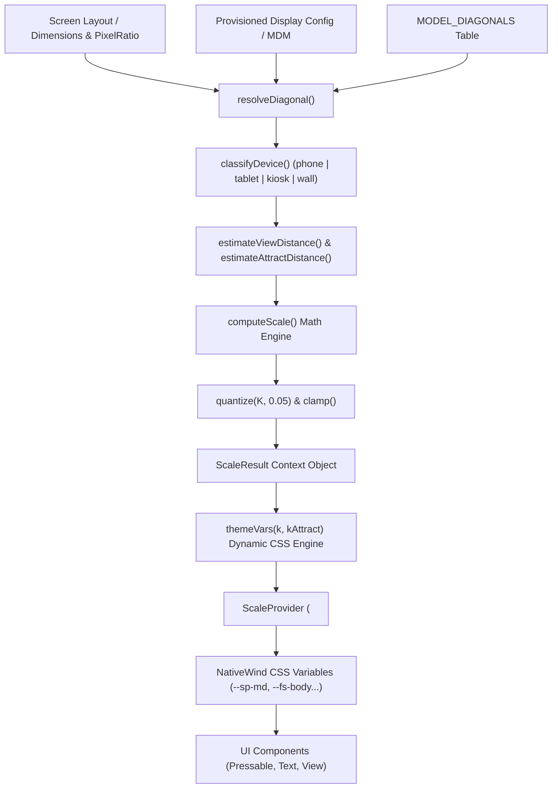

# Đặc tả Kiến trúc Hệ thống Theme & Runtime Visual Scaling System

- **Thời gian tạo (Created)**: 2026-09-16 11:45:00 (GMT+7)
- **Trạng thái**: ĐÃ HOÀN THÀNH
- **Thiết bị mục tiêu**: Kiosk Sumi mini K2 / Sunmi K2 mini (Màn hình 15.6" dọc), Tablet & Kiosk màn hình lớn 21.5"-43"

---

## Scope & Boundaries (Ranh giới Trách nhiệm)

### Mô-đun LÀM GÌ:

- Định nghĩa Single Source of Truth cho toàn bộ Design Tokens (Màu sắc, Đổ bóng, Font chữ, Khoảng cách cơ sở).
- Tính toán hệ số co giãn thị giác động $K$ lúc runtime dựa trên kích thước vật lý màn hình (PPI, đường chéo inch) và khoảng cách nhìn.
- Bơm các biến CSS Variables (`--sp-*`, `--fs-*`, `--r-*`, `--bw-*`) vào ứng dụng qua NativeWind v4 `vars()`.
- Cung cấp sàn kích thước vùng chạm an toàn ($\ge 19\text{mm}$ cho Kiosk công cộng).

### Mô-đun KHÔNG LÀM GÌ:

- Không quản lý trạng thái phiên khám hay dữ liệu đo y tế.
- Không can thiệp trực tiếp vào các thuộc tính animation GPU của Reanimated (Reanimated quản lý riêng qua transform/opacity).

---

## 1. Đường ống & Luồng dữ liệu (Pipeline & Data Flow)



---

## 2. Bảng Cấu trúc Dữ liệu & Interfaces

```typescript
export type DeviceClass = 'phone' | 'tablet' | 'kiosk' | 'wall'

export type ScaleInput = {
  diagonalIn?: number // Đường chéo màn hình vật lý (inch)
  viewDistanceMm?: number // Khoảng cách nhìn thực tế (mm)
  comfort?: number // Hệ số thoải mái (Kiosk: 1.15 - 1.3)
}

export type ScaleResult = {
  k: number // Hệ số co giãn cho giao diện tương tác
  kAttract: number // Hệ số co giãn cho màn hình chờ (đọc từ xa)
  ppi: number // Mật độ điểm ảnh thực trên inch
  pixelRatio: number // Density ratio báo từ OS
  diagonalIn: number // Đường chéo tính được
  viewDistanceMm: number // Khoảng cách nhìn tính được (mm)
  deviceClass: DeviceClass // Phân loại thiết bị
  source: 'config' | 'model-table' | 'estimated'
}
```

---

## 3. Giải trình Lý do Thiết kế (Design Rationale / HOW & WHY)

### 1. Tại sao không dùng pixel cố định hay Tailwind build-time static config?

Màn hình Kiosk đứng công cộng có khoảng cách nhìn xa hơn điện thoại cầm tay (~650mm vs ~350mm). Nếu dùng số dp/px cố định của mobile, chữ và nút bấm trên màn Kiosk lớn sẽ bị quá nhỏ khiến người dùng lớn tuổi phải rướn người hoặc khó đọc. Tính toán K lúc runtime đảm bảo giữ nguyên góc nhìn mắt người dùng ($~0.0073\text{ rad}$).

### 2. Lý do tại sao K được làm tròn nấc 0.05 (Quantization)?

Nếu K là một số thực tùy ý (ví dụ `1.3412...`), giao diện của từng máy sẽ lệch vài pixel lẻ, khiến không thể so sánh ảnh kiểm thử tự động (QA Visual Regression) và không tái lập được bug giao diện. Snap về nấc 0.05 thu hẹp các biến thể về tập hợp hữu hạn.

### 3. Sàn vùng chạm tối thiểu 19mm

Người dùng Kiosk đứng thao tác thường bấm nhanh, không có điểm tựa tay. Ngưỡng 19mm là chuẩn thiết kế giao diện cảm ứng Kiosk công cộng (so với 9mm của điện thoại). `touchFloorDp()` tự động nâng đè `--sp-touch` nếu hệ số K bị làm tròn xuống.
