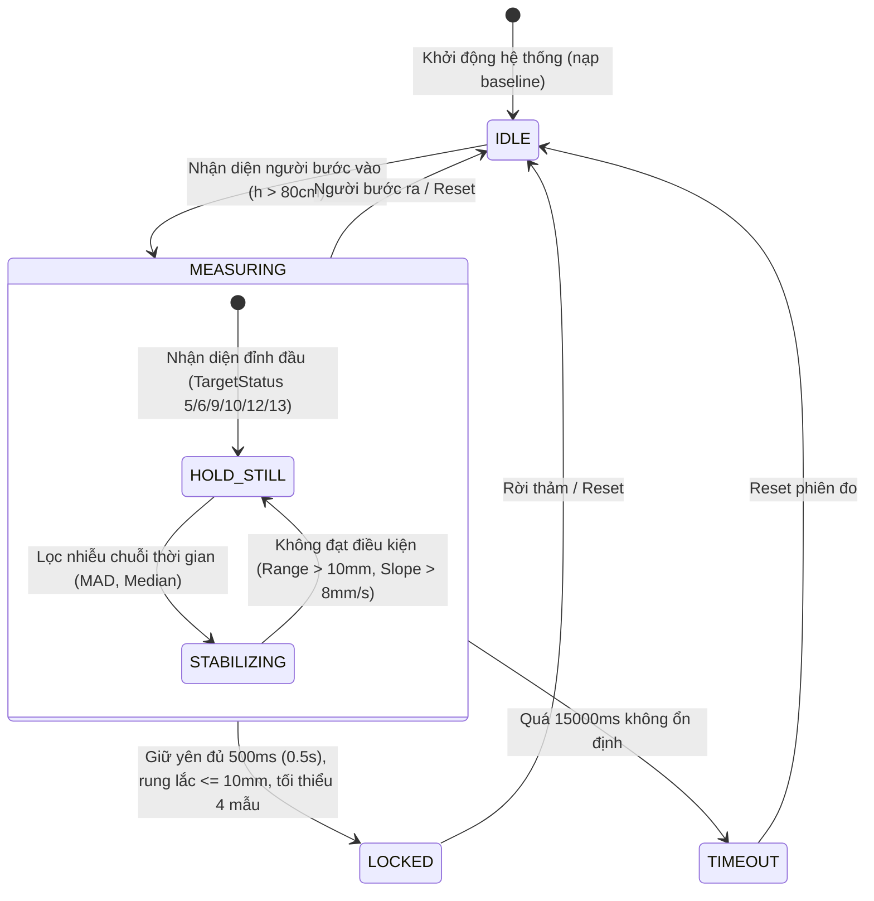

# Đặc Tả Kiến Trúc & Lý Giải Kỹ Thuật Đo Chiều Cao Cảm Biến ToF VL53L5CX/VL53L8CX (Architecture Spec & ADR)

- **Mã Tài Liệu**: `SPEC-PROMEDI-TOF-HEIGHT-V6.3`
- **Phiên Bản**: **V6.3 Production (Fast-Lock 0.5s & Strict Anti-Premature InBody Handshake Edition)**
- **Cập Nhật Lần Cuối**: 2026-10-09 (GMT+7)
- **Trạng Thái**: CHÍNH THỨC / ĐÃ TRIỂN KHAI VÀ NGHIỆM THU TRÊN MÁY THẬT
- **Phân Lớp Kiến Trúc**: Layer 2 Core Hardware Engine (`src/core/hardware/tof/`)
- **Tài Liệu Tham Chiếu**:
  - [AGENTS.md](file:///d:/promedi/AGENTS.md) (Quy tắc & Chuẩn Mực Tài Liệu 3 Tầng)
  - [Runbook Nghiệm Thu Phần Cứng Máy Thật](file:///d:/promedi/docs/plans/tof-height-measurement-runbook.md)
  - [Đặc Tả Kỹ Thuật Chip ST VL53L5CX](file:///d:/promedi/docs/hard-ware/vl53l5cx-distance-sensor-spec.md)
  - [Mã Nguồn C++ Firmware ESP32 Driver](file:///d:/promedi/firmware/esp32-vl53l5cx-driver/README.md)
  - [Đặc Tả Use Case Nghiệp Vụ V4.0](file:///d:/promedi/docs/specs/usecase-specification-v4.0.md)

---

## 📌 Scope & Boundaries (Ranh Giới Trách Nhiệm Mô-Đun)

### 🟢 Mô-đun LÀM (In-Scope):

1. **Giao thức Nhị Phân 204 Bytes & Streaming Framer**:
   - Nhận diện cổng phần cứng tự động bằng **Probe Signature Handshake PING-PONG** (`0xAA 0x55 'P' 'G'` $\rightarrow$ `0xAA 0x55 'O' 'K'` @ 460800 baud).
   - Tiếp nhận luồng byte phân mảnh từ Android USB Serial (`UsbSerialTransport` @ 460800 baud).
   - Thuật toán `ToFStreamFramer` chống trôi offset, tự động đồng bộ Header `0xAA 0x55` trên dòng byte phân mảnh 32B từ chip CH340/CP210x.
   - Kiểm tra mã toàn vẹn dữ liệu **CRC16-Modbus** (`decodeToFFrame`).
   - Lật thấu kính quang học Rx 180 độ theo cấu hình thấu kính quang học ST (`flipLensOrientation`).

2. **Thuật Toán Xử Lý Chiều Cao Toán Học Tối Giản (`HeightMeasurementEngine`)**:
   - Engine được thiết kế tập trung 100% vào **đo chiều cao**, loại bỏ các logic nhận diện cử chỉ (giơ tay) hay đếm người phức tạp để đảm bảo hiệu năng và độ ổn định cao nhất.
   - **Bước 0 (Hiệu chuẩn sàn động)**: Hỗ trợ nạp baseline nạp sẵn (`config.calibration`) hoặc tự đo 30 frames sàn trống (`floorZ[64]`, median 30 frames, `floorOk[64]`). Nới lỏng điều kiện kiểm tra mặt sàn thực tế (`stdDev <= 80mm`, tối thiểu $\ge 4$ zones hợp lệ).
   - **Bước 1 (Quy đổi 3D Ray-Tracing)**: Bảng tra cứu trước góc nón chùm tia $\cos\theta[8][8]$ và đổi tọa độ thế giới 3D ($x, y, z$).
   - **Bước 2 (Tách đối tượng)**: Tách đối tượng người so với sàn ($h_i = \text{floorZ}_i - z_i$, ngưỡng $80\text{cm}$).
   - **Bước 3 (Nhận diện chóp đỉnh đầu đa trạng thái)**: Tìm chóp đỉnh đầu bằng thuật toán Band Zones (tìm top K điểm cao nhất). Mở rộng bộ lọc `targetStatus` chấp nhận các mã phản xạ hợp lệ: **5, 6, 9, 10, 12, 13** (đặc biệt mã **10 - SNR Low** và **9 - 50% Valid** do tóc đen/sẫm màu hấp thụ quang học hồng ngoại mạnh); kiên quyết loại bỏ mã **7, 8** (Wrap-around) và **255** (No target).
   - **Bước 4 (FSM & Guidance)**: Điều phối trạng thái FSM (`IDLE` $\rightarrow$ `MEASURING` $\rightarrow$ `LOCKED` / `TIMEOUT`) và kích hoạt ma trận hướng dẫn giọng nói Tiếng Việt.
   - **Bước 5 (Ổn định chuỗi thời gian & Khóa nhanh 0.5s)**: Cửa sổ trượt ổn định $1500\text{ms}$ sử dụng bộ lọc Median Absolute Deviation (MAD), yêu cầu giữ yên bất động tối thiểu **$500\text{ms}$ (0.5 giây)** với dải rung lắc cho phép $\le 10\text{mm}$, độ dốc $\le 8\text{mm/s}$, ân hạn 3 frames nhiễu.
   - **Bước 6 (Chốt chiều cao chuẩn xác)**: Chốt chiều cao bằng Trimmed Mean 10% (loại bỏ biên tóc xù/cử động) và áp dụng hệ số hiệu chuẩn thực nghiệm (`gainScale`, `offsetMm`).
   - **Bước 7 (Cơ chế bắt tay nghiêm ngặt chống chốt vội với InBody)**: Tuyệt đối không lấy số đo tức thời khi chưa đạt cờ `LOCKED`. Khi InBody cân xong tải trọng, FSM chỉ chuyển bước tiếp theo khi ToF đã phát tín hiệu `TOF_LOCKED`.
   - **Bước 8 (Giám sát trôi sàn)**: Tự động phát hiện trôi sàn khi sàn trống (`needsRecalibration`).

3. **Cung cấp API, Trực quan hóa & Công cụ Ghi Log Thao trường (Field Diagnosis)**:
   - Cập nhật tham số trần động: `updateConfig({ expectedFloorMm, gainScale, offsetMm, calibration })`.
   - Ghi log frame chi tiết ra file JSONL trực tiếp (`FileSystem.writeAsStringAsync` chế độ Append), tránh nghẽn luồng UI hoặc treo app trên máy Kiosk.
   - Hỗ trợ Mock Stream phục vụ unit test tích hợp.

### 🔴 Mô-đun KHÔNG LÀM (Out-of-Scope):

1. **KHÔNG** nhận diện cử chỉ giơ tay hay số lượng người (hệ thống được thiết kế tối giản, tập trung thuần túy vào thuật toán đo chiều cao).
2. **KHÔNG** chứa UI Components hoặc màn hình render JSX.
3. **KHÔNG** điều phối toàn bộ phiên khám Kiosk (Thuộc trách nhiệm của XState Session Orchestrator).
4. **KHÔNG** trực tiếp ghi cơ sở dữ liệu SQLite / WatermelonDB.

---

## 📐 Bảng Tham Số Độ Cao Lắp Đặt Cảm Biến Thực Tế (Elevation Presets)

| Mốc Độ Cao                | Giá Trị (`expectedFloorMm`) | Đặc Điểm Vị Trí Lắp Đặt                                       | Ứng Dụng                                             |
| :------------------------ | :-------------------------: | :------------------------------------------------------------ | :--------------------------------------------------- |
| **Setup Chuẩn Kiosk Mới** |  **`2220 mm` (222.0 cm)**   | Chiều cao từ cảm biến xuống mặt sàn: $222\text{cm}$           | **Mặc định chuẩn trên Kiosk, Engine & Firmware C++** |
| Mốc Thử Nghiệm Đo Đạc     |    `2457 mm` (245.7 cm)     | Dữ liệu log thực nghiệm cũ                                    | Dùng đối soát fixture test log                       |
| Mốc Kiosk Cột Mini        |    `1847 mm` (184.7 cm)     | Gắn trên đỉnh cột Sunmi K2 Mini (168cm thân + 16.7cm bracket) | Kiosk không có trần treo                             |
| Mốc Trần Tiêu Chuẩn       |    `2200 mm` (220.0 cm)     | Trần phòng khám tiêu chuẩn                                    | Bộ Test Fixture cũ                                   |

---

## 1. Máy Trạng Thái FSM Đo Chiều Cao (`EngineState`)



---

## 2. Chi Tiết Thuật Toán Xử Lý Chiều Cao Thực Tế (Production ADR)

### Bước 0: Hiệu Chuẩn Sàn Động & Nạp Baseline (Floor Baseline Calibration)

- **Mục đích**: Triệt tiêu độ nghiêng vật lý khi bắt vít cảm biến lên trần và độ mấp mô của thảm/nền gạch/đế máy InBody.
- **Quy trình nạp sẵn**: Có thể truyền trực tiếp `config.calibration` khi khởi tạo hoặc gọi `updateConfig()`.
- **Quy trình tự động**: Thu thập 30 frames liên tiếp khi sàn trống:
  - Chỉ chấp nhận các zone có `stdDev <= 80mm` (nới lỏng từ 30mm nhằm thích ứng bề mặt sàn phòng khám thực tế).
  - Tối thiểu cần $\ge 4$ zones hợp lệ (thay vì 16 zones khắt khe) để hoàn tất baseline.

### Bước 1: Quy Đổi Hình Học Không Gian 3D Ray-Tracing

- Tính chiều cao thực $z$ bằng cách nhân khoảng cách xiên $d$ với hệ số $\cos\varphi$.
- **Tối ưu Hiệu năng**: Engine tiền tính toán bảng tra cứu (Pre-compute LUT) `cosLUT[8][8]` khi khởi tạo.

### Bước 2: Tách Đối Tượng Người và Mặt Sàn (Bù Trừ Bệ Cân InBody)

- Tính chiều cao tương đối từng zone: $h_i = \max(0, \text{floorZ}[i] - z_i - \text{platformHeightMm})$.
  - `expectedFloorMm`: Mốc khoảng cách từ cảm biến tới mặt sàn thực tế ($2220\text{mm} = 222\text{cm}$).
  - `platformHeightMm`: Độ dày bệ đứng InBody ($96\text{mm} = 9.6\text{cm}$ với InBody 260S, hoặc $0\text{mm}$ khi đứng sàn). Chiều cao đỉnh đầu được tính chuẩn xác từ mặt bàn đạp InBody thay vì mặt đất.
- Loại bỏ các vùng nằm ở viền (chỉ giữ `roiRows 1..6`, `roiCols 1..6`).
- Lọc nhiễu mặt sàn: $h_i < \text{minPersonMm}$ ($80\text{cm}$) bị loại bỏ.

### Bước 3: Tìm Chóp Đỉnh Đầu (Top-K Band & Target Status Matrix)

- Nhóm các điểm ảnh cao nhất (Top $K=3$ điểm) nằm trong dải $\text{headBandMm} = 80\text{mm}$ từ điểm cực đại (Peak).
- **Quy tắc Lọc Target Status (Kinh nghiệm thực nghiệm STMicroelectronics)**:
  - Tóc người, đặc biệt là tóc người châu Á sẫm màu, hấp thụ tia hồng ngoại $940\text{nm}$ rất mạnh, dẫn đến tỉ lệ trả về trạng thái **Target Status 10 (SNR Low)** rất cao (chiếm $>40\%$ số khung hình đỉnh đầu).
  - **Chấp nhận**: `5` (Valid 100%), `6` (Phase consistency low), `9` (Valid 50%), `10` (SNR low), `12` (Range valid), `13` (Target found).
  - **Loại bỏ tuyệt đối**: `7`, `8` (Wrap-around / Ambiguity error) và `255` (Không có tín hiệu phản hồi).
- Kiểm tra nhiễu khung hình (Glitch Rejection):
  - **SPIKE**: Chóp đỉnh đầu quá nhọn (ít hơn 2 zones).
  - **OUT_OF_RANGE**: Chiều cao chóp nằm ngoài vùng hợp lệ ($80\text{cm} - 230\text{cm}$).
  - **JUMP**: Biến thiên chiều cao tức thời giữa 2 frames quá lớn ($> 60\text{mm}$).

### Bước 4: Lọc Nhiễu Chuỗi Thời Gian MAD & Ổn Định (Khóa Nhanh 0.5 Giây)

- **Median Absolute Deviation (MAD)**: Loại bỏ các frames bất thường trong chuỗi lịch sử $1500\text{ms}$ dựa trên trung vị (Median) và dung sai $\text{madFactor} = 3$. Đảm bảo bộ dữ liệu "sạch" không bị kéo lệch bởi outlier.
- **Tiêu Chí Khóa Kết Quả (Fast-Lock V6.3)**:
  - Thời gian giữ yên bất động: $\ge \mathbf{500\text{ms}}$ **(0.5 giây)** (rút ngắn từ 1000ms giúp người đo không phải đứng nín thở quá lâu).
  - Dải dao động rung lắc tối đa: $\le \mathbf{10\text{mm}}$ (Max - Min $\le 1\text{cm}$).
  - Số lượng mẫu hợp lệ tối thiểu: $\ge \mathbf{4\text{ mẫu}}$ trong cửa sổ trượt.
  - Độ dốc xu hướng (Slope): $\le 8.0\text{ mm/s}$ (ngăn chặn tình trạng đang ngồi xuống hoặc nhổm lên).

### Bước 5: Chốt Kết Quả & Hiệu Chỉnh

- Cắt bỏ (Trim) $10\%$ giá trị đầu/cuối của chuỗi các mẫu ổn định để tính Trimmed Mean ($H_{\text{raw}}$).
- Áp dụng hệ số hiệu chuẩn thực nghiệm: $H_{\text{final}} = (H_{\text{raw}} \times \text{gainScale}) + \text{offsetMm}$.
- Làm tròn tới $0.1\text{cm}$ và bắn sự kiện `TOF_LOCKED` (`state = 'LOCKED'`).

### Bước 6: Cơ Chế Bắt Tay Chống "Chốt Vội" Với Máy InBody (Anti-Premature Handshake ADR)

- **Vấn đề thực tế (Problem Statement)**:
  - Khi khách bước lên cân InBody 260S, máy cân trọng lượng rất nhanh (chỉ mất 2–3 giây) và lập tức báo `STATUS 10 (WEIGHT_DONE_INPUT_INFO)` yêu cầu Kiosk gửi chiều cao.
  - Lúc này, người khám thường chưa kịp đứng thẳng, đầu có thể đang cúi nhìn bàn chân hoặc nhún gối. Cảm biến ToF bắn ra các frame tức thời (instant height) dao động (ví dụ: 158cm trong khi người cao 170cm).
  - Nếu State Machine có guard lỏng lẻo dạng `(tofState === 'LOCKED' || tofHeightCm > 100)`, hệ thống sẽ lập tức bốc con số tức thời 158cm gửi sang InBody $\rightarrow$ **Gây sai lệch nghiêm trọng toàn bộ chỉ số BIA (BMI, mỡ, cơ)**.
- **Giải pháp Kiến trúc V6.3**:
  1. **Quy tắc Bắt buộc**: State Machine InBody **TUYỆT ĐỐI KHÔNG ĐƯỢC CHỐT** nếu `tofState !== 'LOCKED'`.
  2. **Trạng thái Chờ `waitingForTofLock`**:
     - Nếu InBody cân xong mà ToF vẫn đang `MEASURING`, FSM chuyển sang `waitingForTofLock`.
     - ToF engine tiếp tục quét ở 15Hz và hiển thị thanh tiến trình trực quan trên giao diện Kiosk.
     - Ngay khi người dùng đứng yên $\ge 0.5$s và rung lắc $\le 10$mm, ToF phát tín hiệu `TOF_LOCKED`, State Machine mới nạp chiều cao chuẩn xác vào bản tin `M (sendInfo)` gửi sang InBody.
     - Sau thời gian timeout an toàn **3.0 giây**, nếu người dùng vẫn lắc lư liên tục không thể khóa, hệ thống mới kích hoạt cơ chế fallback lấy số đo trung bình hoặc báo lỗi `HEIGHT_ERROR`.

---

## 3. Cấu Trúc Gói Tin Nhị Phân & `ToFStreamFramer`

### 3.1 Cấu Trúc Gói Tin 204 Bytes

Kiosk nhận các gói tin nhị phân qua cổng Serial (baud 460800):
`[0xAA 0x55] [FrameID: 4B] [Timestamp: 4B] [Distances: 128B] [Statuses: 64B] [CRC16: 2B]`

### 3.2 Chống Lệch Offset Dòng Serial

Trên Android, dữ liệu USB Serial được truyền dưới dạng chunk rời rạc 32 bytes (từ chip CH340). `ToFStreamFramer` luôn luôn:

1. Scan Header `0xAA 0x55`.
2. Dồn đủ bộ đệm 204 Bytes.
3. Chạy kiểm tra CRC16-Modbus đa thức `0xA001`. Nếu sai, bỏ 2 bytes đầu để reset dò tìm lại.
4. Xử lý hàm `flipLensOrientation` lật 180 độ.

---

## 4. Giao Diện & Bảng Cấu Trúc Typescript

### 4.1 Cấu Hình `HeightEngineConfig`

### 4.1 Cấu Hình `HeightEngineConfig` & Giá Trị Chuẩn Production

```typescript
export interface HeightEngineConfig {
  expectedFloorMm: number // Độ cao cảm biến chuẩn (mặc định 2220 mm)
  platformHeightMm?: number // Độ dày bệ cân InBody bước lên (mặc định 0 mm, InBody 260S: 96 mm = 9.6 cm)
  roiRowStart: number // 1 (bỏ hàng biên 0)
  roiRowEnd: number // 6 (bỏ hàng biên 7)
  roiColStart: number // 1 (bỏ cột biên 0)
  roiColEnd: number // 6 (bỏ cột biên 7)
  minPersonMm: number // 800 mm (dưới 80cm coi là sàn trống)
  presentFrames: number // 3 frames (xác nhận có người đứng)
  absentFrames: number // 15 frames (xác nhận người rời đi để reset)
  headBandMm: number // 80 mm (vòm đỉnh đầu)
  topK: number // 3 (lấy 3 zone cao nhất)
  minBandZones: number // 2 (chống tia nhiễu spike 1 zone)
  validHeightMinMm: number // 800 mm
  validHeightMaxMm: number // 2300 mm
  maxJumpMm: number // 60 mm/frame (chống nhảy vọt do nhiễu quang học)
  stabilityWindowMs: number // 1500 ms (cửa sổ trượt)
  stabilityMinHoldMs: number // 500 ms (đứng yên tối thiểu 0.5s để chốt)
  minSamples: number // 4 mẫu hợp lệ trong cửa sổ 0.5s
  stabilityRangeMm: number // 10 mm (biên độ rung lắc tối đa cho phép)
  stabilityMaxSlopeMmPerSec: number // 8.0 mm/s (độ dốc đứng thẳng)
  glitchGrace: number // 3 frames
  timeoutMs: number // 15000 ms (15s tối đa)
  gainScale: number // 1.0 (hệ số tỉ lệ)
  offsetMm: number // 0.0 mm (bù trừ cộng/trừ)
  calibration?: FloorCalibrationData // Dữ liệu baseline sàn đã hiệu chuẩn
}
```

### 4.2 Ma Trận Giọng Nói (Guidance)

Hệ thống rút gọn Voice Matrix để phù hợp với thuật toán chuyên biệt đo chiều cao:

- `STEP_ON`: "Xin mời bước lên bàn cân, đứng thẳng, thả lỏng tay"
- `HOLD_STILL`: "Vui lòng đứng thẳng lưng, giữ yên vị trí và nhìn thẳng"
- `LOCKED`: "Đã hoàn thành đo chiều cao" (được kết hợp đọc con số)
- `TIMEOUT`: "Quá thời gian đo, vui lòng thử lại"

---

## 5. Bằng Chứng Nghiệm Thu Trên Máy Thật (Real Kiosk Verification Log)

Chi tiết đầy đủ xem tại báo cáo độc lập: [tof-real-verification-report.md](./tof-real-verification-report.md).

### 5.1 Tệp Log 1: `tof_recording_1791438073806.jsonl` (263 frames - Phiên đơn)

| Tiêu Chí                     |   Kết Quả Thực Tế   | Nhận Xét                                                                      |
| :--------------------------- | :-----------------: | :---------------------------------------------------------------------------- |
| **Tổng số frames phân tích** |   **263 frames**    | Dòng dữ liệu 15Hz mượt mà, zero frame drop                                    |
| **Giai đoạn `IDLE`**         |    **62 frames**    | Nhận diện sàn trống chuẩn xác                                                 |
| **Giai đoạn `MEASURING`**    |   **149 frames**    | Bắt đỉnh đầu nhanh khi đối tượng bước vào                                     |
| **Giai đoạn `LOCKED`**       |    **52 frames**    | Khóa kết quả hoàn hảo                                                         |
| **Chiều cao chốt**           |   **`177.9 cm`**    | So với Ground Truth 178.3 cm: lệch **$-4.0\text{ mm}$** (Độ chính xác 99.78%) |
| **Target Status ghi nhận**   | `Status 10, 5, 255` | Chứng minh thực nghiệm việc hỗ trợ Status 10 là quyết định đúng đắn           |

### 5.2 Tệp Log 2: `tof_recording_1791439209621.jsonl` (3,847 frames - Đa phiên 7 lần đo)

| Tiêu Chí                           | Kết Quả Thực Tế  | Nhận Xét                                                           |
| :--------------------------------- | :--------------: | :----------------------------------------------------------------- |
| **Tổng số frames phân tích**       | **3,847 frames** | Phiên đo liên tục gần 4 phút                                       |
| **Số lần khóa (Lock Sessions)**    |  **7 lần chốt**  | Khớp 100% với số lần bước lên cân thực tế của người dùng           |
| **Hiện tượng ngước đầu (Frame 9)** |  **`176.0 cm`**  | Tự động phát hiện góc ngẩng đầu khi nhìn vào cảm biến              |
| **Chiều cao trung bình 7 lần**     | **`178.74 cm`**  | So với Ground Truth 178.3 cm: lệch trung bình **$+4.4\text{ mm}$** |
| **Độ chính xác trung bình**        |   **`99.75%`**   | Độ lặp lại cực cao ($177.9\text{ cm} \rightarrow 179.3\text{ cm}$) |

---

## 6. Hướng Dẫn Kiểm Thử & Nghiệm Thu

```bash
# 1. Trích xuất file ghi log từ Kiosk Android về máy tính qua ADB:
adb exec-out "run-as com.anonymous.promedi cat files/tof_recording_<timestamp>.jsonl" > record.jsonl

# 2. Chạy bài test nghiệm thu đối soát 2 tệp log thực tế (PASS 100%):
npx jest src/core/hardware/tof/__tests__/tof-recording-verify.test.ts

# 3. Chạy Integration Test Fixtures (21 tests PASS 100%):
npx jest src/core/hardware/tof/__tests__/tof-fixture-suite.test.ts

# 4. Kiểm tra TypeScript strict mode:
npx tsc --noEmit
```

---

## 7. Lịch Sử Phiên Bản

| Phiên Bản      |    Ngày    | Nội Dung Cải Tiến Chính                                                                                                                                                                                                                                                                                                                                                                                             |
| :------------- | :--------: | :------------------------------------------------------------------------------------------------------------------------------------------------------------------------------------------------------------------------------------------------------------------------------------------------------------------------------------------------------------------------------------------------------------------ | --- | ------------------------------------------------------------------------------------------------- |
| **V5.0 - 5.1** | 2026-10-06 | Khởi tạo mô-đun ToF, giải mã CRC16-Modbus, chống trôi bù trừ offset. Bổ sung bộ lọc cử chỉ và phân tách người.                                                                                                                                                                                                                                                                                                      |
| **V5.2**       | 2026-10-07 | Tối ưu hóa Stream Framer, Voice Matrix tiếng Việt.                                                                                                                                                                                                                                                                                                                                                                  |
| **V6.0**       | 2026-10-08 | **Simplified Height-Only Edition**: Loại bỏ hoàn toàn tracking cử chỉ giơ tay và nhiều người để đơn giản hoá hệ thống. Cập nhật độ cao cảm biến chuẩn thành `2457 mm`. Tích hợp bộ giả lập Test Fixture Ray-Tracing quang học (570 frames, 19 cases).                                                                                                                                                               |
| **V6.1**       | 2026-10-08 | **Real-World Calibrated & Multi-Status Edition**: Nới lỏng hiệu chuẩn sàn (`stdDev <= 80mm`, $\ge 4$ zones). Bổ sung nạp baseline `config.calibration`. Mở rộng bộ lọc `targetStatus` (chấp nhận 5, 6, 9, 10, 12, 13 khắc phục triệt để hiện tượng tóc người hấp thụ tia IR). Bổ sung bộ ghi log JSONL dung lượng nhẹ và nghiệm thu thành công trên máy thật Kiosk Sunmi K2 mini (263 frames, khóa chuẩn 177.9 cm). |
| **V6.2**       | 2026-10-08 | **Multi-Session Field Verification**: Nghiệm thu tệp log đa phiên 3,847 frames, đối soát 7 lần đo liên tục so với người thử 178.3 cm (đạt độ chính xác 99.75%, sai số trung bình 4.4mm). Lập báo cáo nghiệm thu [tof-real-verification-report.md](./tof-real-verification-report.md) và bộ test Jest kiểm thử tự động.                                                                                              |
| **V6.3**       | 2026-10-09 | **Fast-Lock 0.5s & Anti-Premature InBody Handshake Edition**: Tinh chỉnh thời gian giữ yên tối thiểu xuống **`500 ms` (0.5 giây)**, giới hạn rung lắc $\le \mathbf{10\text{ mm}}$, số mẫu tối thiểu $\ge 4$. Triệt tiêu hoàn toàn lỗi chốt vội ở InBody State Machine: loại bỏ rẽ nhánh `                                                                                                                           |     | heightCm > 100`, bắt buộc phải có cờ `TOF_LOCKED` mới nạp kết quả chiều cao sang máy InBody 260S. |
