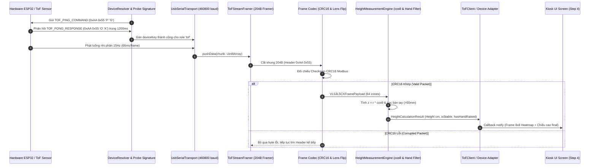

# Đặc Tả Kiến Trúc & Lý Giải Thiết Kế Đo Chiều Cao Cảm Biến ToF VL53L5CX/L8CX (Architecture Spec & ADR)

- **Phiên bản**: V5.1 Production
- **Phân lớp**: Layer 2 Core Hardware Engine (`src/core/hardware/tof/`)
- **Tài liệu tham chiếu**:
  - `AGENTS.md` (Chuẩn mực tài liệu 3 tầng ProMedi)
  - `docs/hard-ware/vl53l5cx-distance-sensor-spec.md`
  - `docs/plans/tof-height-measurement-runbook.md`

---

## 📌 Scope & Boundaries (Ranh Giới Trách Nhiệm Mô-đun)

### 🟢 Mô-đun LÀM (In-Scope):

1. Nhận diện cổng phần cứng linh hoạt bằng cơ chế **Device Resolver Probe Signature PING-PONG** (Gửi lệnh `0xAA 0x55 'P' 'G'` $\rightarrow$ Phản hồi `0xAA 0x55 'O' 'K'` @ 460800 baud).
2. Nhận luồng dữ liệu byte thô từ kết nối USB Serial (`UsbSerialTransport` @ 460800 baud).
3. Gom buffer và cắt gói nhị phân cố định 204 Bytes (`ToFStreamFramer`).
4. Kiểm tra tính toàn vẹn dữ liệu bằng mã kiểm tra lỗi CRC16-Modbus (`decodeToFFrame`).
5. Ánh xạ lật thấu kính quang học Rx 180 độ (`flipLensOrientation`).
6. Quy đổi khoảng cách xiên r sang độ sâu thẳng đứng $z = r \times \cos\theta$ dựa trên mảng tra cứu trước `cosLookupTable[8][8]`.
7. Nhận diện cụm đỉnh đầu người (Peak Head Cluster Blob) và lọc nhiễu cử chỉ giơ tay (Hand Gesture Filter $>50\text{mm}$).
8. Cung cấp API Stream `onFrame` / `onHeightResult` và báo lỗi `TransportError` / trạng thái `'error'` khi phần cứng hỏng (Không tự động ngầm fallback sang Mock mode).

### 🔴 Mô-đun KHÔNG LÀM (Out-of-Scope):

1. KHÔNG chứa UI Components hoặc màn hình render JSX (UI màn hình đo đặt tại `src/features/measure-height/`).
2. KHÔNG điều phối State Machine phiên khám Kiosk (Thuộc trách nhiệm của XState Session Machine tại `src/core/machines/`).
3. KHÔNG lưu trữ SQLite / WatermelonDB (Thuộc Layer 2 Store & Service).

---

## 1. Đường Ống & Luồng Dữ Liệu (Data Pipeline & FSM)



---

## 2. Bảng Cấu Trúc Dữ Liệu & API Payloads

### 2.1 Cấu trúc Gói Lệnh Bắt Tay Handshake (4 Bytes Payload)

| Kiểu Gói                                      | Header (2 Bytes) | Payload (2 Bytes)    | Tổng        | Mô tả                        |
| :-------------------------------------------- | :--------------- | :------------------- | :---------- | :--------------------------- |
| **PING Command** (Kiosk $\rightarrow$ ESP32)  | `0xAA 0x55`      | `0x50 0x47` (`"PG"`) | **4 Bytes** | Gửi hỏi thử thiết bị ToF     |
| **PONG Response** (ESP32 $\rightarrow$ Kiosk) | `0xAA 0x55`      | `0x4F 0x4B` (`"OK"`) | **4 Bytes** | Phản hồi xác nhận thành công |

### 2.2 Cấu trúc Gói tin Nhị phân 204 Bytes (Serial Protocol Payload)

| Offset (Bytes) | Tên Trường       | Kiểu Dữ Liệu   | Mô Tả                                                |
| :------------- | :--------------- | :------------- | :--------------------------------------------------- |
| `0..1`         | `Header`         | `uint8_t[2]`   | Cố định `0xAA 0x55`                                  |
| `2..5`         | `FrameID`        | `uint32_t`     | Số thứ tự frame tăng dần (Little Endian)             |
| `6..9`         | `TimestampMs`    | `uint32_t`     | Thời gian đo tính từ lúc khởi động (ms)              |
| `10..137`      | `Distances`      | `uint16_t[64]` | Mảng 64 khoảng cách mm từ thấu kính tới mục tiêu     |
| `138..201`     | `TargetStatuses` | `uint8_t[64]`  | Mảng 64 mã trạng thái độ tin cậy (`5`=100%, `9`=50%) |
| `202..203`     | `CRC16`          | `uint16_t`     | Mã kiểm tra lỗi CRC16-Modbus over bytes `0..201`     |

### 2.3 Domain TypeScript Interface (`HeightCalculationResult`)

```typescript
export interface HeightCalculationResult {
  measuredHeightCm: number // Chiều cao chốt (cm, chính xác 0.1cm)
  headDistanceMm: number // Khoảng cách từ cảm biến trần tới đỉnh đầu (mm)
  floorDistanceMm: number // Khoảng cách trần tới mặt sàn (2200mm)
  confidence: number // Độ tin cậy tính toán (0.0 .. 1.0)
  hasHandRaised: boolean // Cờ phát hiện bàn tay giơ cao > 50mm
  isStable: boolean // Cờ kiểm tra tính ổn định (độ lệch <= 15mm)
  personCount: number // Số lượng người đứng dưới cảm biến
  rawFrame: VL53L5CXFramePayload // Payload thấu kính raw 8x8
}
```

---

## 3. Giải Trình Lý Do Thiết Kế (Design Rationale / HOW & WHY)

### 3.1 Tự Động Dò Cổng Qua PING/PONG Probe Signature (Zero-Touch Kiosk Fleet)

- Các dongle USB-to-Serial trên trần Kiosk có thể chung chip CH340 (`1A86:7523`). Hệ điều hành Android Kiosk không thể phân biệt dây nào nối xuống InBody, dây nào nối xuống Huyết áp, dây nào nối lên trần ToF.
- **Giải pháp**: `device-probes.ts` định nghĩa Probe Signature riêng cho `'tof'` ở tốc độ `460800` baud. Bộ dò gửi `TOF_PING_COMMAND` (`0xAA 0x55 'P' 'G'`) và chờ trong 1200ms để xác minh xem cổng đó có đang trả về `TOF_PONG_RESPONSE` (`0xAA 0x55 'O' 'K'`) hoặc luồng 204B hợp lệ hay không $\rightarrow$ Đồng bộ kiến trúc Handshake 100% với InBody và BPBIO.

### 3.2 Tại sao loại bỏ Fallback ngầm sang Mock Mode khi kết nối phần cứng lỗi?

- Trước đây khi kết nối cổng Serial lỗi, `ToFDistanceDevice` tự động bật Mock stream ngầm làm kỹ thuật viên/QA không phát hiện ra dây USB bị đứt hoặc tuột chốt.
- **Cải tiến Production**: Loại bỏ hoàn toàn fallback ngầm. Nếu kết nối phần cứng lỗi, Device Adapter sẽ cập nhật trạng thái `'error'` và ném `TransportError` để State Machine điều hướng người dùng/kỹ thuật viên sang màn hình báo lỗi phần cứng `hardware-error.tsx`.

### 3.3 Bảng tra cứu trước Bù góc Quang học ($\cos\theta$ Lookup Table)

- Do cảm biến lắp đặt trên trần nhà phát ra chùm tia hình nón góc quét $45^\circ \times 45^\circ$, khoảng cách $r$ đo được ở các zone góc rìa là khoảng cách xiên.
- Khoảng cách độ sâu thẳng đứng $z$ được tính theo công thức:
  $$z(r, c) = r(r, c) \times \cos\left(\theta(r, c)\right)$$
- Để tránh chi phí tính toán hàm lượng giác `Math.tan()` và `Math.sqrt()` liên tục 64 lần mỗi 66ms trên vi xử lý Android Kiosk, Engine pre-compute mảng 2 chiều `cosLookupTable[8][8]` ngay khi khởi tạo instance.
