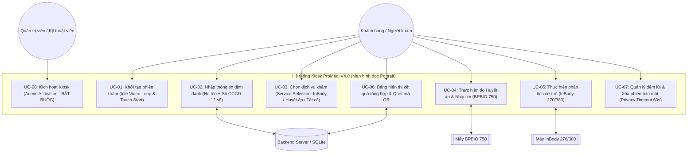

# TÀI LIỆU ĐẶC TẢ USE CASE (USE CASE SPECIFICATION)

## HỆ THỐNG KIOSK KHÁM SỨC KHỎE TỰ ĐỘNG - PROMEDI (PHIÊN BẢN V4.0)

- **Mã tài liệu**: PROMEDI-UC-V4.0
- **Phiên bản**: 4.0 (Cập nhật quy trình 3 bước & UI màn hình dọc)
- **Ngày cập nhật**: 2026-09-17
- **Thiết bị mục tiêu**: Kiosk Sunmi mini K2 (Màn hình dọc Portrait 1080x1920), Máy đo huyết áp InBody BPBIO 750, Máy phân tích cơ thể InBody 270 / 380.
- **Tài liệu Kiến trúc FSM**: [fsm-2-layer-architecture.md](./fsm-2-layer-architecture.md) _(Đặc tả Kiến trúc FSM 2 Lớp: Session Orchestrator & Device Adapter)_.

---

## 1. TỔNG QUAN TÁC NHÂN (ACTORS) & SƠ ĐỒ USE CASE

### 1.1 Danh sách Tác nhân (Actors)

1. **Khách hàng / Người khám (User/Customer)**: Người tương tác trực tiếp với màn hình cảm ứng Kiosk để thực hiện tự khám sức khỏe.
2. **Quản trị viên / Kỹ thuật viên (Admin/Technician)**: Người thực hiện kích hoạt ban đầu và cấu hình hệ thống Kiosk tại cơ sở y tế.
3. **Máy đo Huyết áp InBody BPBIO 750 (Hardware Actor - BP)**: Thiết bị phần cứng đo huyết áp tâm thu, tâm trương, nhịp tim, cảm biến khuỷu tay và cảm biến cử động.
4. **Máy phân tích InBody 270/380 (Hardware Actor - InBody)**: Thiết bị BIA đa tần số đo khối lượng cơ, mỡ, lượng nước ($TBW/ICW/ECW$), tỷ lệ phù nề ($ECW/TBW$).
5. **Hệ thống Backend / Database (System Actor)**: Hệ thống đồng bộ hồ sơ khách hàng, tính toán chỉ số và lưu trữ phiên khám.

### 1.2 Sơ đồ Sức khỏe Tổng thể (Use Case Diagram)

---

## 2. QUY TẮC NGHIỆP VỤ CHUNG (SYSTEM BUSINESS RULES)

| Mã BR             | Tên quy tắc                                         | Mô tả chi tiết                                                                                                                                                                                                                                                                                                                                                                                                                                                               |
| :---------------- | :-------------------------------------------------- | :--------------------------------------------------------------------------------------------------------------------------------------------------------------------------------------------------------------------------------------------------------------------------------------------------------------------------------------------------------------------------------------------------------------------------------------------------------------------------- |
| **BR-ACT-01**     | Kích hoạt thiết bị độc lập (Pure Device Activation) | Kiosk **BẮT BUỘC** được kích hoạt thành công (Màn 0) mới được khởi chạy vào ứng dụng. Khi kích hoạt thành công (`DEVICE_ACTIVATED`), hệ thống tự động lưu thông tin thiết bị và bộ đôi `accessToken` & `refreshToken` vào MMKV storage. Kiosk vận hành độc lập theo phiên thiết bị, **không yêu cầu đăng nhập tài khoản nhân viên**. Khi khởi động lại hoặc khôi phục mạng, `appMachine` tự động gọi actor `refreshTokenFlow` để làm mới token hoặc khôi phục phiên offline. |
| **BR-LAYOUT-01**  | Giao diện dọc Portrait                              | Giao diện tối ưu theo chiều dọc (1080x1920 Kiosk Portrait). Cấu trúc 4 phần: Top Header (Logo & Step Progress) $\rightarrow$ Video/Image Guide $\rightarrow$ Status & Progress Control $\rightarrow$ Footer Banner QR.                                                                                                                                                                                                                                                       |
| **BR-VOICE-01**   | Chính sách im lặng                                  | Màn 0 (Kích hoạt), Màn 1 (Video chờ) và Màn 2 (Nhập thông tin) **tuyệt đối không phát âm thanh** (Silent Mode) để giữ yên tĩnh phòng khám.                                                                                                                                                                                                                                                                                                                                   |
| **BR-VOICE-02**   | Giọng nói hướng dẫn                                 | Từ Màn 3 đến Màn 6, chỉ phát giọng nói khi: (1) Bắt đầu chọn dịch vụ / bước đo, (2) Phát hiện lỗi/cảnh báo cảm biến, (3) Hoàn tất bước đo/chuyển bước, (4) Nhắc nhở hết giờ (Timeout).                                                                                                                                                                                                                                                                                       |
| **BR-IDENT-01**   | Định danh 2 trường bắt buộc                         | Người dùng bắt buộc nhập **Họ và tên** và **Số Căn cước công dân (CCCD 12 chữ số)**. Sai định dạng $\rightarrow$ Viền đỏ, khóa nút xác nhận.                                                                                                                                                                                                                                                                                                                                 |
| **BR-FLOW-01**    | Luồng tối đa 3 bước                                 | Quy trình tuyến tính gọn tối đa 3 bước chính: **Bước 1: Chọn dịch vụ** $\rightarrow$ **Bước 2: Thực hiện đo** (InBody / Huyết áp theo dịch vụ đã chọn) $\rightarrow$ **Bước 3: Kết quả tổng hợp**.                                                                                                                                                                                                                                                                           |
| **BR-MED-01**     | Tính toán Huyết áp                                  | Áp lực mạch Pulse Pressure = $SYS - DIA$. Áp lực tưới máu trung bình $MAP = DIA + \frac{1}{3}(SYS - DIA)$.                                                                                                                                                                                                                                                                                                                                                                   |
| **BR-MED-02**     | Cảnh báo Phù nề                                     | Đánh giá $ECW / TBW$. Ngưỡng bình thường: $0.360 - 0.390$. Nếu $ECW / TBW > 0.400$ $\rightarrow$ Gắn cờ Cảnh báo nguy cơ giữ nước/phù nề.                                                                                                                                                                                                                                                                                                                                    |
| **BR-PRIVACY-01** | Đếm ngược 60s & Xóa dữ liệu                         | Màn 6 đếm ngược 60s. Mọi thao tác chạm đều reset về 60s. Khi đếm về 0s hoặc bấm "KẾT THÚC" $\rightarrow$ Xóa toàn bộ data tạm trên màn hình, quay về Màn 1.                                                                                                                                                                                                                                                                                                                  |

---

## 3. ĐẶC TẢ CHI TIẾT TỪNG USE CASE

---

### UC-00: KÍCH HOẠT THIẾT BỊ KIOSK (ADMIN ACTIVATION - BẮT BUỘC)

- **Mã Use Case**: `UC-00`
- **Tên Use Case**: Kích hoạt thiết bị Kiosk tại cơ sở
- **Tác nhân chính**: Quản trị viên / Kỹ thuật viên (Admin/Technician)
- **Tác nhân phụ**: Backend Server
- **Mô tả**: Yêu cầu bắt buộc khi cài đặt ứng dụng lần đầu trên Kiosk Sunmi K2 mini. Khóa toàn bộ tính năng khám nếu chưa kích hoạt.
- **Điều kiện tiền đề**: Ứng dụng khởi chạy lần đầu hoặc chưa lưu thông tin kích hoạt hợp lệ trong bộ nhớ cục bộ.
  - Nếu **Đã kích hoạt**: Tự động bỏ qua Màn 0, chuyển ngay sang **Màn hình 1 (Video chờ)**.

2. Quản trị viên nhập Mã kích hoạt bằng bàn phím cảm ứng trên màn hình.
3. Quản trị viên nhấn nút **"Kích hoạt"**.
4. Hệ thống gửi mã xác thực đến Backend Server.
5. Server xác nhận mã hợp lệ, trả về cấu hình chi nhánh/cơ sở y tế.
6. Hệ thống lưu cờ `is_activated = true` và chuyển sang **Màn hình 1 (Video chờ)**.

#### Luồng ngoại lệ (Exception Flows):

- **E00.1 - Mã kích hoạt không hợp lệ / Lỗi kết nối mạng**:
  - Tại bước 4, nếu mã sai hoặc mất mạng $\rightarrow$ Màn hình hiển thị thông báo lỗi _"Mã kích hoạt không hợp lệ hoặc lỗi kết nối máy chủ"_.
  - Khóa hệ thống tại Màn 0, không cho phép truy cập luồng tự khám.

---

### UC-01: KHỞI TẠO PHIÊN KHÁM (IDLE VIDEO LOOP & TOUCH START)

- **Mã Use Case**: `UC-01`
- **Tên Use Case**: Khởi tạo phiên khám sức khỏe từ Màn hình chờ
- **Tác nhân chính**: Khách hàng / Người khám
- **Mô tả**: Màn hình rảnh rỗi chạy video hướng dẫn tự khám lặp lại liên tục. Khi người dùng chạm vào video, hệ thống khởi tạo phiên khám và chuyển sang Màn hình nhập thông tin.
- **Điều kiện tiền đề**: Kiosk đã kích hoạt thành công (BR-ACT-01) và đang ở Màn hình 1.
- **Điều kiện hậu đề**: Khởi tạo mã `session_id` duy nhất và chuyển sang Màn hình 2.

#### Luồng sự kiện chính (Basic Flow):

1. Hệ thống hiển thị Màn hình 1 chạy video hướng dẫn tự khám vòng lặp toàn màn hình. (Giọng nói: Im lặng).
2. Khách hàng chạm vào bất kỳ vị trí nào trên màn hình video.
3. Hệ thống khởi tạo `session_id` mới trong bộ nhớ tạm thời.
4. Hệ thống chuyển sang **Màn hình 2 (Nhập thông tin định danh)**.

---

### UC-02: NHẬP THÔNG TIN ĐỊNH DANH (IDENTIFICATION)

- **Mã Use Case**: `UC-02`
- **Tên Use Case**: Nhập Họ tên và Số CCCD 12 số để định danh
- **Tác nhân chính**: Khách hàng / Người khám
- **Tác nhân phụ**: Backend DB / SQLite Local Storage
- **Mô tả**: Khách hàng nhập bắt buộc cả 2 trường **Họ và tên** cùng với **Số Căn cước công dân (CCCD - 12 chữ số)** trên Popup `"NHẬP THÔNG TIN CÁ NHÂN"`.
- **Điều kiện tiền đề**: Hệ thống đang ở Màn hình 1/2, đã có `session_id`.
- **Điều kiện hậu đề**: Lưu thông tin Họ tên, Số CCCD vào phiên khám.

#### Luồng sự kiện chính (Basic Flow):

1. Hệ thống hiển thị Popup Modal `"NHẬP THÔNG TIN CÁ NHÂN"`:
   - Ô nhập 1 (\*): **Họ và tên** (Bàn phím cảm ứng).
   - Ô nhập 2 (\*): **Số CCCD (đúng 12 chữ số)** (Phím Virtual Numpad số lớn).
   - Nút hành động: **"Bắt đầu kiểm tra sức khỏe"**.
   - _(Giọng nói: Im lặng theo BR-VOICE-01)_.
2. Khách hàng nhập Họ tên và Số CCCD 12 chữ số.
3. Hệ thống validate dữ liệu thực thời khi bấm xác nhận:
   - Họ tên không được để trống.
   - Số CCCD phải đúng 12 chữ số.
4. Khách hàng bấm **"Bắt đầu kiểm tra sức khỏe"**.
5. Hệ thống tra cứu thông tin khách hàng từ Backend DB / Cache:
   - Nếu là khách mới $\rightarrow$ Mở Quick Popup cho khách chọn Chiều cao (cm) và Giới tính (Nam/Nữ) rồi nhấn Lưu.
6. Hệ thống chuyển sang **Màn hình 3 (Chọn dịch vụ cần đo)**.

#### Luồng ngoại lệ (Exception Flows):

- **E02.1 - Dữ liệu không hợp lệ (`INVALID_IDENTITY_FORMAT`)**:
  - Nếu Họ tên trống hoặc Số CCCD $\neq 12$ chữ số $\rightarrow$ Hiển thị thông báo lỗi bên dưới trường tương ứng.

---

### UC-03: CHỌN DỊCH VỤ CẦN ĐO (SERVICE SELECTION)

- **Mã Use Case**: `UC-03`
- **Tên Use Case**: Chọn danh mục dịch vụ kiểm tra sức khỏe
- **Tác nhân chính**: Khách hàng / Người khám
- **Mô tả**: Cho phép khách hàng chọn các danh mục muốn đo: **InBody**, **Huyết áp**, hoặc **Chọn tất cả**.
- **Điều kiện tiền đề**: Đã hoàn thành Màn 2 (Nhập thông tin định danh).
- **Điều kiện hậu đề**: Ghi nhận danh sách dịch vụ đã chọn vào phiên khám (`selected_services`).

#### Luồng sự kiện chính (Basic Flow):

1. Hệ thống hiển thị Màn hình 3 (Chọn dịch vụ):
   - Thanh Header Top: Tiến trình bước (Bước 1: Chọn dịch vụ).
   - Thẻ dịch vụ 1: **Phân tích cơ thể InBody** (Icon Cơ thể).
   - Thẻ dịch vụ 2: **Đo Huyết áp & Nhịp tim** (Icon Huyết áp).
   - Thẻ dịch vụ 3: **Chọn tất cả** (Mặc định được chọn).
   - Nút hành động: **"Bắt đầu đo"** màu xanh nổi bật.
2. Hệ thống phát giọng nói hướng dẫn:
   - _Voice prompt_: **"Mời quý khách chọn các dịch vụ cần đo và nhấn Bắt đầu đo."**
3. Khách hàng chạm chọn/bỏ chọn các dịch vụ mong muốn hoặc giữ mặc định "Chọn tất cả".
4. Khách hàng bấm **"Bắt đầu đo"**.
5. Hệ thống khởi tạo danh sách bước đo theo thứ tự ưu tiên (Huyết áp $\rightarrow$ InBody) và chuyển sang **Màn hình 4 (Thực hiện đo)**.

---

### UC-04: THỰC HIỆN ĐO HUYẾT ÁP & NHỊP TIM (INBODY BPBIO 750)

- **Mã Use Case**: `UC-04`
- **Tên Use Case**: Đo huyết áp và nhịp tim tự động
- **Tác nhân chính**: Khách hàng / Người khám
- **Tác nhân phụ**: Máy đo BPBIO 750 (Hardware Module)
- **Mô tả**: Hướng dẫn tư thế đo qua video + chữ gọn gàng, hiển thị tiến trình bơm/xả khí thời gian thực, đọc kết quả $SYS, DIA, Pulse$.
- **Điều kiện tiền đề**: Dịch vụ "Huyết áp" hoặc "Chọn tất cả" được kích hoạt tại Màn 3.
- **Điều kiện hậu đề**: Lưu kết quả huyết áp vào phiên khám.

#### Luồng sự kiện chính (Basic Flow):

1. Màn hình dọc Kiosk hiển thị giao diện đo Huyết áp:
   - **Header Top**: Icon các bước đo (Huyết áp đang active sáng đèn).
   - **Khung Video & Chữ hướng dẫn**: Video minh họa luồn tay + Chữ ghi ngắn: _"Lưu ý: Luồn tay qua máy, cánh tay ngang mức tim, nghỉ ngơi tại chỗ, không nói chuyện."_
   - **Thanh Progress & Status**: _"Đang thực hiện đo... 45%"_ (Thanh tiến trình xanh animated).
   - **Nút điều khiển**: Nút **"Bỏ qua"** (Skip) và nút **"Tiếp tục"**.
   - **Footer Bottom**: Banner QR App MediPay.
2. Hệ thống phát giọng nói hướng dẫn:
   - _Voice prompt_: **"Đo huyết áp và nhịp tim. Quý khách vui lòng luồn tay vào vòng đo, tỳ cùi chỏ vào cảm biến và giữ yên."**
3. Máy BPBIO 750 bơm/xả khí và trả kết quả về Kiosk.
4. Màn hình cập nhật tiến trình 100%, hiển thị chỉ số Huyết áp ($SYS, DIA, Pulse$).
5. Hệ thống phát giọng nói:
   - _Voice prompt_: **"Đã đo xong huyết áp. Mời bạn nhấn Tiếp tục."**
6. Khách hàng bấm **"Tiếp tục"** (hoặc hệ thống tự chuyển sau 5s):
   - Nếu có chọn InBody $\rightarrow$ Chuyển sang **UC-05 (Đo InBody)**.
   - Nếu chỉ chọn Huyết áp $\rightarrow$ Chuyển thẳng sang **UC-06 (Tổng hợp kết quả)**.

#### Luồng thay thế & Ngoại lệ (Alternative & Exception Flows):

- **A04.1 - Khách bấm "Bỏ qua" (Skip)**:
  - Nếu khách bấm nút "Bỏ qua" $\rightarrow$ Bỏ qua bước đo Huyết áp, chuyển sang dịch vụ tiếp theo hoặc Tổng hợp kết quả.
- **E04.1 - Lỗi cùi chỏ / Cử động (`BP_ELBOW_OFF` / `BP_MOTION`)**:
  - Nhấp nháy cảnh báo đỏ trên màn hình.
  - _Voice prompt_: **"Cảnh báo: Khuỷu tay chưa chạm điểm cảm biến. Quý khách vui lòng đẩy tay sâu hơn và ngồi yên."**
- **E04.2 - Lỗi mất kết nối cổng COM / Timeout quá 3 lần (`CONNECTION_ERROR`)**:
  - Hệ thống tự động chuyển sang **Màn hình Lỗi Kết Nối (Hardware Error)** để không kẹt luồng.
  - Kích hoạt đếm ngược 30s tự động quay về Màn hình 1 (Home).
  - **Kiosk Admin Gesture**: Kỹ thuật viên dùng 3 ngón tay chạm liên tiếp 3 lần vào màn hình để hiển thị log lỗi chi tiết (bình thường ẩn để tối giản UI cho người dùng).

---

### UC-05: THỰC HIỆN PHÂN TÍCH THÀNH PHẦN CƠ THỂ (INBODY 270 / 380)

- **Mã Use Case**: `UC-05`
- **Tên Use Case**: Phân tích trở kháng điện sinh học BIA InBody
- **Tác nhân chính**: Khách hàng / Người khám
- **Tác nhân phụ**: Máy InBody 270/380 (Hardware Module)
- **Mô tả**: Hướng dẫn tháo giày, đứng tấm kim loại, cầm thanh nắm điện cực. Thu thập dữ liệu Cơ, Mỡ, Water, BMR, InBody Score.
- **Điều kiện tiền đề**: Dịch vụ "InBody" hoặc "Chọn tất cả" được kích hoạt tại Màn 3.
- **Điều kiện hậu đề**: Lưu dữ liệu chỉ số InBody vào phiên khám.

#### Luồng sự kiện chính (Basic Flow - Auto-pilot Protocol):

1. Hệ thống tự động thiết lập kết nối TCP Socket tới máy InBody, gửi lệnh **Dọn dẹp (SKIP)** để ép máy thoát khỏi các màn hình lỗi cũ (nếu có), sau đó gửi lệnh **Khóa máy (LOCK)** để vô hiệu hóa phím bấm cứng.
2. Màn hình dọc Kiosk hiển thị giao diện đo InBody:
   - **Header Top**: Icon các bước đo (InBody đang active sáng đèn).
   - **Khung Video & Chữ hướng dẫn**: Video đứng InBody + Chữ lưu ý gọn: _"Lưu ý: Tháo giày/vớ, đứng khớp điện cực chân, cầm 2 tay nắm dang 15 độ, giữ thả lỏng."_
3. Hệ thống phát giọng nói hướng dẫn (`INBODY_START`):
   - _Voice prompt_: **"Phân tích chỉ số cơ thể. Quý khách vui lòng tháo giày, đứng lên máy InBody và cầm hai tay nắm."**
4. Kiosk liên tục **Polling trạng thái (STATUS 500ms)** ngầm. Khi khách bước lên cân, InBody chốt cân nặng (Status `1`), Kiosk lập tức **tự động đẩy gói Thông tin Định danh (INFO)** xuống máy mà không cần khách thao tác.
5. InBody tiến hành quét BIA (Status `2`). Kiosk tự động **ngắt mọi âm thanh hướng dẫn trước đó** để không đè âm báo tít tít của máy vật lý, UI hiển thị progress "Đang đo...".
6. InBody báo đo xong (Status `3`), Kiosk tự động gửi lệnh **Rút dữ liệu (RESULT)**. UI nhảy 100% progress.
7. Màn hình hiển thị tóm tắt chỉ số InBody Score, Cơ, Mỡ.
8. Kiosk thực hiện **Resend Status** (Chờ InBody trả về Status `0` - Ready) để đảm bảo InBody đã dọn dẹp màn hình, sau đó hệ thống tự động gọi Voice (`INBODY_COMPLETE`) và chuyển sang Bước 5 (hoặc **UC-06**).

#### Luồng ngoại lệ (Exception Flows):

- **E05.1 - Lỗi tiếp xúc / Bàn cân lắc (`INBODY_CONTACT_ERROR` / `INBODY_UNSTABLE`)**:
  - Nhấp nháy cảnh báo trên khung hướng dẫn.
  - _Voice prompt_: **"Cảnh báo: Chưa nhận đủ tiếp xúc điện cực. Quý khách vui lòng cầm chắc thanh nắm và đứng yên."**
- **E05.2 - Lỗi mất kết nối cổng COM / Timeout (`CONNECTION_ERROR`)**:
  - Tương tự E04.2, hệ thống chuyển sang **Màn hình Lỗi Kết Nối**. Hỗ trợ đếm ngược 30s về Home và Kiosk Admin Gesture.

---

### UC-06: BẢNG HIỂN THỊ KẾT QUẢ TỔNG HỢP & QUÉT MÃ QR (SUMMARY DASHBOARD)

- **Mã Use Case**: `UC-06`
- **Tên Use Case**: Hiển thị tổng hợp kết quả tự khám & Đồng bộ QR
- **Tác nhân chính**: Khách hàng / Người khám
- **Tác nhân phụ**: Backend Server
- **Mô tả**: Bảng tổng hợp kết quả khám 3 khu vực chính (Thông tin cá nhân, Kết quả đo InBody/Huyết áp theo dịch vụ đã chọn, Khuyến nghị y tế & Mã QR).
- **Điều kiện tiền đề**: Đã hoàn thành các bước đo được chọn.
- **Điều kiện hậu đề**: Đã đồng bộ phiếu kết quả lên Server.

#### Luồng sự kiện chính (Basic Flow):

1. Màn hình hiển thị Bảng tổng hợp kết quả (Màn hình 6):
   - **Header**: Họ tên, SĐT/CCCD, Ngày giờ khám.
   - **Khối Tim mạch**: Huyết áp tâm thu/tâm trương, Nhịp tim, Nhãn đánh giá màu sắc.
   - **Khối InBody**: Điểm InBody, Tỷ lệ mỡ PBF, Tỷ lệ cơ SMM, Tỷ lệ phù nề $ECW/TBW$.
   - **Khối Mã QR & App Download**: Mã QR tải kết quả về điện thoại qua Zalo/MediPay.
   - **Nút hành động**: Nút **"KẾT THÚC"** màu đỏ + Thanh đếm lùi 60 giây.
2. Hệ thống phát giọng nói:
   - _Voice prompt_: **"Quá trình khám sức khỏe đã hoàn tất. Quý khách có thể xem kết quả trên màn hình hoặc quét mã QR để lưu lại."**
3. Khách hàng quét mã QR hoặc đọc kết quả trên màn hình.

---

### UC-07: QUẢN LÝ ĐẾM LÙI & XÓA PHIÊN BẢO MẬT (PRIVACY TIMEOUT)

- **Mã Use Case**: `UC-07`
- **Tên Use Case**: Đếm ngược tự động 60s & Xóa sạch dữ liệu bảo mật
- **Tác nhân chính**: Khách hàng / Hệ thống Kiosk
- **Mô tả**: Kích hoạt bộ đếm 60s tại Màn 6. Reset timer khi chạm màn hình. Tự động xóa dữ liệu tạm khi đếm về 0s hoặc bấm KẾT THÚC.
- **Điều kiện tiền đề**: Màn hình 6 (Bảng Tổng hợp) đang hiển thị.
- **Điều kiện hậu đề**: Xóa toàn bộ dữ liệu tạm phiên khám (`session_id = null`), quay về Màn 1 (Video chờ).

#### Luồng sự kiện chính (Basic Flow):

1. Kích hoạt đếm lùi 60s tại Màn 6.
2. Nếu chạm bất kỳ điểm nào trên màn hình $\rightarrow$ Reset timer về **60 giây**.
3. Nếu chạm nút **"KẾT THÚC"** hoặc đếm về **0s**:
   - _Voice prompt_: **"Cảm ơn quý khách đã sử dụng dịch vụ. Chúc bạn một ngày tốt lành."**
   - Xóa toàn bộ dữ liệu tạm thời của phiên.
   - Chuyển lập tức về **Màn hình 1 (Video chờ)**.

---

## 4. BẢNG MA TRẬN GIỌNG NÓI & SỰ KIỆN MÃ LỖI (VOICE & EXCEPTION MATRIX)

| Màn hình    | Tên sự kiện / Mã lỗi        | Điều kiện kích hoạt                    | Trạng thái UI Kiosk (Màn hình dọc)               | Giọng nói hướng dẫn (Voice Prompt Script)                                                                       |
| :---------- | :-------------------------- | :------------------------------------- | :----------------------------------------------- | :-------------------------------------------------------------------------------------------------------------- |
| **Màn 0**   | `ADMIN_ACTIVATION`          | Chưa kích hoạt ứng dụng                | Ô nhập Mã kích hoạt Kiosk                        | _(Không phát - Silent Mode)_                                                                                    |
| **Màn 1**   | `IDLE_SCREEN`               | Kiosk rảnh rỗi                         | Video loop hướng dẫn toàn màn hình               | _(Không phát - Silent Mode)_                                                                                    |
| **Màn 2**   | `INVALID_IDENTITY_FORMAT`   | Họ tên trống hoặc Số CCCD $\neq 12$ số | Viền đỏ ô nhập, hiển thị thông báo lỗi           | _(Không phát - Silent Mode)_                                                                                    |
| **Màn 3**   | `SERVICE_SELECTION`         | Chuyển sang Màn hình chọn dịch vụ      | Thẻ chọn InBody, Huyết áp, Chọn tất cả           | _"Mời quý khách chọn các dịch vụ cần đo và nhấn Bắt đầu đo."_                                                   |
| **Màn 4a**  | `BP_START`                  | Bắt đầu đo Huyết áp                    | Header icon BP active + Video guide + Bar 0%     | _"Đo huyết áp và nhịp tim. Quý khách vui lòng luồn tay vào vòng đo, tỳ cùi chỏ vào cảm biến và giữ yên."_       |
| **Màn 4b**  | `BP_ELBOW_OFF`              | Cùi chỏ rời cảm biến / Cử động         | Nhấp nháy viền đỏ video hướng dẫn                | _"Cảnh báo: Khuỷu tay chưa chạm điểm cảm biến. Quý khách vui lòng đẩy tay sâu hơn và ngồi yên."_                |
| **Màn 4c**  | `BP_COMPLETE`               | BPBIO 750 hoàn tất đo                  | Bar 100% + Chỉ số SYS/DIA                        | _"Đã đo xong huyết áp."_                                                                                        |
| **Màn 5a**  | `INBODY_START`              | Bắt đầu đo InBody                      | Header icon InBody active + Video guide + Bar 0% | _"Phân tích chỉ số cơ thể. Quý khách vui lòng tháo giày, đứng lên máy InBody và cầm hai tay nắm."_              |
| **Màn 5b**  | `INBODY_CONTACT_ERROR`      | Điện cực chưa tiếp xúc đủ              | Nhấp nháy cảnh báo bàn tay/bàn chân              | _"Cảnh báo: Chưa nhận đủ tiếp xúc điện cực. Quý khách vui lòng cầm chắc thanh nắm và đứng yên."_                |
| **Màn 5c**  | `INBODY_COMPLETE`           | InBody hoàn tất phân tích BIA          | Bar 100% + Tóm tắt InBody Score                  | _"Đã phân tích xong chỉ số cơ thể."_                                                                            |
| **Màn Lỗi** | `HARDWARE_CONNECTION_ERROR` | Rớt cổng kết nối COM / Timeout 3 lần   | Màn hình tối giản "LỖI KẾT NỐI", đếm ngược 30s   | _(Không phát - Silent Mode)_                                                                                    |
| **Màn 6a**  | `SUMMARY_START`             | Vào Màn hình Tổng hợp Kết quả          | Dashboard 3 khối + Mã QR + Count 60s             | _"Quá trình khám sức khỏe đã hoàn tất. Quý khách có thể xem kết quả trên màn hình hoặc quét mã QR để lưu lại."_ |
| **Màn 6b**  | `SUMMARY_TIMEOUT_10S`       | Đồng hồ đếm lùi còn 10s                | Thanh đếm lùi nhấp nháy đỏ                       | _"Màn hình sẽ đóng sau 10 giây nữa. Quý khách có thể chạm vào màn hình nếu cần xem thêm."_                      |
| **Màn 6c**  | `SESSION_TERMINATED`        | Bấm KẾT THÚC hoặc hết 60s              | Xóa sạch phiên khám $\rightarrow$ Quay về Màn 1  | _"Cảm ơn quý khách đã sử dụng dịch vụ. Chúc bạn một ngày tốt lành."_                                            |

---

## 5. TIÊU CHÍ NGHIỆM THU CHI TIẾT (ACCEPTANCE CRITERIA)

1. **Ràng buộc Kích hoạt Bắt buộc (BR-ACT-01)**: Khi mở ứng dụng lần đầu hoặc chưa kích hoạt, Kiosk bắt buộc ở Màn 0 (Kích hoạt), không cho phép thực hiện bất kỳ phiên khám nào.
2. **Tuân thủ Chuẩn Màn hình Dọc (BR-LAYOUT-01)**: Toàn bộ UI thiết kế dọc (1080x1920 Kiosk Portrait), có Top Header Step progress, Khung Video/Text Hướng dẫn ngắn gọn, Progress Bar phần trăm animated, Nút Bỏ qua/Tiếp tục và Footer QR code.
3. **Phân luồng Dịch vụ Linh hoạt (BR-FLOW-01)**: Người dùng có thể chọn từng dịch vụ lẻ (InBody hoặc Huyết áp) hoặc "Chọn tất cả". Quy trình tự động điều hướng đúng các bước đo tương ứng với tối đa 3 bước tổng thể.
4. **Nhập liệu Định danh Đúng Chuẩn (BR-IDENT-01)**: Bắt buộc nhập Họ và tên + 1 trong 2 định danh (SĐT 10 số hoặc CCCD 12 số). Khóa nút "Xác nhận" nếu nhập thiếu hoặc sai định dạng.
5. **Tuân thủ Âm thanh & Bảo mật Privacy**: Màn 0, Màn 1, Màn 2 hoàn toàn im lặng. Màn 6 tự động xóa sạch dữ liệu phiên sau 60s không chạm hoặc bấm "KẾT THÚC".
